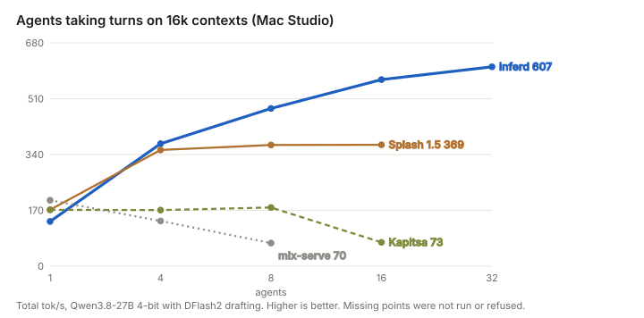
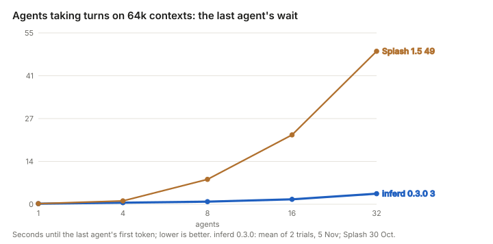
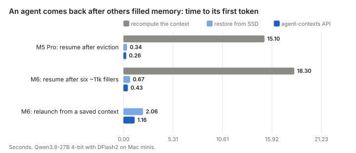
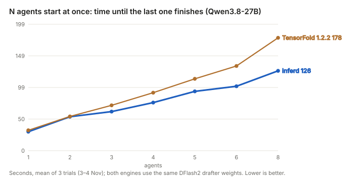
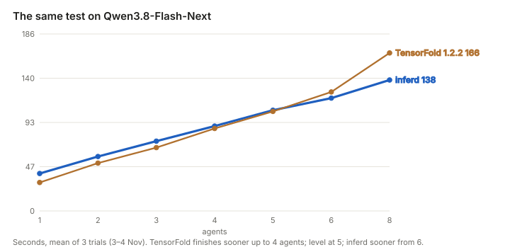
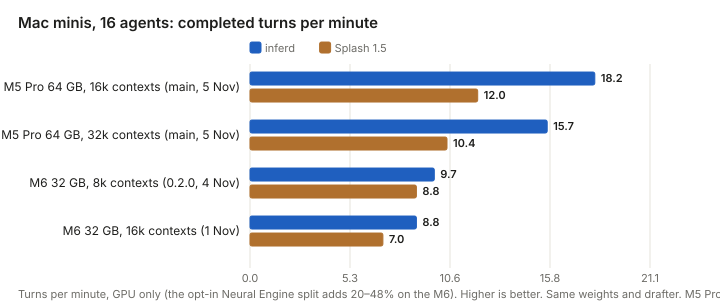
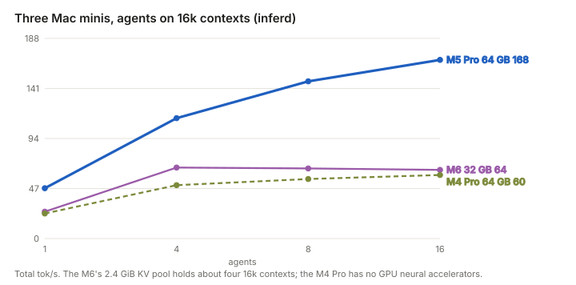
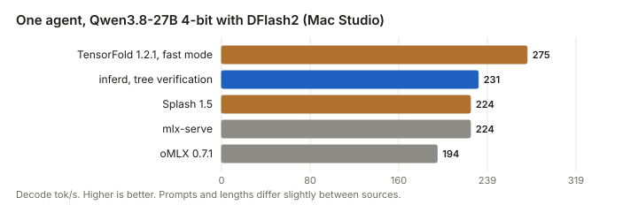
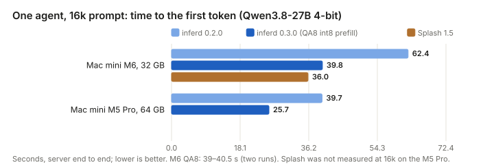
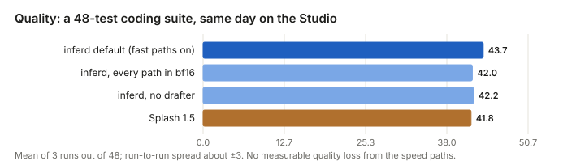

# inferd: an inference engine for the agentic future

Agents are how software is starting to use language models: not one conversation, but many workers at once, each with a long context, a short reply, a tool call, and a return a minute later. inferd is an inference engine for Apple Silicon built for exactly that pattern. It runs Qwen open-weight models natively in Metal, keeps every agent's context warm, parks the rest on the SSD, and gives each agent its own budget.

| | |
|---|---|
| **722 tok/s** | 32 agents on 16k contexts on one Mac Studio, 849 with 64 (release 0.3.0; the next engine levels off near 370) |
| **0.2–0.7 s** | for an agent to resume from memory or SSD, instead of 15–18 s to re-read its context |
| **29% sooner** | 8 Qwen3.8-27B agents all finish (125.6 vs 177.6 s on TensorFold 1.2.2, 177.9 s on 1.2.1; same drafter, 3 trials) |
| **32 GB → 256 GB** | from a Mac mini M6 to a Mac Studio M5 Ultra |

## Why agents need a different engine

- **Agents arrive in crowds.** A coding assistant fans out to a planner, a tester and a reviewer; a research task spawns ten readers. Throughput across many simultaneous streams matters more than one fast stream.
- **Agents come back.** Most of an agent's prompt is the conversation so far. An engine that recomputes it every turn spends its time re-reading. An engine that remembers it answers in a fraction of a second.
- **Agents share context.** Several agents usually start from the same document, codebase or system prompt. Computing it once and handing it to all of them is the cheapest token there is.
- **Agents need budgets.** A web-search helper needs 8k of context and no reasoning; the planner needs 128k and thinking. One server should hold both without one starving the other.

Chat engines are tuned for one person waiting for one reply. Agent fleets reward something else: keeping many streams
moving, remembering what each one has already read, and never making the twentieth agent wait for the first nineteen.

With 32 agents on 64k contexts, the last agent starts in about 3.4 seconds (the 0.3.0 engine, 5 Nov); it waits 49 s on the next-best engine.

## What is genuinely new

- **An API for KV caches.** Save a context once, pin it, and launch any number of agents from it; park an agent's session and resume it later; let a one-off agent run without disturbing anyone's cache (`/v1/contexts`, `inferd: {context, session, cache}`). Most engines share prefixes implicitly; inferd lets the agent framework say what to keep.
- **Contexts that live on the SSD.** Evicted contexts go to a content-addressed, checksummed tier on the SSD and come back in about a quarter of a second instead of a 15–18 s re-read, and they survive a restart.
- **A prefix cache for hybrid models.** Qwen3.8 mixes attention with recurrent (Gated DeltaNet) layers, whose state cannot be sliced like a KV cache. inferd snapshots that state at the right points and replays only what a speculative step committed, so caching and drafting work together.
- **Per-agent context, effort and priority.** `max_context`, `effort` and `priority` per request, admission by memory budget, and preemption back to the cache.
- **Structured output that holds under load.** Strict JSON Schema output by constrained decoding for a documented subset of the schema, then validation, with tool calls and stop strings.

## Head to head, honestly

TensorFold is a remarkable engine and the fairest comparison we have: same Mac, same weights, same drafter. When
several agents start at once with long prompts and long answers, inferd finishes sooner from three agents up on the
27B, because its combined decode keeps climbing (693 vs 474 tok/s at 8 agents) while TensorFold's levels off. On
Flash-Next the crossover comes later.

## Small Macs count

Most people who run models locally have a Mac mini or a laptop, not a Studio. inferd leads Splash on every fleet cell
we measured on the minis, and runs on a 32 GB M6.

## Where others are better

- One fast stream: TensorFold's fast mode is about 19% faster on the 27B (275 vs 231 tok/s), and oMLX and TensorFold are faster on Flash-Next.
- A few agents starting together on Flash-Next: TensorFold finishes sooner up to about five agents; with Flash-Next agents arriving at random the two are level on total time and TensorFold's slowest first tokens come sooner.
- Prefill on smaller chips: on a 32 GB Mac mini M6 Splash reads a 16k prompt slightly sooner (36 s vs 39–40 s with 0.3.0's int8 prefill, which needs no copy of the weights; 0.2.0 took 62 s). On M4-class GPUs, without neural accelerators, the current development build (after 0.3.0) puts part of each layer on the Neural Engine: 8k prompts on an M4 Pro in 43 s instead of 64 s.
- Models without a drafter (Qwen3.5-9B, Gemma-4, Glimmer): mlx-lm and mlx-vlm are faster for one agent.
- Maturity: inferd is days old, run by a small team with AI assistance, and tested on the machines named here. It is for a trusted local user, not a shared network service yet.

## Speed without giving up quality

The fast paths (4-bit weights with int8 activations, an 8-bit KV cache, speculative decoding) were checked against
every alternative path on the same day: no measurable loss, and the logits match the reference implementations.

## On the shoulders of giants

Very little here would exist without the open-source work around it. inferd's own contribution is the engine that puts
these pieces together for agents; much of what it does well, others did first.

- **MLX** Apple's framework, whose matrix-multiply and attention kernels inferd vendors (MIT) and builds on.
- **Splash** The engine that showed what a Mac can do for agents: a Neural Engine split, int8 KV, parked state on SSD and shared prefill. It is the most complete agent engine on the Mac, with excellent prefill on smaller chips.
- **TensorFold** The fastest single stream on a Mac and a superb prefill; its arrival-order scheduling wins when a handful of agents start together. The mlx.fast competition behind it moved everyone's kernels forward.
- **DFlash2** The z-lab DFlash method and the incoai drafter that make speculative decoding on the 27B worth doing.
- **vLLM** Paged KV, continuous batching and prefix caching: the serving design inferd reimplements for hybrid models.
- **mlx-lm** The reference every logit here is checked against, and the quickest way to try a new model on a Mac.
- **mlx-vlm** Prince Canuma's vision library: inferd's image path runs its vision towers.
- **oMLX and mlx-serve** Polished Mac servers that are hard to beat for one user.
- **MiaAI-Lab** Their public benchmark recipes shaped our "N agents start at once" test.
- **Hugging Face** The hub every model and drafter here comes from, and the tokenizers.
- **Qwen** Open weights good enough to build a business on, including the hybrid design this engine targets.

## What's next

Single-stream speed (one weight layout for the faster lane kernels, so they cost no extra memory), smarter scheduling when agents of very different sizes arrive
together, and a release process with automated gates.

## Try it

[README.md](README.md) has the quick start; [examples/](examples/) has small demos (agents with their own budgets,
shared contexts, OCR agents, strict JSON); [docs/FEATURES.md](docs/FEATURES.md) lists what is shipped and what is
experimental; [docs/RESULTS.md](docs/RESULTS.md) has every measurement behind these charts.

---

Measured by Incept5 on Mac Studio M5 Ultra 256 GB, Mac mini M5 Pro 64 GB, M6 32 GB and M4 Pro 64 GB, and a MacBook Pro M5 Max. Models: Qwen3.8-27B (4/8-bit, bf16), Qwen3.8-Flash-Next, Qwen3.6-35B-A3B, Qwen3.5-9B, plus Muse Glimmer and Gemma-4. Competing engines ran on the same machines, weights and harnesses; each chart names its
test. Figures are from 1–3 November 2026. inferd is experimental software under the [Apache License 2.0](LICENSE).
