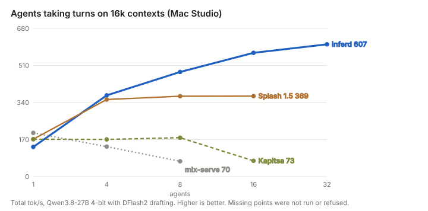

# inferd

**A native inference engine for Apple Silicon, built for many AI agents at once.** C++, Objective-C++ and Metal,
written from scratch in October–November 2026, with no MLX runtime in the token path. One model, many concurrent
agents with long contexts: continuous batching, speculative decoding for every agent, an 8-bit paged KV cache, a
prefix cache that hands one agent's context to the next, an SSD tier for contexts that do not fit in memory, and an
API that lets the agent framework decide what the cache keeps.

inferd is young, experimental software. It leads where agents pile up on one Mac; other engines are still faster for a
single stream, and it was built on the shoulders of the projects listed under [Acknowledgements](#acknowledgements).
Primary model: **Qwen3.8-27B** (4-bit) with the **incoai Qwen3.8-27B-DFlash2** drafter.

<p align="center"></p>

## Download

Prebuilt for Apple Silicon, no Xcode needed: pick the file for **your macOS**, from the
[v0.2.0 release](https://github.com/Incept5-AI/inferd/releases/tag/v0.2.0).

| Your Mac runs | Download | Checksum | Status |
|---|---|---|---|
| **macOS 27** | [inferd-0.2.0-macos27-arm64.tar.gz](https://github.com/Incept5-AI/inferd/releases/download/v0.2.0/inferd-0.2.0-macos27-arm64.tar.gz) | [.sha256](https://github.com/Incept5-AI/inferd/releases/download/v0.2.0/inferd-0.2.0-macos27-arm64.tar.gz.sha256) | tested on Mac Studio M5 Ultra and Mac mini M6 / M5 Pro / M4 Pro |
| **macOS 26** | [inferd-0.2.0-macos26-arm64.tar.gz](https://github.com/Incept5-AI/inferd/releases/download/v0.2.0/inferd-0.2.0-macos26-arm64.tar.gz) | [.sha256](https://github.com/Incept5-AI/inferd/releases/download/v0.2.0/inferd-0.2.0-macos26-arm64.tar.gz.sha256) | **beta**: built for macOS 26; a source build ran on an M4 Max with macOS 26. Run the release gate once (below) |

Use the one that matches: the macOS 27 build refuses to start on macOS 26, and the macOS 26 build must not be used on
macOS 27 (its kernels compute wrong logits there at prefill chunks of 256+ rows).

```bash
(cd ~/Downloads && shasum -a 256 -c inferd-0.2.0-macos27-arm64.tar.gz.sha256)   # or the macos26 file: prints OK
git clone https://github.com/Incept5-AI/inferd && cd inferd && git checkout v0.2.0 && cd engine
tar xzf ~/Downloads/inferd-0.2.0-macos27-arm64.tar.gz        # unpacks build/ here; skip ./build.sh
zsh tools/release_gate.sh ~/models/Qwen3.8-27B-4bit ~/models/Qwen3.8-27B-DFlash2   # optional check, a few minutes
```

Then start the server as in the [Quick start](#quick-start) (from `python3 -m venv` on). Building from source works on
macOS 26 and 27.

## Where it stands (4 November 2026, release 0.2.0)

Same model, same weights, same drafter for every engine, on the same machine and harness. Methodology, every table and
the raw file behind each number: [docs/RESULTS.md](docs/RESULTS.md).

| Machine | Workload | inferd | Other engine |
|---|---|---:|---:|
| Mac Studio M5 Ultra | 32 agents taking turns on 16k contexts, total tok/s | **615–620** | Splash 1.5: levels off at ~369 |
| Mac Studio M5 Ultra | 32 agents on 64k contexts: the last agent's first token | **3.8 s** | Splash 1.5: 48.9 s |
| Mac Studio M5 Ultra | 8 Qwen3.8-27B agents start at once (14k prompts, 6,400 tokens out): all done | **125.6 s** | TensorFold 1.2.2: 177.6 s (1.2.1: 177.9 s) |
| Mac Studio M5 Ultra | 16 agents arriving at random, 2k–16k prompts: all done | **78.7 s** | TensorFold 1.2.2: 116.8 s |
| Mac mini M5 Pro, 64 GB | 16 agents at 16k, completed turns per minute | **14.3** | Splash 1.5: 12.0 |
| Mac mini M6, 32 GB | Qwen3.8-27B 4-bit + drafter, 16 agents on 8k contexts, turns per minute | **9.7**, **14.3** with the opt-in Neural Engine split | Splash 1.5: 8.8; TensorFold 1.2.2 cannot load the 27B on 32 GB |
| Mac mini M6, 32 GB | Qwen3.5-9B 4-bit, 16 agents taking turns on 16k contexts, total tok/s | **160** | TensorFold 1.2.2: 23 |
| Mac mini M6, 32 GB | Qwen3.8-27B, 8–16 agents taking turns on 16k contexts, total tok/s | 64–66 | **Splash 1.5: 86–89** (inferd's KV pool on 32 GB holds about four 16k contexts) |
| MacBook Pro M3 Max (external tester) | 16 agents at 32k: the last agent's first token | **28.4 s** | Splash 1.5: 113–115 s |
| Mac Studio M5 Ultra | one agent, single stream | 143–231 tok/s | **Splash, TensorFold and mlx-serve are faster** |
| Mac Studio M5 Ultra | 32 agents forked from a 25k context, relaunched after 1.4M tokens of unrelated work: first token | **1.03 s** (100% cached) | |
| Mac mini M5 Pro, 64 GB | 16 forked agents relaunched / 8 agents resumed after unrelated load: first token | **2.1 s / 0.25 s** | TensorFold 1.2.2 (with its disk cache): 195 s / 15.4 s |
| Mac Studio M5 Ultra | Qwen3.8-Flash-Next, 1–5 agents starting together | | **TensorFold 1.2.2 finishes sooner** |
| Mac Studio M5 Ultra | Qwen3.8-Flash-Next, 16 agents arriving at random | 57.2 s, p95 first token 13.7 s | TensorFold 1.2.2: 57.3 s, **9.2 s** |

Quality: logits match the mlx_lm reference (top-1, cosine ≥ 0.9997); [HLE Lite](https://github.com/Incept5-AI/hle-lite) (173 items, effort medium) 32.4% for the
27B 4-bit, 34.1% for 8-bit and 41.6% for Flash-Next, inside the range of published runs on other engines; 100/100
strict-JSON replies valid on the first attempt. Overview with charts: [OVERVIEW.md](OVERVIEW.md).

## Quick start

Needs Apple Silicon and macOS 26 or 27 (prebuilt files for each under [Download](#download); an external tester's M4
Max on macOS 26 built from source and ran the server, self-tests and logits checks). M5-class and newer GPUs (with neural
accelerators) are the main target; the M3/M4 family runs on its own kernel path and is lightly tested; M1/M2 are
untested. Python 3.12 for the OpenAI front end.

**Prebuilt** (no Xcode needed): see [Download](#download) for the macOS 27 and macOS 26 files. Unpack the one for
your macOS into `engine/` of a checkout of the same tag and skip `./build.sh`. (The macOS 27 file on macOS 26 stops at
startup with "metallib core.metallib: This library is using a deployment target (0x00020009) that is not supported
on this OS".)

**From source** (needs Xcode with its Metal toolchain; the kernels are Metal 4 and must be built on the machine's own
macOS, 26 or 27). Recent Xcode releases (e.g. 26.6) ship **without the Metal compiler**: if `./build.sh` stops with
"missing Metal Toolchain", install it once with `xcodebuild -downloadComponent MetalToolchain` (about 690 MB).

```bash
cd engine
./build.sh                                              # kernels + inferd + tools
python3 -m venv ~/.venvs/inferd && ~/.venvs/inferd/bin/pip install -r requirements.txt
hf download mlx-community/Qwen3.8-27B-4bit --local-dir ~/models/Qwen3.8-27B-4bit
hf download incoai/Qwen3.8-27B-DFlash2 --local-dir ~/models/Qwen3.8-27B-DFlash2
MODEL=~/models/Qwen3.8-27B-4bit DRAFT=~/models/Qwen3.8-27B-DFlash2 PY=~/.venvs/inferd/bin/python \
  ./run.sh 8300 32 1024 0 32 65536                      # port, max agents, step tokens, KV GiB (0 = auto), snapshots, max ctx
curl localhost:8300/v1/chat/completions -H 'Content-Type: application/json' \
  -d '{"model":"qwen3.8-27b","messages":[{"role":"user","content":"Hello"}]}'
./run.sh stop 8300
```

Then run the self-tests: `examples/run_all.sh` prints a PASS/FAIL table (they check that inferd works on your
machine; they are not benchmarks). Per-machine settings: [docs/MACHINES.md](docs/MACHINES.md). On a Mac Studio give the
KV pool an explicit size (e.g. 64–140 GiB) rather than 0 = auto.

## The agent API

An ordinary OpenAI chat request plus one optional field:

```json
{"model": "qwen3.8-27b", "messages": [...],
 "inferd": {"context": "brief-42", "session": "agent-7", "effort": "low", "max_context": 32768, "priority": 1}}
```

- `POST /v1/contexts` saves and pins a context (a system prompt, documents, a whole conversation); any number of agents
  start from it and pay only for their own new tokens.
- `"session"` keeps an agent's latest turn cached, or parked on SSD, so it resumes in 0.2–0.7 s instead of a 15–18 s
  re-read. `"cache": "drop"` runs one-off work without disturbing anyone's cache.
- `effort`, `max_context` and `priority` are per agent, so a cheap helper and an expensive planner share one server.
- `GET /v1/cache` shows what is cached, pinned, parked and free; every reply reports `cached_tokens`.

Details: [docs/CONTEXTS.md](docs/CONTEXTS.md). Shipped vs experimental: [docs/FEATURES.md](docs/FEATURES.md).

## Documentation

| Document | What is in it |
|---|---|
| [OVERVIEW.md](OVERVIEW.md) | The short story with charts: why agents need a different engine, what is new, where others are better |
| [docs/RESULTS.md](docs/RESULTS.md) | Every benchmark and comparison, methodology, charts, caveats, raw-data links |
| [docs/MACHINES.md](docs/MACHINES.md) | Mac Studio, Mac minis and MacBook Pro: what differs, what pays where, recommended settings |
| [docs/ARCHITECTURE.md](docs/ARCHITECTURE.md) | How the engine works: kernels, attention, KV, scheduler, prefix cache, SSD tier, speculative decoding, every env knob |
| [docs/CONTEXTS.md](docs/CONTEXTS.md) | The agent-contexts API |
| [docs/FEATURES.md](docs/FEATURES.md) | What is shipped, what is opt-in, what is experimental |
| [docs/EXPERIMENTS.md](docs/EXPERIMENTS.md) | Everything we tried, kept or rejected, with numbers; what is ours and what is borrowed |
| [docs/TESTING.md](docs/TESTING.md) | Correctness checks, smoke vs milestone benchmarks, how to report a result |
| [docs/ROADMAP.md](docs/ROADMAP.md) | What could still be improved, prioritised, with evidence |
| [examples/](examples/) | Thirteen small demos and self-tests: quickstart, per-agent budgets, tools, strict JSON, OCR agents, agent contexts, agent hand-off, an agent team under memory pressure, fleets |
| [bench/](bench/) | The measurement harnesses behind docs/RESULTS.md |
| [CONTRIBUTING.md](CONTRIBUTING.md) | Setup, build, workflow, conventions, gotchas, where you can help |
| [SECURITY.md](SECURITY.md) | The trust model (local, trusted use) and how to report a vulnerability |

## Repository layout

```
engine/      the engine: src/ (C++ headers), kernels/ (Metal), tools/ (server, tests), frontend/ (OpenAI API, vision),
             third_party/mlx (vendored MLX kernels, MIT, patched: see its README)
bench/       client harnesses (studio/conc.py, studio/speed.py, wall.py, agents.py, agents_scenarios.py)
results/     raw results (JSON lines, logs) behind every number in docs/RESULTS.md
examples/    small demos and self-tests, one folder each (see examples/README.md)
docs/        the documentation above; docs/img/ charts, regenerated by docs/make_charts.py
micro/       early microbenchmarks (bandwidth, GEMM, MLX baselines)
```

## Acknowledgements

inferd stands on the shoulders of these projects. Much of what it does well, they did first, and several of them are
better than inferd at important things.

- **[MLX](https://github.com/ml-explore/mlx)** (Apple's ml-explore team). inferd vendors MLX's quantized matrix-multiply,
  GEMM and flash-attention Metal kernels (MIT; see [NOTICE](NOTICE) and `engine/third_party/mlx`). Without them there
  would be no engine to speak of.
- **[mlx-lm](https://github.com/ml-explore/mlx-lm)**: the reference every logit in inferd is checked against, and still
  the quickest way to try a new model on a Mac.
- **[mlx-vlm](https://github.com/Blaizzy/mlx-vlm)** (Prince Canuma): inferd's vision path runs its vision towers; it
  makes images on Apple Silicon simple.
- **[Qwen](https://huggingface.co/Qwen)**: open weights good enough to build on, including the hybrid Gated DeltaNet
  design this engine targets.
- **[DFlash](https://github.com/z-lab/dflash)** (z-lab) and the **[incoai DFlash2](https://huggingface.co/incoai/Qwen3.8-27B-DFlash2)**
  drafter: the block-diffusion drafting that makes speculative decoding on the 27B worth doing.
- **TensorFold**: the fastest single stream on a Mac, superb prefill, and arrival-order scheduling that wins when a
  handful of agents start together. The mlx.fast competition around it moved everyone's kernels forward, ours included.
- **Splash**: the engine that showed what a Mac can do for agents (a Neural Engine split, int8 KV, parked state on
  SSD, shared prefill). Faster than inferd for one agent on short contexts, with excellent prefill on smaller chips.
- **oMLX** and **mlx-serve**: polished, quick-to-start Mac servers that are hard to beat for one user.
- **MiaAI-Lab**: their public benchmark recipes shaped our "N agents start at once" test.
- **[vLLM](https://github.com/vllm-project/vllm)**: paged KV, continuous batching and prefix caching, the serving design
  inferd reimplements for hybrid models.
- **[Hugging Face](https://huggingface.co)**: the hub every model and drafter here is downloaded from, and the tokenizers.

## Licence

[Apache License 2.0](LICENSE); third-party attributions in [NOTICE](NOTICE). Measured and maintained by
[Incept5](https://github.com/Incept5-AI).
