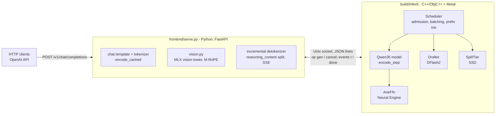
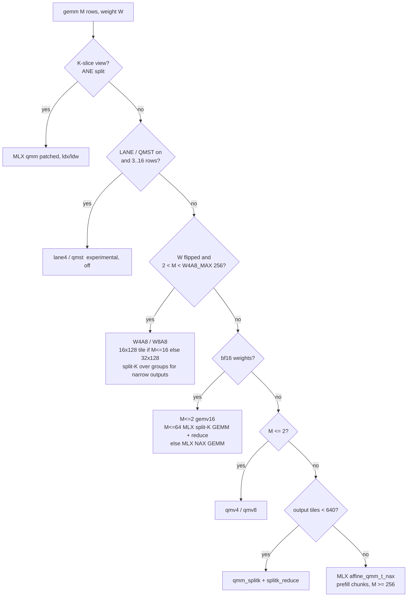

# inferd architecture

inferd is a native inference engine for Apple Silicon, built to serve many concurrent agents on one model with
vLLM-class machinery: continuous batching, chunked prefill, paged KV, a prefix cache, speculative decoding, and an
SSD tier that parks contexts on disk. The host is C++ / Objective-C++, the kernels are Metal Shading Language, and
there is no MLX runtime in the engine. The primary model is **Qwen3.8-27B**, a hybrid of 48 Gated DeltaNet (GDN)
layers and 16 gated full-attention layers. Since 2026-11-01 the same model class also runs Qwen3.5-9B,
Qwen3.6-35B-A3B (MoE), Muse Glimmer 30B and Gemma-4-31B.

This document describes how the engine works today. the study log is the dated study log behind every decision, and
`docs/EXPERIMENTS.md` catalogues what was tried and measured. Section references below of the form
*(study log: "heading")* point at the study log section that records the number or decision.

Contents

1. [Hardware and model assumptions](#1-hardware-and-model-assumptions)
2. [Process layout](#2-process-layout)
3. [Source map](#3-source-map)
4. [Weights: formats, fusion and flipping](#4-weights-formats-fusion-and-flipping)
5. [The forward pass](#5-the-forward-pass)
6. [GEMM routing](#6-gemm-routing)
7. [Attention paths](#7-attention-paths)
8. [Paged KV cache](#8-paged-kv-cache)
9. [GDN recurrent state: slots, snapshots, tapes](#9-gdn-recurrent-state-slots-snapshots-tapes)
10. [The scheduler](#10-the-scheduler)
11. [Prefix cache, fan-out and the SSD tier](#11-prefix-cache-fan-out-and-the-ssd-tier)
12. [Speculative decoding with DFlash2](#12-speculative-decoding-with-dflash2)
13. [Neural Engine FFN split](#13-neural-engine-ffn-split)
14. [Vision](#14-vision)
15. [Other model families](#15-other-model-families)
16. [Request lifecycle walkthrough](#16-request-lifecycle-walkthrough)
17. [Kernel inventory](#17-kernel-inventory)
18. [Vendored MLX code and our patches](#18-vendored-mlx-code-and-our-patches)
19. [Configuration: arguments and environment knobs](#19-configuration-arguments-and-environment-knobs)
20. [Tools and checks](#20-tools-and-checks)

---

## 1. Hardware and model assumptions

- **GPU:** an M5-class or newer GPU. The kernels use Metal 4's MetalPerformancePrimitives `matmul2d` (the path to the
  GPU's neural accelerators, "NAX") and are compiled with `xcrun metal -std=metal4.0`. Tested on Mac Studio M5 Ultra
  (80 GPU cores, 256 GB), MacBook Pro M5 Max, Mac mini M5 Pro (20 cores, 64 GB) and Mac mini M6 (12 cores, 32 GB).
- **Measured ceilings on the M5 Ultra** *(study log: "Measured ceilings, M5 Ultra (2026-10-29)")* and the int8 path
  *(study log: "W4A8: int8 activations on the integer tensor path (2026-10-30)")*:

  | quantity | value |
  |---|---:|
  | streaming read bandwidth | 1,135–1,142 GB/s |
  | fp16/bf16 `matmul2d`, 4096³ | 124 TFLOPS |
  | int8 × int8 → int32 `matmul2d`, 4096³ | 223 TOPS |

- **The model class** *(study log: "The models are both hybrid GDN (3 linear : 1 full attention)")*. Qwen3.8-27B has 64
  layers; every fourth layer (`full_attention_interval` = 4) is gated full attention with 4 KV heads × 256 dims and 24
  query heads (GQA factor 6); the other 48 are Gated DeltaNet. Only a quarter of the layers have a KV cache, so KV is
  64 KiB per token in bf16. Each sequence also carries a fixed-size recurrent state: 3 MiB per GDN layer, 144 MiB per
  sequence *(study log: "Where a 27B decode step goes (2026-10-29)")*. Concurrency is cheap in KV memory, but prefix
  caching, branching and batching all need per-sequence recurrent-state handling, which is where the existing Mac
  engines break.

## 2. Process layout

Two processes, connected by a Unix socket carrying newline-delimited JSON:



- **`build/inferd`** (`engine/tools/server.mm`) loads the checkpoint (and the drafter if `DRAFT` is set), sizes the KV
  pool, listens on the socket and runs the scheduler loop. One client (the front end) is served at a time; it
  multiplexes requests by id. A reader thread queues incoming JSON; the main thread submits requests, runs
  `Scheduler::step()` and writes token events back after each step. A `sigwait` thread handles SIGTERM/SIGINT: with a
  persistent SSD tier it first writes every cached context the tier lacks, then exits.
- **Wire protocol** (from the header of `server.mm`):
  - request: `{"op":"gen","id":N,"tokens":[...],"max_tokens":N,"temperature":T,"top_p":P,"top_k":K,"stop":[...],"seed":S}`;
    multimodal prompts add `"mrope"` (t, h, w per prompt token), `"rope_delta"` and `"embeds"` (base64 bf16 image
    features). `{"op":"cancel","id":N}` cancels.
  - events: `{"id":N,"t":[tok]}` per token, then `{"id":N,"done":"stop|length|error...","p":P,"c":C,"cached":K}`.
- **`frontend/serve.py`** (FastAPI + uvicorn) owns everything textual: the chat template (Hugging Face tokenizer),
  tokenization, stop ids (from `generation_config.json` or `config.json`, plus `<|im_end|>`-style end tokens), the
  incremental UTF-8-safe detokenizer, splitting `<think>…</think>` into `reasoning_content`, SSE streaming and
  `usage.prompt_tokens_details.cached_tokens`. Endpoints: `/v1/chat/completions`, `/v1/models`, `/health`.
  A client disconnecting from a stream sends `cancel` to the engine.
  - Note: when a request omits `temperature`, the front end sends 0.7 (`body.get("temperature", 0.7)`), so such
    requests take the speculative-sampling path, not the greedy one.
- **`engine/run.sh [port] [max_running] [step_tokens] [kv_gib] [snapshots] [max_ctx]`** starts both, waits for
  inferd's "listening on" line and the front end's `/health`, and writes logs to an `inference/logs` directory in the
  home directory.

## 3. Source map

| path | role |
|---|---|
| `engine/src/gpu.h` | Metal wrapper: device, queue, pipeline cache (`pso`, `pso_fc` with boolean function constants), `alloc` (shared storage), the encoder helper `Enc`, optional `MTLResidencySet`, GPU core count from the IORegistry |
| `engine/src/weights.h` | safetensors loader (`Checkpoint`), `QLinear` (fused affine 4/8-bit or bf16 linear), views `rows_of` / `kslice_of`, load-time bf16→8/4-bit quantizer for the drafter |
| `engine/src/qwen35.h` | the model (`Qwen35Config`, `Layer`, `Qwen35`): buffers, KV pool, state slots, GEMM routing, `set_batch`, `encode_step`, attention planning, MoE FFN, ANE split |
| `engine/src/moe.h` | MoE weight stacks (`MoeW`, `load_moe`) |
| `engine/src/dflash.h` | the DFlash2 drafter (`Drafter`): context append and draft block |
| `engine/src/scheduler.h` | `Scheduler`: admission, step planning, prefix trie (`PrefixCache`), snapshots, eviction, preemption, `BlockTuner`, sampling, commit |
| `engine/src/spill.h` | `SpillTier`: content-addressed SSD tier, persistence |
| `engine/src/ane.h` | `AneFfn`: private AppleNeuralEngine client, MIL program generation, IOSurface buffers |
| `engine/src/json.h` | minimal JSON parser |
| `engine/kernels/*.metal` | kernels (section 17) |
| `engine/third_party/mlx` | vendored MLX v0.32.3 Metal kernel headers, MIT, with our patches (section 18) |
| `engine/tools/server.mm` | `inferd` |
| `engine/tools/decode_test.mm`, `spec_test.mm` | correctness and timing tools (section 20) |
| `engine/tools/ane_probe.mm`, `ane_rot_test.mm`, `disp_test.mm` | probes |
| `engine/tools/ref_logits.py`, `tie_check.py`, `a8_quality.py` | references against `mlx_lm` |
| `engine/frontend/serve.py`, `vision.py` | the OpenAI front end and the vision path |

## 4. Weights: formats, fusion and flipping

### Formats

`load_qlinear` reads MLX checkpoints directly. Precision is detected **per tensor** from shapes, so one engine runs
the mlx-community 4-bit, 8-bit and bf16 builds of the same model *(study log: "Weight precisions: 4-bit, 8-bit and bf16
(2026-10-29 night)")*:

- **4- and 8-bit:** MLX affine quantization, group 64: `Wq uint32[N, K*bits/32]`, scales and biases `bf16[N, K/64]`,
  `w = s·q + b`. K comes from the scales' width, bits from how many values each uint32 packs. MLX's 4-bit nibble order
  equals Metal's `uint4b_format`, so these weights can feed tensor ops without repacking *(study log: "4-bit GEMM, day 1
  (2026-10-29)")*.
- **bf16:** `bits = 16`, `wq` holds `[N, K]` bf16 rows; `s`/`b` unused.

### Fusion at load

Projections that share an input are concatenated by rows into one `QLinear` (one buffer holding `[Wq | scales |
biases]`): GDN `in_proj` = qkv | z | b | a, attention `in_proj` = q | k | v (q interleaved with Qwen's output gate),
MLP `gate_up` = gate | up. `rows_of(q, lo, n)` and `kslice_of(q, k0, kn)` are zero-copy views (output rows; input
columns) used by the drafter, the ANE split and the drafter vocabulary cut.

### Flipped weights (W4A8 / W8A8)

With `W4A8` on (the default), every 4- and 8-bit linear except the embedding table is **XOR-flipped in place at load**
(`w_flip`: 4-bit `q ^ 8`, 8-bit `q ^ 0x80`), turning unsigned codes into signed ones (`q − 8`, `q − 128`). The integer
tensor path runs signed int8 × int4 15–20% faster than unsigned u8 × u4, and the flip needs no second copy of the
weights *(study log: "W4A8: int8 activations on the integer tensor path (2026-10-30)")*. Every other reader flips back:

| reader | how it un-flips |
|---|---|
| `qmv4` / `qmv8` | `GemmArgs.xr` XOR mask |
| MLX `affine_qmm_t_nax` and our `qmm_splitk` | function constant 40 (patched `quantized_nax.h`) |
| ANE re-quantization kernels | a `flip` argument (8 when flipped) |
| lane4 / QMST copies (experimental) | stored pre-flipped / XOR at repack |

The W4A8 epilogue compensates: `Σ (S q + B)(sx xq) = S sx Σ (q−8) xq + (B + 8S) sx Σ xq` (`kernels/w4a8.metal`).
MoE expert stacks are never flipped (W4A8 does not route them). A new kernel that reads `QLinear.wq` and forgets the
flip reads garbage.

### The drafter's weights

The DFlash2 checkpoint is bf16. `load_qlinear_bf16_q8` quantizes it at load to MLX's affine layout: the `fc` and
candidate-selector projections to 8-bit, the layer linears to `DRAFT_BITS` (default 4). The drafter has no embedding
or LM head of its own: it shares the target's.

## 5. The forward pass

One engine step is a **ragged batch**: T token rows from S sequences (`SeqWork`: state slot, block list, first
position, tokens). Decode rows, speculative verify blocks and prefill chunks share one forward pass
*(study log: "Ragged batches, prefill, and attention v2 (2026-10-29)")*. `set_batch` fills the per-row inputs (token,
position, sequence index, M-RoPE positions, attention mode) and per-sequence inputs (slot, block table row, start,
length, logits rows); `encode_step` encodes the whole model into Metal command buffers.

```
embed{4,8,16}(tok) [+ embed_ext for image rows]          x: bf16 [T, hidden]
for each layer l:
  rmsnorm_for(x)  ── fused with int8 activation quantization when the next GEMM takes W4A8 (rmsnorm_a8)
  in_proj GEMM    ── one fused projection
  if GDN layer:
     gdn_conv       depthwise causal conv (kernel 4) per sequence run, conv state in the slot
     gdn_prep       L2-norm q/k, beta = sigmoid(b), g = exp(-exp(A_log) * softplus(a + dt_bias))
     gdn_step       the delta-rule recurrence, state row in registers across the sequence's tokens
     gdn_out_norm   rmsnorm(y) * w * silu(z)
     (verify steps: inputs go to per-layer tapes; speculative sequences' state is left untouched)
  else (attention layer):
     attn_prep      q/k RMSNorm, RoPE / M-RoPE, write K,V (8-bit + scale, or bf16) into the paged cache
     attention      per-row mode: row kernel / multi-row / NAX paged / attn_mpp / chunk tiles / flash
     attn_combine   merge split partials, apply the sigmoid output gate
  out_proj GEMM   ── residual add fused (split-K reduce adds into x)
  rmsnorm_for(x)
  gate_up GEMM → silu_mul (fused with int8 quantization for down: silu_mul_a8) → down GEMM (+= x)
     (MoE models: router, routed experts, shared expert; ANE split: part of the FFN on the Neural Engine)
  capture_cols    copy x for the drafter at its target layers
rmsnorm_gather    final norm, only the rows whose logits are needed
lm_head GEMM      logits bf16 [n_out, vocab]
verify steps: row_argmax, [top-16 for sampled rows], spec_accept(_s), gdn_conv_replay + gdn_replay per GDN layer
```

Details that matter:

- **Logits only where needed.** A plain sequence produces logits for its last row; a speculative sequence for every
  verify row.
- **Command buffers.** A step is encoded into one command buffer, but the server commits it in pieces
  (`CB_SPLIT` = 16 layers; the drafter's work is committed first) so the GPU starts while the CPU encodes the rest.
  That took the 8-row verify step from 25.4 to 23.9 ms together with two other changes, and 8k single-stream decode
  from 177 to 181.7 tok/s *(study log: "Closing the gap, continued (Studio, smoke tests only)" and the preceding
  "attn_mpp" section)*. A speculative cycle is ~1,377 dispatches *(study log: "Single-stream gap, continued (laptop,
  2026-10-30 midday)")*; host overhead per step is ~0.5 ms against MLX's 8.6 ms *(study log: "Native engine, day 1")*.
- **Fusions.** `rmsnorm_a8` and `silu_mul_a8` (`FUSE_A8` = 3) produce the int8 activations of the next W4A8 GEMM
  directly. `splitk_res_norm` (folding a split-K reduce into the next norm, `DEFER_SPLIT`) exists but is off: at 8
  rows its one-threadgroup-per-row shape was slower.
- **Profiling switch.** `SKIP` takes a list of stages (`gemm`, `norm`, `gdn`, `attn`, `act`, `ane`) to leave out, for
  timing only.

## 6. GEMM routing

`Qwen35::gemm` picks a kernel by weight precision and row count M:



- **M ≤ 2: `qmv4`/`qmv8`**, our matvec, which reuses each weight read across 2 rows. More rows spill registers (381 ms
  per step at R = 8) *(study log: "Native engine, day 1")*.
- **3 ≤ M < 256: W4A8/W8A8** (`kernels/w4a8.metal`). `a8_quant` quantizes activations with one int8 scale **per row
  per 64-group** (absmax/127) and also stores `scale·Σq`; the kernel runs `matmul2d` on int8 activations × the
  checkpoint's own signed 4-bit (or 8-bit) weights, one 64-wide K group per `run()`, with the affine epilogue per
  group. Tiles are 16 × 128 for M ≤ 16 and 32 × 128 above. Narrow outputs (the hidden-size N = 5120 outputs give few
  tiles) split K over groups: below 480 tiles on GPUs with ≥ 60 cores, else below 3 × cores; the split count is capped
  at 6 × cores (16-row tiles) or 12 × cores (32-row tiles). This is the verify path: at 8–16 agents a verify step is
  40–80 rows.
- **M ≥ 256 (prefill chunks): MLX's NAX `affine_qmm_t_nax`**, vendored, reading the flipped weights through function
  constant 40. It runs a 2,048-row chunk's linear layers at ~115 TFLOPS, ~90% of the bf16 peak *(study log: "Agent fleets
  (2026-10-30 evening)")*. When the output has fewer than 640 tiles, our `qmm_splitk` (derived from MLX's
  `qmm_t_nax_tgp_impl`) writes float partials and `splitk_reduce` sums them, adding the residual.
- **bf16 checkpoints:** `gemv16` for M ≤ 2, MLX's NAX split-K GEMM for M ≤ 64, MLX's fused NAX GEMM above.
- **Residual mode.** `mode 1` adds into the destination (the residual stream); MLX kernels without a residual epilogue
  write to `tmp` and an `add_inplace` follows.
- **Split-K scratch** is sized for the widest projection the split condition can catch (`kSplitMaxN` = 34,816); an
  undersized scratch once corrupted logits.

Linear-layer time per step, 27B 4-bit, M5 Ultra *(study log: "W4A8: int8 activations on the integer tensor path")*:

| M (rows) | 5 | 40 | 80 | 160 | 2048 |
|---|---:|---:|---:|---:|---:|
| MLX qmm / our qmv (before W4A8) | 29.8 ms | 44.0 | 83.5 | 116.1 | 950 |
| W4A8 | 22.5 | 38.8 | 56.2 | 95.6 | 1,169 |

(16-row tiles later took M = 5 to 20.4 ms *(study log: "Head-to-head and the morning of 2026-10-30")*; M ≥ 256 stays on
MLX's qmm, which wins there.)

## 7. Attention paths

`set_batch` gives every row an attention **mode**, chosen per sequence from its new-row count n:

| mode | kernel(s) | used for | condition (defaults) |
|---|---|---|---|
| 0 | `attn_gqa_row_g<GQ>_d<Dh>` | plain decode, one row | n = 1 |
| 4 | `q_pack48` / `q_pack_i8_48` + `attn_mpp8[_kv8][_iq]` | single-agent verify blocks | 6 ≤ n ≤ 8 (`NAX_MPP_MIN` 6), GQ = 6, Dh = 256 |
| 5 | `q_pack32` / `q_pack_i8_32` + `attn_mpp8[_kv8]_r32[_iq]` | multi-agent verify blocks | 2 ≤ n ≤ 5 (`NAX_MPP32`) |
| 3 | `attn_paged_nax_wm2` | verify blocks when attn_mpp is off | 2 ≤ n ≤ `NAX_ROWS` (8) |
| 6 | `q_pack_sh` + `attn_shared[_kv8]` ("chunk tiles") | agent follow-up turns | 9 ≤ n ≤ `CHUNK_TILE_MAX` (256) |
| 1 | `kv_gather` + MLX `attention_nax` (flash) | large prefill chunks | n ≥ `FLASH_ROWS` (64) and not mode 6 |
| 2 | `attn_gqa_g<GQ>_d<Dh>` | multi-row fallback | NAX kernels unavailable (other GQ/Dh) |
| — | `attn_decode` | the original v1 kernel | `ATTN_V1=1` only |
| cascade | `attn_shared` over a shared prefix + per-sequence suffix | agents sharing physical KV blocks | `CASCADE=1` (off) |

All modes except flash write **unnormalised split partials** `{acc[Dh], m, l}` per (row, head, split) into
`attn_part`, and `attn_combine` merges them and applies the attention output gate. Splitting the key range across
threadgroups (flash-decoding) is what fills the GPU when there are few rows. The split count targets a number of
threadgroups per layer: 1,024 in general (`ATTN_SPLIT_TGS`), 128 when only attn_mpp runs (`ATTN_SPLIT_TGS_MPP`,
`_MPP32`), and max(128, 2 × GPU cores) for one long sequence alone (`ATTN_SPLIT_TGS_ONE`); chunks are aligned to 128
keys for attn_mpp.

### The kernels

- **`attn_gqa_row` (mode 0).** The 6 query heads that share a KV head are processed together so each K/V position is
  read once; lanes own positions, 32 at a time, so scores need no cross-lane traffic and the softmax costs one
  `simd_max`/`simd_sum` per head per 32 keys; V is accumulated with lanes over dims *(study log: "Ragged batches, prefill,
  and attention v2")*. Templated over (GQ, Dh) for the other models: 6/256, 4/256, 8/256, 2/256, 16/128, 8/512.
  For Dh = 256 the V accumulator is held in two named `float4`s: an indexed array cost the 27B 15–23% at 16–64 decode
  rows *(study log: "Diagnosed 2026-11-01: templating attn_gqa_row …")*.
- **`attn_paged_nax` (mode 3).** Packs the 6 heads × ≤ 5 rows sharing a KV head into one 32-row NAX tile (MLX `nax.h`
  MMA fragments, head dim split over 4 simdgroups); one 32-position key tile is exactly one paged block, so paging
  costs nothing *(study log: "NAX verify attention")*.
- **`attn_mpp` (modes 4 and 5)** — our verify attention on whole-tile `matmul2d` ops *(study log: "attn_mpp: verify
  attention on whole-tile matmuls (2026-10-30 afternoon)" and "2026-10-31: long-context verify attention reworked")*.
  One threadgroup per (KV head, sequence, split) handles all of the sequence's packed rows (8 rows × 6 heads = 48, or
  32 for the multi-agent variant). Per 128-key group (four 32-token pages):
  - **S^T = K Q^T with K as the left operand**, in its natural row-per-key layout; one 128 × 48 × 256 matmul when the
    four pages are physically contiguous (the allocator arranges that, section 8), else per page or per 64-key half.
  - Scores are `store()`d by the matmul straight into threadgroup memory (key-major, padded pitch), and the key and
    query scales are applied as the softmax reads them.
  - **Softmax lanes:** 4 lanes own a packed row (8 for the 32-row variant), keys interleaved; row max/sum are
    log2(LPR) xor-shuffles and the running m/l stay in registers.
  - Online softmax in two 64-key halves, double-buffered P, and a **lazy O rescale** (only when a row's reference max
    grows by more than 2^8).
  - O += P V into a cooperative 48 × 256 fp32 tile.
  - **8-bit KV:** int8 K as the QK left operand with per-key scales applied to scores; V's scale folded into P; int8 V
    as the P V operand. **`ATTN_IQ`** (default on with KV8) also quantizes each packed query row (absmax/127 over 256
    dims, `q_pack_i8`) so QK runs int8 × int8 → int32.
- **`attn_shared` (mode 6, and cascade).** The attn_mpp kernel with a "shared" variant: 48-row tiles of (row, head)
  pairs from a sequence's new rows, split over keys, each row masked at its own causal end. It replaced gathering the
  whole KV for a follow-up turn (512 MB per layer at 128k) and MLX flash with no key split *(study log: "Chunk tiles (mode
  6)")*. Cascade attention uses the same kernel to attend once to a prefix several sequences share physically; it is
  correct but measured slower than letting the GPU caches serve the shared blocks, so it is off.
- **Flash (mode 1).** `kv_gather` copies the sequence's paged KV (dequantizing 8-bit KV) into contiguous scratch, then
  MLX's NAX flash attention (`attention_nax_dsplit` for Dh 256/512, `attention_nax` for 128) runs causal over it, and
  `attn_gate` applies the output gate. Used for big prefill chunks, where the gather is amortised.

## 8. Paged KV cache

```
per attention layer l:                         (Qwen35::kc / vc / ks / vs, "head planes")
  K: [Hkv][ns][Dh]  int8 (KV8) or bf16          ns = n_blocks * 32, slot = block * 32 + t
  V: [Hkv][ns][Dh]
  K scale, V scale: [Hkv][ns] float             (KV8 only; absmax/127 per (position, kv head))
kernel index: (kh * ns + slot) * Dh + d,  scale: kh * ns + slot

sequence: block table [max_blocks] -> physical block ids; 32 tokens per block
allocation: aligned groups of 4 blocks (128 keys) kept physically contiguous where possible
```

- **Blocks** of 32 tokens, refcounted (`Scheduler::block_ref`). A block can be held by a running sequence and by the
  prefix trie at once.
- **8-bit KV is the default** (`KV8`, since 2026-10-31; Gemma-4 defaults to bf16). int8 values plus a float scale per
  (position, KV head). It halves KV memory (the 140 GiB pool holds ~4.5M tokens against 2.3M in bf16, *study log: "8-bit
  KV cache"*), and the reworked attention made it faster than bf16 at long context.
- **Head planes** (2026-10-31): each KV head's block, and a run of ascending blocks, is one contiguous range. Logits
  are bit-identical to the older `[block][t][Hkv][Dh]` layout; spill files store a block as one run per head.
- **Contiguity and grouped allocation.** attn_mpp reads a 128-key K tile in one matmul only when a group's 4 pages are
  physically adjacent. The allocator therefore (a) hints "the block right after the previous page" within a group of 4
  (`alloc_block(prefer)`), (b) keeps a stack of fully free aligned groups (`grp_free`, `free_groups`) and gives a
  sequence starting a new group a whole free group, and (c) evicts `EVICT_BATCH` = 64 blocks at a time when the pool
  is full, so freed runs are handed out in ascending order. Scattered pages cost 10–14% per verify step at
  128k–256k *(study log: "v11: grouped KV allocation" and "Diagnosed 2026-10-30: a full KV pool handed out pages in
  descending order")*. Anything that takes blocks off the pool must go through `alloc_block`/`push_free`.
- **Pool sizing.** `kv_gib` on the command line, or `kv_gib ≤ 0` to size from Metal's `recommendedMaxWorkingSetSize`
  less the model, drafter, state and scratch and a margin (`KV_MARGIN_GIB` 1.5, plus `ANE_MARGIN_GIB` 0.5 with the
  ANE split). On the Mac Studio use an explicit size: auto-sizing with a small model filled 222.5 of 224 GiB and hung
  the first request *(study log: "Diagnosed 2026-11-01: a server that hung …")*.

## 9. GDN recurrent state: slots, snapshots, tapes

Per GDN layer, each **state slot** holds the conv state (`[3, conv_dim]` bf16, the last three conv inputs) and the
recurrent state (`[Hv, Dv, Dk]` fp32). The drafter's per-slot context ring (K/V for its sliding window) lives in the
same slot numbering. There are `max_running + snapshots` slots: a slot is either bound to a running sequence or holds
a prefix-cache snapshot. Restoring a snapshot is a GPU blit from one slot to another (`encode_copy_slot`), done at the
start of the step that needs it.

```
slots:  [ running seq 0 | running seq 1 | ... | snapshot A | snapshot B | ... | free ]
         conv + GDN state per layer, plus the drafter's ring per drafter layer
```

- **Snapshots.** KV can be rebuilt by sharing blocks, but the recurrent state at position p cannot be recomputed
  without re-reading the whole prefix, so the cache stores the state at chosen points. Each prompt's prefill is split
  at a **snapshot point**: the prompt end minus 16 tokens (`snap_margin`), floored to a block boundary. Chat templates
  re-render the previous turn's tail differently, so follow-up turns diverge a few tokens before the old prompt's end,
  and the margin keeps the snapshot inside the shared part. When a step ends exactly at a sequence's snapshot point,
  its slot is copied into a free snapshot slot and its full blocks enter the trie.
- **Verify tapes.** In a verify step, speculative sequences' GDN state is *not* advanced: `gdn_conv` and `gdn_step`
  write their inputs (conv input, normalised q/k/v, g, beta) to per-layer tapes. After acceptance is known,
  `gdn_conv_replay` and `gdn_replay` advance the state over the committed rows only, with the same arithmetic as
  `gdn_step`. Tapes are sized by `max_tokens` (`step_tokens + max_running × 8`); a test tool that prefilled 16 × 6k in
  one step once sized them to 177 GiB *(study log: "Diagnosed 2026-10-30: the "16-sequence non-GPU time" …")*.

## 10. The scheduler

`Scheduler::step()` (`src/scheduler.h`) runs once per engine step:

1. **Admit** waiting requests (in order) while fewer than `max_running` are running:
   - reject a prompt whose `prompt + max_tokens` exceeds `max_ctx`;
   - walk the prefix trie over the prompt's full blocks (never the last token: it must be computed for logits),
     remembering the deepest node with a snapshot;
   - **KV-budget admission** (`fits`): admit only if the blocks this turn will need (prompt + `ADMIT_RESERVE` = 512
     generated tokens + a draft block) fit beside what running sequences will still take, counting free blocks plus
     blocks held only by the trie (evictable). Before this, admission counted sequences, and on the 32 GB Mac mini M6
     four 33k agents filled the pool and deadlocked at 0.02 tok/s *(study log: "v10: KV-budget admission + preemption")*;
   - take a state slot, evicting a cached snapshot if needed but **sparing the one this request will start from**;
   - with the SSD tier, restore a deeper spilled prefix if there is one (section 11);
   - **fan-out wait**: if the prompt shares ≥ `FANOUT_MIN` (1,024) tokens with a sequence still prefilling them, ask
     that leader to snapshot at the end of the shared part and wait (section 11);
   - bind the cached blocks (refcount +1), queue the snapshot restore (or a zero fill), plan the snapshot points:
     the prompt's end, the end of the system prompt (the front end's `snap_at` hint) and the branch point where the
     prompt leaves a cached one (both only when ≥ `SNAP_BRANCH_MIN` tokens past the restored state).
2. **Plan the step.** Every decoding sequence gets its rows first: a draft block of L rows if it is speculated, else
   1 row. L comes from the block policy (section 12). Prefill chunks then fill the remaining **token budget**
   (`step_tokens`, default 2048), each chunk stopping at its sequence's next snapshot point (vLLM-style chunked
   prefill). There is no lane cap: every admitted agent decodes in every step.
3. **Allocate KV blocks** for the new positions with the contiguity hint. If the pool runs dry, **preempt** the
   newest sequence not yet planned: it returns its blocks and slot and goes back to the front of the queue. Its
   prompt snapshot stays in the trie (or goes to SSD if evicted), so on re-admission it restores that and recomputes
   only its tail (the last prompt tokens and what it has generated so far). A sequence alone that still cannot get a
   block finishes with "error: KV pool exhausted".
4. **Encode**: slot restores/zeros (blit), the drafter's context append and draft block (committed early), the target
   step, the drafter context for prefill rows, snapshot blits. **Commit and wait** once.
5. **Commit results.** Speculative sequences keep the accepted prefix plus the bonus token (`commit`, `emit` from the
   GPU); their committed rows become drafter context for the next step. Plain sequences that finished their prompt
   sample one token (greedy argmax from the GPU's `row_argmax`, or CPU top-k/top-p sampling). Tokens are delivered,
   stop ids and `max_tokens` end the request, and finished sequences release their blocks and slot.
6. **Time the block choice** on decode-only steps for the tuner.

Step-level numbers on the agent-fleet scoreboard are in `docs/EXPERIMENTS.md`.

## 11. Prefix cache, fan-out and the SSD tier

### The trie

`PrefixCache` is a trie of **full 32-token KV blocks**, keyed by (parent node, the block's tokens) through an FNV hash
index. A node holds one reference to its KV block, an optional snapshot slot, a child count and an LRU clock. Blocks in
the trie are immutable. A request resumes from the **deepest node that carries a snapshot**; the blocks along the path
are shared physically with every other sequence that uses them.

**How KV passes between agents.** Because blocks are shared by reference, a follow-up turn, a fork, a retry or a second
agent reading the same document attends to the same physical pages as the first. On the follow-up harness a turn
restored 16,352 of ~16,470 prompt tokens *(study log: "Agent serving, prefix cache, flash prefill, DFlash2 speculation")*.
Sharing pages also helps attention: 16 agents × 64k with physically shared prefixes took 110 ms per 5-row verify step
against 147 ms with private copies, because the GPU caches serve the repeated reads *(study log: "Agent fleets
(2026-10-30 evening)")*.

**Fan-out.** When N agents start on the same long document at once, only the first should prefill it. `wait_for_leader`
finds a running sequence still prefilling a shared prefix (≥ `FANOUT_MIN` tokens), inserts a snapshot point at the end
of the shared part into the leader's `snap_pts`, and keeps the follower waiting; once the leader snapshots there, the
follower hits the cache. 8 agents on one 32k document: fan-out 188.8 s → 24.6 s *(same section)*.

**Branch points (1 Nov 2026).** On a hybrid model the trie's KV is usable only up to a GDN state snapshot, and
snapshots used to sit only near prompt ends: agents that shared a system prompt but asked different questions shared
0 cached tokens. Now the front end sends the system prompt's end as `snap_at`, and a prompt whose KV match runs
≥ `SNAP_BRANCH_MIN` (256) tokens past its restored state also snapshots at the branch point. Studio, 2.5k-token system
prompt + ~1.8k different user turns: the 2nd agent on caches 2,560 tokens and turns take 1.22 s instead of 2.65 s
(with only the branch rule, the 3rd agent on).

**Eviction.** `evict(blocks, slots, keep)` drops least-recently-used leaves; when only a slot is missing it drops the
oldest snapshot anywhere, inner nodes included, but never `keep` (the node a caller is about to use). Every evicted
snapshot is first spilled to the SSD tier when one is configured.

**Named contexts, pins and sessions (2 Nov 2026).** On top of the implicit cache, `docs/CONTEXTS.md` describes an
explicit API: a saved context is a `prefill_only` request whose chain is pinned (`Node::pin` on every node of the
chain, `pin_snap` on its end: never evicted, not counted as free by `fits`); `session` requests mark their latest
snapshot (`Node::sess`), which `evict_key` orders after every unmarked prefix; `no_cache` requests take no snapshot
points. `ctx_offload` / `session_offload` spill a chain and free its unshared tail (`drop_chain`).

### SSD tier (`src/spill.h`)

```
SPILL_DIR/
  b<hash>    one KV block (every attention layer's K, V and 8-bit scales, one run per head), named by the hash of
             all tokens up to the block's end: written once, shared by every chain through it, refcounted
  s<hash>    one snapshot's state: conv + GDN state per layer + the drafter's ring
  t<hash>    (SPILL_PERSIST) the chain's tokens, written last and renamed into place
  MANIFEST   (SPILL_PERSIST) model, drafter, drafter bits, KV precision, block/state geometry
```

- **Spill** (on eviction of a snapshot node): write the state plus only the blocks not yet on disk. **Restore** (at
  admission, when a spilled prefix is deeper than the trie's best snapshot): read the state plus only the blocks memory
  no longer holds into fresh blocks and a slot, and re-enter the chain in the trie with a snapshot at its end.
- All copies run on the CPU between steps (shared-storage buffers, GPU idle) through a 64 MiB staging buffer with
  `F_NOCACHE`; files are deleted oldest-entry-first above the quota (`SPILL_GIB`, default 64).
- With 8-bit KV on the 27B a block is ~1.06 MiB and a state ~190 MiB *(study log: "SSD tier for the prefix cache")*. A
  follow-up restored from SSD had a TTFT of 0.24–0.33 s against 7.2 s for re-prefill, with replies identical to a
  large-pool reference.
- **Persistence** (`SPILL_PERSIST=1`): start-up rebuilds the index from token files whose state and blocks are present
  at the right sizes and deletes the rest; any MANIFEST difference empties the directory. On SIGTERM/SIGINT inferd
  first writes every cached snapshot chain the tier lacks *(study log: "Persistent SSD tier")*. Without it the directory
  is emptied at start-up and on exit.

## 12. Speculative decoding with DFlash2

### The drafter

`src/dflash.h` implements the **DFlash2** block drafter published by z-lab and incoai as `Qwen3.8-27B-DFlash2`
(Splash, incoai's engine, uses the same files). It is 5 Qwen3-style layers (GQA 4, head dim 128) with a dynamic
grouped conv around each attention and MLP sub-block, attending **non-causally within the block** and to a sliding
window of projected target hidden states, plus a **candidate selector** (top-16 candidates per position rescored with
predecessor/successor codebooks of rank 256). It shares the target's embedding and LM head. Shapes other than these
are rejected at load.

Per cycle and sequence (`encode_context`, `encode_block`):

1. **Context append.** The target's hidden states at the drafter's `target_layer_ids` (captured by `capture_cols`)
   for the rows committed last step go through `fc` and `hidden_norm`, then each layer's k|v projection (an offset
   view of the fused qkv weight) writes them into the drafter's per-slot K/V ring (`window + 8` positions).
2. **Draft block.** Rows `[staged token, mask × (L−1)]` run through the 5 layers (`draft_attn5`, or `draft_attn8g`
   for 6–8 rows as 2 groups of 4 across threadgroups), the final norm and the target's LM head; a sharded top-16
   (`row_top16_shard` + `top16_merge`, 64 shards) feeds `draft_select`, which walks the positions greedily and writes
   the chosen draft tokens **straight into the target's verify input rows**.

### The cycle

```mermaid
sequenceDiagram
  participant CPU as Scheduler (CPU)
  participant GPU
  CPU->>GPU: blits: restore / zero slots
  CPU->>GPU: drafter: context append (last step's committed rows) + draft block -> verify tokens
  Note over CPU,GPU: committed early (CB_SPLIT) so the GPU drafts while the CPU encodes the target
  CPU->>GPU: target verify step (L rows per speculative sequence + prefill chunks)<br/>GDN inputs -> tapes, state untouched
  CPU->>GPU: row_argmax [+ top-16 per row for sampled sequences]<br/>spec_accept / spec_accept_s -> commit, emit
  CPU->>GPU: gdn_conv_replay + gdn_replay over committed rows only
  CPU->>GPU: drafter context for prefill rows; snapshot blits
  CPU->>GPU: commit (pieces of 16 layers)
  GPU-->>CPU: one wait per cycle
  CPU->>CPU: deliver emitted tokens; tuner bookkeeping
```

- **Greedy verification** (`spec_accept`): a = the length of the draft prefix that matches the target's argmax; commit
  a + 1 rows; emit d1..da plus the target's prediction after row a (the bonus token). Output is identical to plain
  greedy decode except where a different kernel path flips a near-tie; like vLLM, the engine is not batch-invariant at
  the bit level *(study log: "Agent serving, prefix cache, flash prefill, DFlash2 speculation")*. Since W4A8, verify runs
  int8 activations while M = 1 decode runs bf16, which moves only near-tie flips.
- **Speculative sampling** (`spec_accept_s`, 0.1.1): the drafter's proposal is a point mass on d, so the exact rule is:
  accept d with the target's probability p(d) after temperature, top-k and top-p, otherwise emit a sample from p with
  d removed and renormalised; if all drafts are accepted, sample the bonus from the last row. p comes from each verify
  row's top-K, computed on the GPU (`row_top64_shard_v` + `top64_merge_v`; K = 64, `SPEC_TOPK=16` for the old set;
  ties by token id, the host's order; a step whose sampled sequences all have top-k 1..16 uses the 16-candidate
  kernels, ~5% cheaper at 16k x 8 sampled agents on the Studio). Since 2026-11-04 (Codex review R03) the rule is exact by construction: top-k
  1..64 draws from the full top-k set; with top-k off and top-p < 1, `verify_zpart` sums each row's softmax normaliser
  over the whole vocabulary (64 shards) and the nucleus is cut against it, so it is exact whenever the nucleus fits in
  the 64 candidates; a row where it does not is handed to the host (`vhost`), which samples it from the full logits
  under `src/sampling.h` and replaces the placeholder (counted: `spec_host` in the done event, `spec_sampling` in
  `/v1/cache`). `Scheduler::submit` does not speculate the rest (top-k above 64, or off with top-p 1): one token per
  step on the host sampler, unless the request opts into truncation to the 64 (`spec_truncate`; front end
  `"inferd": {"spec_sampling": "truncate"}`). Before, the host path silently capped "no limit" at 1,024 candidates and
  this path at 16, and the GPU broke logit ties by thread rather than by id. Per-sequence `{t, top_p, top_k,
  seed}` live in `samp`; a counter hash gives the uniforms. `SPEC_SAMPLE=0` restores plain (non-speculated) sampling
  *(study log: "0.1.1: speculative sampling (2026-10-31 night)")*.

### Block size policy

The block is the number of verify rows per sequence (staged token + drafts): 4, 5 or 8, with 8 = DFlash2's trained
`block_size` (`DRAFT_BLOCK`, capped at `kMaxBlock` = 8). The scheduler decides L each step:

1. Start from the drafter's block (8); above `SPEC_WIDE` (4) decoding agents drop to 5.
2. If `SPEC_BLOCKS` is set (`"n1:L1,n2:L2"`), it overrides.
3. Otherwise drop to L−1 when that saves a 32-row W4A8 tile (8 agents: 40 → 32 rows; 16: 80 → 64).
4. With `SPEC_AUTO` (default on), the **BlockTuner** chooses among 4/5/8 per *regime* (decoding agents × mean-context
   bucket): acceptance E(L) is an exponential moving average of "the first k drafts were all accepted" from every
   greedy cycle, cost T(L) the measured wall time of decode-only steps; it picks the best n · E(L) / T(L), starting
   from the fixed rule's block, exploring one step in 8 until each candidate has 3 timings, then re-testing one
   alternative every 16th step *(study log: "Block size by regime, and a self-tuning chooser" and "Tuner, single
   stream")*. `INFERD_DEBUG=1` prints its table every 64 steps of a regime.

### Drafter knobs worth knowing

`DRAFT_BITS` (4; 8 for 8-bit layer linears), `DRAFT_CHUNK` (64 keys per drafter attention split), `TOP16_SHARDS` (64),
`DRAFT_VOCAB` (0 = full vocabulary; a cut to the first N ids plus the special-token tail is opt-in because acceptance
fell on agent text), `DRAFT_SKIP` (timing only). Every embedding lookup must handle all three precisions
(`embed4/8/16`): the drafter shares the target's table, and a 4-bit lookup on an 8-bit table once dropped acceptance to
1.1 tokens/cycle.

## 13. Neural Engine FFN split

On the small Macs a prefill chunk is compute-bound on the GPU while the Neural Engine sits idle; the Mac mini M6's ANE
runs an int8-weight fp16 FFN at ~21–23 TFLOPS against its GPU's ~15 *(study log: "Neural Engine FFN split for prefill
(2026-11-01 night)")*. With `ANE_UNITS` = n > 0 (default 0; the deployed setting is 24 on the M6), prefill steps of at
least `ANE_MIN_ROWS` (1,024) rows split each layer's FFN by intermediate channel: the GPU computes channels `[0, Cg)`,
the ANE the last n × 512 channels.

```mermaid
sequenceDiagram
  participant GPU
  participant CPU
  participant ANE
  GPU->>GPU: layer mixer, rmsnorm, pack normed rows into ANE input IOSurfaces<br/>(W8A8: Hadamard-rotate + int8 per token)
  GPU->>GPU: (first layer only) re-quantize this layer's ANE weight rows into weight set A
  GPU-->>CPU: commit + wait
  par
    CPU->>ANE: evaluate ffn<R>(set A) on a thread
  and
    GPU->>GPU: gate/up via row views, silu_mul2, down via K-slice view (+= x)
    GPU->>GPU: re-quantize layer l+1's ANE rows into weight set B
  end
  GPU-->>CPU: commit + wait; join ANE thread
  GPU->>GPU: ane_join: x += ANE partial down projection
```

- **Our own client of the private AppleNeuralEngine service** (`src/ane.h`; `tools/ane_probe.mm` first): the
  `_ANEClient`/`_ANEModel`/`_ANERequest`/`_ANEIOSurfaceObject` classes are loaded with `dlopen`, the program is **MIL
  text** compiled with `kANEFModelMIL` and cached under `TMPDIR` by a hash of its text, and evaluation is synchronous
  (`evaluateWithModel`). One function per 256-row bucket from 512 to the largest chunk.
- **Weights are inputs, not constants.** All tensors are IOSurfaces that Metal also sees as buffers
  (`newBufferWithBytesNoCopy`). Just before each layer the GPU re-quantizes that layer's ANE rows from our own 4-bit
  weights to int8 rows with per-row fp16 scales (`ane_rowscale`, `ane_quant`, or `ane_req_rot`), so nothing is held
  twice; two weight sets alternate so the next layer's re-quantization overlaps the current layer's ANE run.
- **Precision.** gate/up are **W8A8 with a random-sign 512-point Walsh–Hadamard rotation**: activations are rotated
  and quantized per token per 2,560-channel segment (`ane_pack_x8`), the weight rows get the same rotation
  (`ane_req_rot`), so outliers are spread before int8 (`ANE_A8=0` falls back to W8A16). down stays W8A16 (fp16
  intermediate); the int8 intermediate (`ANE_A8D`) is broken and off. The program dequantizes int8 by 1/128 and folds
  the rest into the per-row scales, and computes SiLU as g/2 · (1 + tanh(g/2)) (the ANE's sigmoid loses accuracy on
  small gates, a finding from Splash). On a 1,000-token prompt: GPU alone KL 0.00017 vs mlx_lm, W8A16 split 0.00091,
  rotated W8A8 split 0.00015.
- **GPU side.** gate/up go through `rows_of` views, `silu_mul2` combines them, and down reads a **K-slice view**
  (`kslice_of`): MLX's qmm patched to take the full matrix's row lengths in buffers 8 and 11.
- **Residency.** The split's per-layer hand-offs leave the GPU idle between command buffers, and on the 32 GB M6 macOS
  then unwired GPU memory and re-wired it each layer. With `ANE_UNITS` set, a `MTLResidencySet` over every buffer and
  the ANE surfaces is on by default (`gpu.h`) *(study log: "Diagnosed 2026-11-01: the ANE split made server prefill slower
  until the weights stayed wired")*.
- The split applies only to dense models with 4-bit FFN weights whose hidden size is a multiple of 2,560.

Design credit: the idea and overall structure follow Splash's `AneFfn` (github.com/incoai/splash, Apache-2.0); the
client, the MIL program generator and the kernels here are our own.

## 14. Vision

Images work end to end through the OpenAI API (`image_url` parts: an inline data URI; http(s) URLs and local paths
only when enabled, `INFERD_IMAGE_URLS=1` / `INFERD_IMAGE_FILES=1`) in **PNG, JPEG, WebP or GIF** (first frame): the
decoder identifies nothing else, whatever the data URI's media type says, and runs in a child process killed after
`INFERD_IMAGE_DECODE_TIMEOUT` s (`frontend/image_decode.py`; Codex review 2026-11-04 R01), for checkpoints that
carry the vision tower *(study log: "Vision (2026-10-29 night)")*:

- **Front end** (`frontend/vision.py`): the Hugging Face processor renders the template and expands each image's pad
  tokens; the checkpoint's vision tower runs **in MLX** (mlx_vlm's Qwen3.5 `VisionModel`, vision weights only);
  mlx_vlm's `get_rope_index` gives the interleaved M-RoPE positions `(t, h, w)` and the delta for later positions.
  Each image's pad tokens are replaced by **content-keyed ids ≥ vocab** (`vocab + (blake2b(pixels) + i · 2654435761)
  mod 2^24`), so the prefix cache keys images by content: the same image hits the cache, a different one does not.
  Features are sent as base64 bf16.
- **Engine:** per-row rope positions `rpos [T, 3]` (`mrope_section` [11, 11, 10]: frequency i takes component i mod 3;
  text rows have t = h = w, so text is unchanged bit for bit), `rope_delta` for generated positions, and `embed_ext`
  overwrites image rows' embeddings with the features.
- The mlx-community 27B 4-bit build has no vision tower; the front end returns HTTP 400 for images there. The
  mlx-community 8-bit/bf16 and lmstudio-community 4-bit builds have it. Greedy output on a synthetic test image is
  word-for-word identical to `mlx_vlm.generate`.

## 15. Other model families

Added 2026-11-01 as smoke ports in the same `Qwen35` class, chosen by `config.json`'s `model_type`, each matching
mlx_lm's logits (top-1) *(study log: "Other models on inferd (2026-11-01)")*. No drafters, not tuned.

| model | what had to change |
|---|---|
| **Qwen3.5-9B** | same hybrid; F32 `A_log` (`load_bf16`), GQA 4. attn_mpp / NAX paged attention are GQ = 6 only, so it uses the row and multi-row kernels and flash |
| **Qwen3.6-35B-A3B** (`qwen3_5_moe`) | `src/moe.h`, `kernels/moe.metal`: router (8-bit) with the shared-expert gate as an extra row, softmax top-8 renormalised, sigmoid-gated shared expert. Below `MOE_SORT_MIN` (128) routed rows a per-row gathered GEMV (`moe_qmv`); above, a counting sort by expert (`moe_sort`, `moe_gather`) and MLX's `affine_gather_qmm_rhs_nax` (`kernels/mlx_gather.metal`) |
| **Muse Glimmer 30B** | separate `gate_proj` interleaved per head into `q_proj` rows so the gated attention applies; centered norms (+1 at load); sandwich norms (`norm_add`); weightless qk-norm with `qk_scale_factor` in the attention scale; NoPE on global layers; scaleless embedding norm; logits × `output_multiplier` then softcap; **sliding window 2048** (`GqaArgs.win` in our kernels, and a window patched into MLX's flash kernel) |
| **Gemma-4-31B** | sliding layers Dh 256 / 16 KV heads, global layers Dh 512 / 4 KV heads with K = V (no `v_proj`), scaleless V norm, proportional RoPE, no output gate, GELU-tanh MLP, per-layer output scalar, embeddings × bf16(√hidden), attention scale 1, softcap 30, tied LM head; D = 512 kernel instances. **bf16 KV by default**: 8-bit KV flips predictions (KL 1.96 vs 0.06). No sliding-window KV yet (ring blocks would conflict with prefix-cache block sharing), so its KV is ~900 KB per token |

## 16. Request lifecycle walkthrough

A follow-up turn from an agent that already has a 32k context, on a server with a drafter and an SSD tier:

```mermaid
sequenceDiagram
  participant Agent
  participant FE as serve.py
  participant Sch as inferd Scheduler
  participant GPU
  participant SSD
  Agent->>FE: POST /v1/chat/completions (stream)
  FE->>FE: apply_chat_template; encode_cached (only new messages are tokenized)
  FE->>Sch: {"op":"gen","id":7,"tokens":[...],"temperature":...}
  Sch->>Sch: admit: trie walk -> deepest snapshot node; fits()? slot (sparing that node)
  alt prefix evicted earlier
    Sch->>SSD: lookup by prefix hash; read state + missing blocks
    SSD-->>Sch: re-enter chain in trie with snapshot
  end
  Sch->>GPU: blit snapshot slot -> sequence slot
  loop prefill chunks (budget step_tokens, stop at snapshot point)
    Sch->>GPU: chunk rows (mode 6 chunk tiles for <= 256 rows) beside other agents' verify blocks
  end
  Sch->>GPU: at snapshot point: copy slot -> snapshot slot; blocks into trie
  loop until stop / max_tokens
    Sch->>GPU: draft block + verify + accept + replay (one command buffer)
    GPU-->>Sch: commit count, emitted tokens
    Sch-->>FE: {"id":7,"t":[tok]} ...
    FE-->>Agent: SSE deltas (reasoning_content until </think>, then content)
  end
  Sch-->>FE: {"id":7,"done":"stop","p":...,"c":...,"cached":...}
  FE-->>Agent: finish_reason, usage.cached_tokens, [DONE]
  Sch->>Sch: release blocks (trie keeps its references) and slot
```

Step by step:

1. **Front end.** `render` applies the chat template (tools, `enable_thinking`/`reasoning_effort` passed through
   `chat_template_kwargs`). `encode_cached` splits the rendered text before each `<|im_start|>` (special tokens are
   split out before BPE, so pieces encode independently) and caches each piece's ids (LRU, 256 MB of text), so a
   128k-token conversation costs a cached re-encode of ~0.09 ms instead of 84 ms *(study log: "Front end: a turn
   re-tokenized the whole conversation")*. Images go through `vision.py` instead.
2. **Submit.** The request goes to inferd as one JSON line; the reader thread queues it; the main loop calls
   `Scheduler::submit`, which marks it speculative if a drafter is loaded (greedy, or sampled with `SPEC_SAMPLE` on).
3. **Admission** (section 10) finds the deepest cached snapshot along the prompt, possibly restoring a deeper one from
   SSD, checks the KV budget, binds the cached blocks, and schedules a slot restore.
4. **Prefill.** The uncached tail is computed in chunks under the step's token budget, beside other agents' decode
   rows. A turn's new rows (≤ 256) use chunk tiles (mode 6); bigger chunks use flash. Prefill stops exactly at the
   snapshot point (prompt end − 16, block-aligned), where the state is snapshotted and the blocks enter the trie, then
   continues with the last few tokens.
5. **Decode.** Each step the drafter proposes L − 1 tokens after the staged token, the target verifies all L rows,
   `spec_accept` commits the accepted prefix plus the bonus token, and the GDN state is replayed over the committed
   rows. The block size L is chosen per regime by the tuner.
6. **Finish.** A stop id or `max_tokens` ends the request; the done event carries prompt, completion and cached token
   counts. The sequence's blocks are unreferenced (the trie keeps the prefix), its slot freed. The next turn of this
   agent will find this turn's snapshot.

## 17. Kernel inventory

All `.metal` files are compiled into one `build/core.metallib` by `engine/build.sh`.

| file | contents | when used |
|---|---|---|
| `core.metal` | `qmv4`/`qmv8`/`gemv16` matvecs; `qgemm4` (day-1 GEMM) and `qmvt4` (disabled); `embed4/8/16`, `embed_ext`; `rmsnorm`, `rmsnorm_a8`, `splitk_res_norm(_a8)`, `rmsnorm_gather`; GDN `gdn_conv`, `gdn_prep`, `gdn_step`, `gdn_out_norm`; `silu_mul`, `silu_mul_a8`, `gelu_mul`, `add_inplace`, `scale_rows`; `attn_prep`, `attn_decode` (v1), `attn_gqa` / `attn_gqa_row` (templated over GQ, Dh), `attn_combine`, `kv_gather`, `attn_gate` | every step |
| `w4a8.metal` | `w_flip`, `a8_quant`, `w4a8_gemm` instances `w4a8_{8,16,32,40,48}x128`, `w4a8_16x{64,256}`, `w8a8_{16,32}x128` (each for output modes 0–3: write, residual add, float, split-K partial) and simdgroup-count variants `w4a8_*s{1,2,8}` kept for re-tests | GEMMs with 3 ≤ M < 256 (the default uses 16×128 and 32×128) |
| `qmm_splitk.metal` | split-K quantized GEMM derived from MLX's `qmm_t_nax_tgp_impl`, `splitk_reduce` | narrow outputs on the MLX-qmm path; the reduce also serves W4A8 split-K |
| `mlx_qmm.metal` | instantiations of MLX's `affine_qmm_t_nax` (4/8-bit, BM 32/64, aligned or not) | M ≥ 256, K-slice views |
| `mlx_gemm.metal`, `mlx_gemm_splitk.metal` | instantiations of MLX's NAX bf16 GEMM and split-K GEMM | bf16 checkpoints |
| `mlx_attn.metal` | instantiations of MLX's NAX flash attention for Dh 256 / 128 / 512 (with our window patch) | prefill chunks ≥ 64 rows (mode 1) |
| `mlx_gather.metal` | instantiations of MLX's `affine_gather_qmm_rhs_nax` | MoE experts, ≥ 128 routed rows |
| `attn_paged.metal` | `attn_paged_nax` (32/64-row tiles; `x`/`v` variants are timing experiments) | verify blocks when attn_mpp is off (mode 3) |
| `attn_mpp.metal` | `q_pack`/`q_pack_i8` (48/32), `attn_mpp` instances (48- and 32-row, bf16 / KV8, int8 queries, shared variant `attn_shared`), `q_pack_sh` | verify blocks (modes 4, 5), chunk tiles (mode 6), cascade |
| `spec.metal` | target side: `capture_cols`, `row_argmax`, `spec_accept`, `spec_accept_s`, `gdn_conv_replay`, `gdn_replay`; drafter: `gather_rows`, `dyn_conv`, `draft_qk`, `draft_attn5/8/8g`, `draft_attn_combine5/8`, `row_top16`, `row_top16_shard`, `top16_merge`, `draft_select` | every speculative cycle |
| `ane.metal` | `ane_pack_x`, `ane_pack_x8`, `ane_rowscale`, `ane_quant`, `ane_req_rot`, `ane_req_rot_cols`, `ane_join`, `ane_join_s`, `silu_mul2` | Neural Engine split |
| `moe.metal` | `moe_qmv{4,8}[f]`, `moe_route`, `moe_silu_mul`, `moe_combine`, `moe_sort`, `moe_gather`, `moe_combine_sorted`, `logit_softcap` | MoE models; softcap for Glimmer/Gemma |
| `lane.metal` | `lane_xsum`, `lane4` (TensorFold-style small-batch GEMM on a repacked copy) | `LANE=1` only (off) |
| `qmst.metal` | `qmst` (Splash-style staged-tile GEMM on a repacked copy) | `QMST=1` only (off) |

## 18. Vendored MLX code and our patches

`engine/third_party/mlx` holds Metal kernel headers from **ml-explore/mlx v0.32.3** (MIT, `LICENSE` included):
`quantized_nax.h`, `steel/attn/kernels/steel_attention_nax.h`, `steel/gemm/kernels/steel_gemm_fused_nax.h`,
`steel_gemm_splitk_nax.h`, `gemm_nax.h` and their include closures. MLX's NAX kernels were already near the roofline
for large M, so we vendored them as the baseline library and spent our own effort where no kernel existed *(study log:
"4-bit GEMM, day 1")*. Our patches, each marked in the source with "inference engine patch" or "inferd patch":

| file | patch | why |
|---|---|---|
| `quantized_nax.h` (dequantize, ~line 486) | function constant 40 (`mlx_q4_flipped`): XOR 4-bit codes with 0x88 per byte and 8-bit codes with 0x80 while dequantizing | read the weights the W4A8 path flipped in place; without the constant the code is unchanged |
| `quantized_nax.h` (`qmm_t_nax_tgp_impl`, ~line 952) | `ldx` / `ldw`: activation and weight row lengths when they differ from K | the ANE split's K-slice view of `down` |
| `quantized_nax.h` (`affine_qmm_t_nax` entry, ~line 1263) | unbatched calls pass buffers 8 and 11 (normally batch dimensions) as `ldx` / `ldw` | carries the K-slice row lengths |
| `steel/attn/params.h` | `AttnParams.window` | sliding-window attention (Muse Glimmer, Gemma-4) |
| `steel/attn/kernels/steel_attention_nax.h` (both kernels) | start at the first key block any row of the query block can see; mask `r − c ≥ window` | sliding window in flash prefill |

Our own kernels also include MLX's `nax.h` MMA fragments (`attn_paged.metal`) and its quantized loaders
(`qmm_splitk.metal`).

## 19. Configuration: arguments and environment knobs

### `inferd` positional arguments

`inferd <model_dir> <socket> [max_running=64] [step_tokens=2048] [kv_gib=96] [snapshots=96] [max_ctx=131072]`

| argument | effect |
|---|---|
| `max_running` | sequences admitted at once (all decode in every step) |
| `step_tokens` | token budget per step for prefill chunks; buffers are sized for `step_tokens + max_running × 8` rows |
| `kv_gib` | KV pool size; ≤ 0 sizes it automatically from Metal's working-set budget |
| `snapshots` | extra state slots for prefix-cache snapshots (slots = `max_running + snapshots`) |
| `max_ctx` | longest context (block-table width) |

Sizing used per machine (from `engine/README.md`): Mac Studio M5 Ultra `64 2048 140 96 262144`; 64 GB Macs
`16 1024 24 30 147456` with an SSD tier; Mac mini M6 `4 1024 3 8 40960` with an SSD tier.

### Environment

Defaults are taken from the code. "Timing only" knobs produce wrong output and exist for profiling.

**Process, memory, SSD tier**

| knob | default | effect |
|---|---|---|
| `MODEL` | (run.sh) | checkpoint directory |
| `DRAFT` | unset | DFlash2 checkpoint directory; unset = no speculation |
| `PY` | (run.sh) | Python interpreter for the front end |
| `INFERD_HOME` | `.` | directory containing `build/core.metallib` |
| `KV_MARGIN_GIB` | 1.5 | margin left when the KV pool is auto-sized |
| `ANE_MARGIN_GIB` | 0.5 | extra margin with the ANE split (its service's buffers are outside Metal's count) |
| `SPILL_DIR` | unset | enables the SSD tier in this directory |
| `SPILL_GIB` | 64 | SSD tier quota |
| `SPILL_PERSIST` | 0 | keep the tier across restarts; flush on SIGTERM/SIGINT |
| `SPILL_DEBUG` | unset | log admissions, restores, misses, preemptions |
| `RESIDENCY` | 0 (1 when `ANE_UNITS` > 0) | one `MTLResidencySet` over every buffer |
| `CB_SPLIT` | 16 in the server, 0 in tools | layers per committed command buffer |
| `INFERD_DEBUG` | unset | per-step plan, per-cycle commit lines (accepted drafts), tuner table |
| `ALLOC_LOG` | unset | log allocations ≥ 1 GiB |

**KV cache and attention**

| knob | default | effect |
|---|---|---|
| `KV8` | 1 (0 for Gemma-4) | 8-bit KV with per-(position, head) scales; 0 = bf16 |
| `ATTN_IQ` | 1 | int8 queries in attn_mpp with 8-bit KV |
| `NAX_MPP` | 1 | attn_mpp for verify blocks (GQ = 6, Dh = 256 only) |
| `NAX_MPP_MIN` | 6 | fewest rows for the 48-row attn_mpp |
| `NAX_MPP32` | 1 | 32-row attn_mpp for 2–5-row blocks |
| `NO_NAX_ATTN` | unset | disable attn_paged_nax (and with it attn_mpp) |
| `NAX_ROWS` | 8 | most rows for the NAX/mpp paths; longer runs go to chunk tiles or flash |
| `NAX_TILE` | 32 | attn_paged_nax tile rows (32 or 64) |
| `FLASH_ROWS` | 64 | fewest rows for gather + flash |
| `CHUNK_TILE_MAX` | 256 | most rows for chunk tiles (mode 6) |
| `CHUNK_TILE_CTX` | 0 | least history for chunk tiles |
| `CASCADE` | 0 | cascade attention over physically shared prefixes |
| `CASCADE_MIN` | 64 | shared blocks needed for cascade (64 = 2k tokens) |
| `CASCADE_TGS` | 256 | threadgroup target for the shared-prefix part |
| `CASCADE_STATS` | unset | log how often cascade engages |
| `ATTN_SPLIT_LEN` | 256 | fewest positions per split |
| `ATTN_SPLIT_TGS` | 1024 | threadgroups per layer target, general case |
| `ATTN_SPLIT_TGS_MPP` | 128 | same, attn_mpp-only steps |
| `ATTN_SPLIT_TGS_MPP32` | 128 | same, with 32-row attn_mpp |
| `ATTN_SPLIT_TGS_ONE` | max(128, 2 × GPU cores) | same, one sequence alone |
| `ATTN_V1` | unset | the original `attn_decode` kernel |
| `EVICT_BATCH` | 64 | blocks evicted at once when the pool is full |
| `NAX_X`, `NAX_VPRE` | unset | timing only (attn_paged_nax stage experiments) |

**GEMM**

| knob | default | effect |
|---|---|---|
| `W4A8` | 1 | int8 activations on the integer tensor path; 0 = bf16 activations through MLX qmm, weights unflipped |
| `W4A8_MAX` | 256 | M at which GEMMs go to MLX qmm instead |
| `W4A8_TM` | auto (16 if M ≤ 16, else 32) | row tile |
| `W4A8_TN` | 128 | column tile for 16-row tiles |
| `W4A8_SPLIT_TILES` | 480 on ≥ 60 cores, else 3 × cores | split K below this many tiles |
| `W4A8_SPLIT_CAP` | auto (6 × / 12 × cores) | most threadgroups after splitting |
| `W4A8_NSG`, `W4A8_NSGW` | 4, 4 | simdgroups per 16-row / 32-64-row tile (experiments) |
| `QMV_MAX`, `QMV_ROWS` | 2, 2 | rows handled by the matvec, rows per threadgroup |
| `QMVT_MAX` | 0 | `qmvt4` (disabled: slower than MLX qmm) |
| `FUSE_A8` | 3 | 0 off, 1 `silu_mul_a8`, 3 also `rmsnorm_a8` |
| `DEFER_SPLIT` | 0 | fold split-K reduces into the next norm |
| `LANE`, `LANE_MIN`, `LANE_MAX`, `LANE_SK` | 0, 2, 16, auto | lane4 small-batch GEMM (off; repacked copy) |
| `QMST`, `QMST_MAX`, `QMST_NSG`, `QMST_TGS`, `QMST_SPREAD` | 0, 16, 2, 6, 1 | Splash-style staged-tile GEMM (off; repacked copy) |
| `MOE_SORT_MIN` | 128 | routed rows from which MoE sorts by expert |

**Scheduling and speculation**

| knob | default | effect |
|---|---|---|
| `ADMIT_RESERVE` | 512 | generated tokens budgeted per admitted turn |
| `FANOUT_MIN` | 1024 | shared prefix length worth waiting for a leader; 0 = off |
| `SNAP_BRANCH_MIN` | 256 | minimum tokens for a system-prompt (`snap_at`) or branch-point snapshot; 0 = off |
| `SPEC_AUTO` | 1 | BlockTuner chooses the block per regime |
| `SPEC_BLOCKS` | unset | fixed block by load, e.g. `8:4,16:3` |
| `SPEC_WIDE` | 4 | most decoders that keep the full block in the fixed rule |
| `SPEC_SAMPLE` | 1 | speculate sampled requests the GPU sampler draws exactly (top_k 1-64, or off with top_p < 1) |
| `SPEC_TOPK` | 64 | speculative sampling candidates per verify row (16 or 64) |
| `DRAFT_BLOCK` | drafter `block_size`, ≤ 8 | largest block |
| `DRAFT_BITS` | 4 | drafter layer linears 4- or 8-bit |
| `DRAFT_VOCAB` | 0 | drafter vocabulary cut (e.g. 98304) |
| `DRAFT_TAIL` | 248032 for a 248,320-token vocabulary | start of the special-token tail kept by the cut |
| `DRAFT_CHUNK` | 64 | keys per drafter attention split |
| `DRAFT_ATTN_ONE` | unset | 8-row drafter attention in one simdgroup (slower) |
| `TOP16_SHARDS` | 64 | shards for top-16; 0 = one threadgroup per row |
| `DRAFT_SKIP` | 0 | timing only: 1 attention, 2 MLP, 4 head |

**Neural Engine**

| knob | default | effect |
|---|---|---|
| `ANE_UNITS` | 0 | 512-channel FFN units on the ANE (M6: 24) |
| `ANE_MIN_ROWS` | 1024 | smallest step that splits |
| `ANE_A8` | 1 | rotated W8A8 for gate/up; 0 = W8A16 |
| `ANE_A8D` | 0 | int8 intermediate for down (broken) |
| `ANE_DEBUG`, `ANE_PROF` | unset | output checks; per-layer timing |
| `TMPDIR` | system | where compiled ANE programs are cached |

**Profiling and test tools**

| knob | where | effect |
|---|---|---|
| `SKIP` | engine | leave out stages (`gemm`, `norm`, `gdn`, `attn`, `act`, `ane`), timing only |
| `PROF_KERNELS` | engine | each dispatch in its own command buffer; per-kernel GPU time |
| `DISPATCH_HIST` | engine | dispatch counts per kernel |
| `BENCH_SHUFFLE` | `decode_test` | scatter block tables (fragmentation) |
| `BENCH_SHARED` | `decode_test` | sequences share a prefix of C blocks |
| `SPEC_PROF`, `SKIP_DRAFT` | `spec_test` | split a cycle into drafter context / block / target; skip the drafter |
| `A8` | `ane_probe` | int8 activations in the probe |

## 20. Tools and checks

| tool | use |
|---|---|
| `decode_test check <M> <toks> <out.bin> [chunk]` + `ref_logits.py compare` | logits vs mlx_lm (expect top-1 ok, cos ≥ 0.999 on normal sequences, typically 0.9995+); chunk 1 = decode, larger = prefill/mixed |
| `decode_test bench <M> <B list> <L> [rows]` | step time at B sequences × context L; rows > 1 times verify blocks |
| `decode_test prefill <M> <L> <chunks>` | prefill speed |
| `decode_test gemm <M> <M list>` | every linear layer per step, walking real weights (a benchmark that cycles a few weight copies is served from the SLC and lies) |
| `decode_test followup <M> <L> <B list> <chunk list>` | agent turns on a long context |
| `spec_test <target> <draft> <toks> <n_gen> [B]` | greedy speculative vs plain output must match; tokens/cycle; prefills one prompt per step |
| `tie_check.py` | explains spec/plain divergences as near-ties |
| `a8_quality.py` | quality of int8 activation quantization by group size |
| `ane_probe`, `ane_rot_test`, `disp_test` | ANE timing, ANE rotation check, per-dispatch cost |

Smoke tests after any kernel change: `decode_test check` at chunks 1 and 24 plus `ref_logits.py compare`, and
`decode_test bench` at B = 1, 16, 64 (after changing a shared kernel, bench 27B decode at B 16/64 too, not just B 1
and verify blocks). When changing the draft block, check a per-cycle commit histogram from `INFERD_DEBUG` (drafter
kernels must cover every row of the block). `spec_test` on short chat prompts reports ~1.01 tokens/cycle whatever the
build, so measure acceptance on the server's commit lines or a longer prompt.
