# inferd results

Every benchmark and comparison measured for inferd between 29 October and 1 November 2026, with the raw file behind
each number. inferd is a native C++/Objective-C++ and Metal inference engine for Apple Silicon, built for many
concurrent agents on one model (Qwen3.8-27B, 4-bit, with a DFlash2 drafter).

For the hardware and per-machine settings, see [MACHINES.md](MACHINES.md). The full study log, with every decision and
diagnosis in date order, is the study log (not published; [EXPERIMENTS.md](EXPERIMENTS.md) summarises it). Charts are regenerated from the raw files by
[`docs/make_charts.py`](make_charts.py).

**Contents**

- [Summary](#summary)
- [Methodology](#methodology)
- [(a) Agent fleets on the Mac minis (8–64 agents) vs Splash 1.5.0](#a-agent-fleets-on-the-mac-minis-864-agents-vs-splash-150)
- [(b) Mac Studio M5 Ultra vs other engines](#b-mac-studio-m5-ultra-vs-other-engines)
- [(c) The mlx.fast competition figures (third party)](#c-the-mlxfast-competition-figures-third-party)
- [(d) Coding benchmark: languages-benchmark v1](#d-coding-benchmark-languages-benchmark-v1)
- [(e) Other models](#e-other-models)
- [(f) Drafter acceptance](#f-drafter-acceptance)
- [Engine-level measurements](#engine-level-measurements)
- [Caveats, contradictions and open items](#caveats-contradictions-and-open-items)

---

## Summary

All rows are Qwen3.8-27B 4-bit (mlx-community) with the incoai DFlash2 drafter unless stated. "Splash" is Splash
1.5.0 on the same machine, the same weights and the same drafter.

| Where | Workload | inferd | Best other engine | Source |
|---|---|---:|---:|---|
| Mac mini M6, 32 GB | 8–64 agents, 8k contexts, turns/min | **10.9–11.3** (with the Neural Engine split) | Splash 6.8–8.9 | [fleet](#a1-headline-turns-per-minute) |
| Mac mini M6, 32 GB | 8–32 agents, 16k contexts, turns/min | **8.8–9.3** (Neural Engine split) | Splash 6.8–8.2 | [fleet](#a1-headline-turns-per-minute) |
| Mac mini M6, 32 GB (0.2.0) | 27B, 16 agents, 8k, turns/min / 9B 16 agents × 16k, tok/s | **14.3** (NE split; GPU 9.7) / **160** | Splash 8.8 / TensorFold 23; TensorFold cannot load the 27B | [(o)](#o-mac-mini-m6-head-to-head-4-november-inferd-020-vs-splash-150-vs-tensorfold-122) |
| Mac mini M6, 32 GB (0.2.0) | 27B, 8–16 agents taking turns on 16k, tok/s | 64–66 | **Splash 86–89** | [(o)](#o-mac-mini-m6-head-to-head-4-november-inferd-020-vs-splash-150-vs-tensorfold-122) |
| Mac mini M5 Pro, 64 GB | 8–64 agents, 16k, turns/min | **13.5–14.3** | Splash 11.9–12.0 | [fleet](#a1-headline-turns-per-minute) |
| Mac mini M5 Pro, 64 GB | 8–32 agents, 32k, turns/min | **11.0–12.8** | Splash 10.3–10.6 | [fleet](#a1-headline-turns-per-minute) |
| Mac Studio M5 Ultra | 16 agents × 16k / 32k / 64k, total tok/s | **563 / 504 / 390** | Splash 369 / 354 / 300 | [Studio](#b1-agents-on-the-studio-concpy-follow-ups) |
| Mac Studio M5 Ultra | 32 agents × 64k, total tok/s (last agent done) | **430 (38.1 s)** | Splash 311 (52.7 s) | [Studio](#b1-agents-on-the-studio-concpy-follow-ups) |
| Mac Studio M5 Ultra | 1 agent × 16k / 256k, tok/s | 136–157 / 95–115 | **Splash 172 / 132** | [Studio](#b1-agents-on-the-studio-concpy-follow-ups) |
| Mac Studio M5 Ultra | single stream, 8k decode, tok/s | 191 | **mlx-serve 224, Splash 219** | [sweep](#b3-single-stream-sweep-speedpy) |
| Mac Studio M5 Ultra (0.2.0) | 32 agents × 16k, total tok/s | **620** | Splash 369 (levels off from 8 agents) | [(n)](#n-release-020-on-four-macs-4-november) |
| Mac Studio M5 Ultra | 8 agents at once, 14k prompts: all done | **125.6 s** | TensorFold 1.2.2 177.6 s | [(m)](#m-tensorfold-122-re-tests-34-november) |
| Mac Studio M5 Ultra | 16 agents arriving at random (27B): all done / p95 first token | **78.7 / 34.0 s** | TensorFold 1.2.2 116.8 / 72.1 s | [(m)](#m-tensorfold-122-re-tests-34-november) |
| Mac mini M5 Pro, 64 GB | relaunch 16 forked agents / resume 8 agents after unrelated load | **2.1 / 0.25 s** | TensorFold 1.2.2 195 / 15.4 s | [(m)](#m-tensorfold-122-re-tests-34-november) |
| MacBook Pro M3 Max | 16 agents × 32k: last agent's first token | **28.4 s** | Splash 113–115 s | [(l)](#l-macbook-pro-m3-max-external-tester-23-november) |

Where inferd trails: one agent on a short (16k) or very long (256k) context, single-stream decode, cold prefill on
the Studio, Flash-Next with 1–5 agents starting together, and one agent on GPUs without neural accelerators (M3 Max).
The fleet rows above the 0.2.0 line are from the 1–2 November builds; (n) has the same workloads on the release. Where it leads: every multi-agent cell from 4 agents up to 64k on the Studio, 16 agents at 128k, and
every fleet cell on both Mac minis. 128k × 4 and × 8 and 256k × 4 are level with Splash within run-to-run noise (see
below).

---

## Methodology

### Harnesses

All three client harnesses are Python stdlib scripts that talk to an OpenAI-compatible `/v1/chat/completions`
endpoint with streaming and `stream_options.include_usage`. Token counts always come from the server's `usage`, never
from local estimates. Every request is greedy (`temperature: 0`) with thinking off
(`chat_template_kwargs.enable_thinking: false`), so two engines on the same weights generate comparable text. Failed
requests are recorded as error rows and never dropped from a cell.

| Harness | What it measures | Prompts | Cache handling | Output | Raw rows |
|---|---|---|---|---|---|
| [`speed.py`](../bench/studio/speed.py) | Cold single-stream prefill and decode by prompt length | Synthetic specification text (repeated "Section i" paragraphs, ~81.7 tokens each) plus a "write a Python module" task; sizes 0.5k–256k (256k targets 250,000 tokens so prompt + 512 fits a 262,144 window) | A fresh UUID nonce at the very start of every prompt, so no prefix cache can hit | `max_tokens` 512 (default); 2 cold reps per size in the comparisons, 1 rep on the mini model runs | `label, size, rep, prompt_tokens, completion_tokens, ttft_s, prefill_tps, decode_tps` |
| [`conc.py`](../bench/studio/conc.py) `--mode followup` | Agent follow-up turns at N concurrent agents | Each agent gets its own nonce'd `speed.py` context of the given size (no shared prefix), primed with an untimed first turn (64 tokens out); the timed turn is a short fixed follow-up ("add type-checked validation...") sent by all N at once behind a barrier | Primed contexts are expected to be cached; `cached_tokens` is recorded per cell | `max_tokens` 512 | `agg_tps`, `agg_decode_tps`, `overlap`, `ttft_med`, `ttft_max`, `stream_tps_med`, `wall_s`, `cached_tokens` |
| [`agents.py`](../bench/agents.py) | Agent fleets: turns per minute with many agents taking real turns | Each agent primed with its own nonce'd context of `--ctx` tokens (no shared prefix: the worst case for memory). A turn appends a unique ~1.2k-token "tool output" (12 paragraphs + a UUID) plus an instruction to summarise and pick the next file | Every cell restarts each agent from its primed context, so turns do not pile up across cells; cache-hit fraction and full hits recorded | `max_tokens` 256 per turn (64 for the prime) | `kind=prime/turn/cell`; cell: `turns_per_min`, `gen_tps`, `ttft_p50/p95`, `lat_p50/p95`, `new_tokens`, `cache_hit`, `err` |

Definitions:

- **`agg_tps` (total tok/s)** = all completion tokens ÷ (last token of the last stream − first request start). It is
  end to end and includes each follow-up's prefill. This is the "total tok/s" in every Studio table.
- **`agg_decode_tps`** = completion tokens ÷ (last token − last first-token): decode once every stream is running.
  It is only meaningful when `overlap` (the share of the decode wall during which all N streams were decoding) is
  high. Splash's multi-agent cells have overlap 0 (it serves a few agents at a time), so its `agg_decode_tps` is not
  comparable and is not quoted here.
- **Last done (`wall_s`)** = wall time from the first request to the last token: the honest end-to-end figure for a
  fleet.
- **A turn (`agents.py`)** = one request: the agent's full history plus the new tool output, up to 256 generated
  tokens. Cells are written `N:K` (N agents, at most K requests in flight); the overnight fleets ran `N:N` with
  2 rounds, so a cell is 2N turns. **Turns per minute** counts completed turns only: `ok / wall_s × 60`.
- **Prefill** in `speed.py` = prompt tokens ÷ time to first token; **decode** = (completion tokens − 1) ÷ (last
  token − first token).

Other tools: [`bench/studio/shared_prefix.py`](../bench/studio/shared_prefix.py) (N agents on one shared document:
fan-out then turns), [`bench/tfprompt.py`](../bench/tfprompt.py) (the competition prompt straight to the engine
socket), `engine/tools/decode_test.mm` (kernel and step timings without a server: `bench`, `prefill`, `gemm`,
`followup`) and `spec_test` (speculative cycle timings). The drivers that start each server and run the harnesses are
`compare.sh` (lab script, not published) (Studio head-to-head),
`agents64g.sh` (lab script, not published) (the overnight fleets),
`aneprefill.sh` (lab script, not published) and `models_smoke.sh` (lab script, not published).

### Run discipline

- **Engines run one at a time** on a machine, each with an untimed warm-up request first, memory sampled every 2 s
  ([`bench/memsample.sh`](../bench/memsample.sh)).
- **Smoke runs vs milestone runs.** Kernel changes were checked with seconds-long smoke tests (logits against mlx_lm,
  `decode_test bench`) and a few `conc.py` cells; full sweeps ran only at milestones. The tables below say which is
  which. Milestone runs: `inferd`/`inferd2` (30 Oct, the first head-to-head), `inferd10` (31 Oct milestone, 16k–256k ×
  1–32), `inferd14` (1 Nov, full sweep on the current build), the overnight mini fleets (1 Nov). Smoke or targeted
  runs: `inferd3`–`inferd9`, `inferd11`–`inferd13`, `inferd14r`/`v0`/`v98304`, and all of section (e).
- **Single runs.** Almost every cell is one run. Apple Silicon results vary run to run; on the Studio single-agent cells
  moved ±10% between runs of the same build (16k × 1: 136, 147, 157 tok/s in
  [inferd14](../results/cmp/inferd14-agents.jsonl) and [inferd14r](../results/studio/cmp/inferd14r-agents.jsonl)).
  Treat differences under ~10% as noise unless repeated.
- **Same weights and drafter.** Every Qwen3.8-27B comparison on the Macs used `mlx-community/Qwen3.8-27B-4bit` and the
  `incoai/Qwen3.8-27B-DFlash2` drafter for both inferd and Splash (Splash's resolved model files were checked to be the
  same snapshots).

---

## (a) Agent fleets on the Mac minis (8–64 agents) vs Splash 1.5.0

This is the headline use case: 8 to 64 agents, each with its own context, taking turns of ~1.2k new tokens (tool
output) and a short reply, on small Macs.

**Setup** (overnight 31 Oct → 1 Nov 2026, `agents64g.sh` (lab script, not published)): `agents.py` cells 8:8,
16:16, 32:32, 64:64, 2 rounds each, one server per engine, both engines sized to the stock GPU memory limit.

- **inferd** (dev build of 1 Nov): KV pool auto-sized from the GPU budget, 4-bit drafter, SSD tier on (96 GiB quota),
  `DRAFT_VOCAB=98304` (the drafter vocabulary cut, since made opt-in; an A/B on the M5 Pro showed no difference, see
  below). It runs 8 (M6) or 32 (M5 Pro) sequences at once; the rest of the fleet waits in the prefix cache or on SSD.
- **inferd + Neural Engine split** (M6 only): 24 of the FFN's 34 512-channel units on the Neural Engine for prefill
  steps of at least 1,024 rows.
- **Splash 1.5.0**: `--max-context` per cell, persistent SSD cache (96 GB), reasoning effort none.

### (a1) Headline: turns per minute

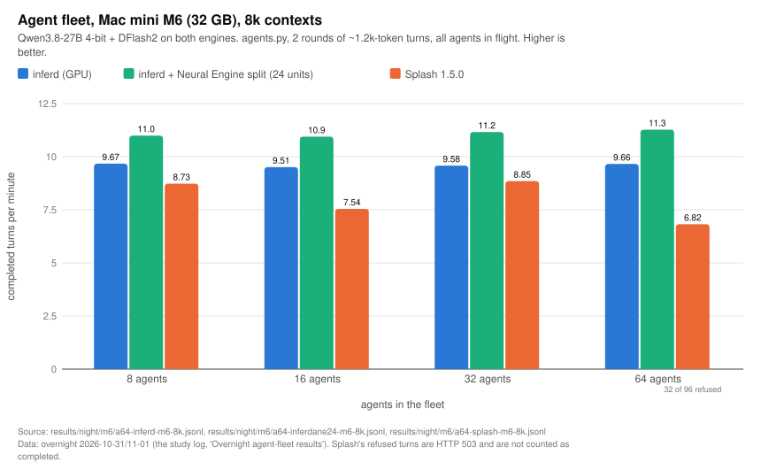

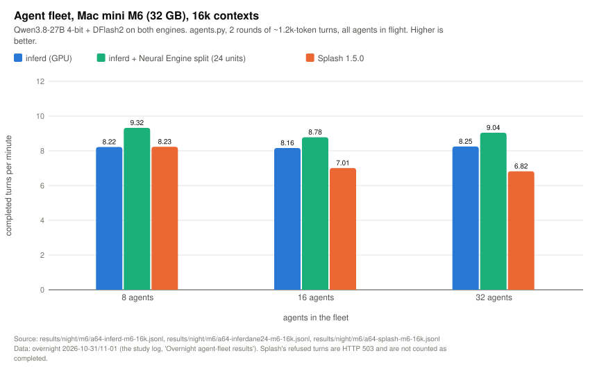

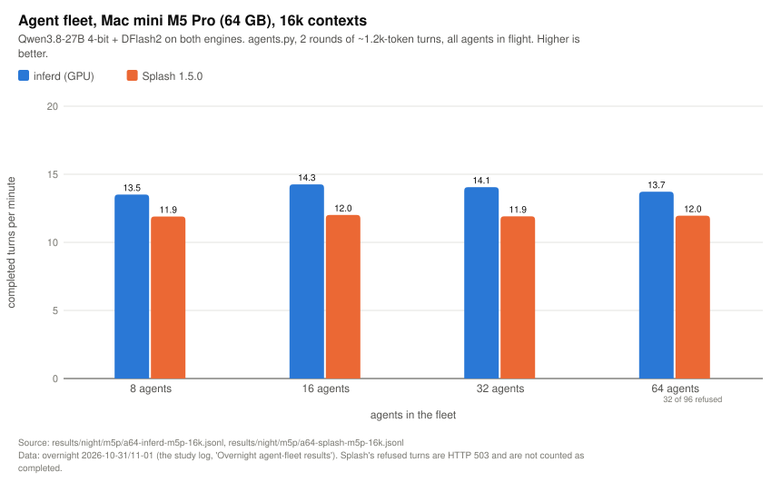

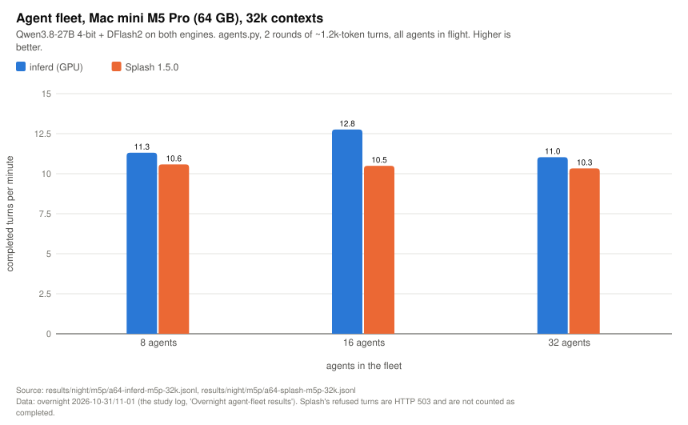

Completed turns per minute (higher is better):

| Machine, context | Engine | 8 agents | 16 | 32 | 64 | Raw |
|---|---|---:|---:|---:|---:|---|
| M6, 8k | inferd (GPU) | 9.67 | 9.51 | 9.58 | 9.66 | [raw](../results/night/m6/a64-inferd-m6-8k.jsonl) |
| M6, 8k | inferd + Neural Engine | **10.99** | **10.94** | **11.16** | **11.27** | [raw](../results/night/m6/a64-inferdane24-m6-8k.jsonl) |
| M6, 8k | Splash 1.5.0 | 8.73 | 7.54 | 8.85 | 6.82 ¹ | [raw](../results/night/m6/a64-splash-m6-8k.jsonl) |
| M6, 16k | inferd (GPU) | 8.22 | 8.16 | 8.25 | not run | [raw](../results/night/m6/a64-inferd-m6-16k.jsonl) |
| M6, 16k | inferd + Neural Engine | **9.32** | **8.78** | **9.04** | not run | [raw](../results/night/m6/a64-inferdane24-m6-16k.jsonl) |
| M6, 16k | Splash 1.5.0 | 8.23 | 7.01 | 6.82 | not run | [raw](../results/night/m6/a64-splash-m6-16k.jsonl) |
| M5 Pro, 16k | inferd (GPU) | **13.51** | **14.26** | **14.05** | **13.72** | [raw](../results/night/m5p/a64-inferd-m5p-16k.jsonl) |
| M5 Pro, 16k | Splash 1.5.0 | 11.90 | 12.01 | 11.91 | 11.96 ¹ | [raw](../results/night/m5p/a64-splash-m5p-16k.jsonl) |
| M5 Pro, 32k | inferd (GPU) | **11.31** | **12.76** | **11.03** | not run | [raw](../results/night/m5p/a64-inferd-m5p-32k.jsonl) |
| M5 Pro, 32k | Splash 1.5.0 | 10.58 | 10.49 | 10.33 | not run | [raw](../results/night/m5p/a64-splash-m5p-32k.jsonl) |

¹ **Splash refused requests at 64 agents.** In both 64-agent cells Splash answered 32 of the first-round requests
with HTTP 503 (its request queue was full); those agents stopped, so the cell completed 64 of 96 attempted turns (32
agents × 2 rounds) against inferd's 128 of 128. Its turns-per-minute figure counts only the turns it served, so it
flatters Splash: it did half the work.

inferd's lead over Splash, by cell:

| Machine, context | 8 agents | 16 | 32 | 64 |
|---|---:|---:|---:|---:|
| M6, 8k, inferd + Neural Engine | +26% | +45% | +26% | +65% (Splash served half the fleet) |
| M6, 8k, inferd GPU only | +11% | +26% | +8% | +42% (same caveat) |
| M6, 16k, inferd + Neural Engine | +13% | +25% | +33% | – |
| M6, 16k, inferd GPU only | 0% | +16% | +21% | – |
| M5 Pro, 16k | +14% | +19% | +18% | +15% (same caveat) |
| M5 Pro, 32k | +7% | +22% | +7% | – |

### (a2) Cell detail

TTFT and turn latency are medians over the cell's turns. "New tok/turn" = uncached prompt tokens per completed turn;
"gen tok/turn" = generated tokens per completed turn. Both engines generate about the same reply length on these
identical weights (110–167 tokens a turn), so turns per minute is a fair comparison within this night's runs.

| Machine | Engine (raw) | Agents | Turns/min | OK/attempted | TTFT p50 s | Turn p50 s | Gen tok/s | New tok/turn | Gen tok/turn | Cache hit | Wall s |
|---|---|---:|---:|---:|---:|---:|---:|---:|---:|---:|---:|
| M6 8k | [inferd](../results/night/m6/a64-inferd-m6-8k.jsonl) | 8 | 9.67 | 16/16 | 12.2 | 44.7 | 18.2 | 1,211 | 113 | 0.878 | 99 |
| M6 8k | inferd | 16 | 9.51 | 32/32 | 58.3 | 93.7 | 19.0 | 1,215 | 120 | 0.878 | 202 |
| M6 8k | inferd | 32 | 9.58 | 64/64 | 153.8 | 188.5 | 19.0 | 1,215 | 119 | 0.878 | 401 |
| M6 8k | inferd | 64 | 9.66 | 128/128 | 348.0 | 383.2 | 18.9 | 1,214 | 117 | 0.878 | 795 |
| M6 8k | [inferd + NE](../results/night/m6/a64-inferdane24-m6-8k.jsonl) | 8 | 10.99 | 16/16 | 13.3 | 41.7 | 22.2 | 1,217 | 121 | 0.878 | 87 |
| M6 8k | inferd + NE | 16 | 10.94 | 32/32 | 51.2 | 80.7 | 21.5 | 1,217 | 118 | 0.878 | 176 |
| M6 8k | inferd + NE | 32 | 11.16 | 64/64 | 131.3 | 162.9 | 22.0 | 1,214 | 118 | 0.878 | 344 |
| M6 8k | inferd + NE | 64 | 11.27 | 128/128 | 298.2 | 326.2 | 22.0 | 1,214 | 117 | 0.878 | 682 |
| M6 8k | [Splash](../results/night/m6/a64-splash-m6-8k.jsonl) | 8 | 8.73 | 16/16 | 39.6 | 49.5 | 16.8 | 1,204 | 115 | 0.879 | 110 |
| M6 8k | Splash | 16 | 7.54 | 32/32 | 99.5 | 106.9 | 15.1 | 1,209 | 120 | 0.878 | 255 |
| M6 8k | Splash | 32 | 8.85 | 64/64 | 183.5 | 197.6 | 17.5 | 1,207 | 119 | 0.879 | 434 |
| M6 8k | Splash | 64 | 6.82 | 64/96 (32 × HTTP 503) | 253.9 | 261.7 | 13.9 | 1,209 | 122 | 0.878 | 563 |
| M6 16k | [inferd](../results/night/m6/a64-inferd-m6-16k.jsonl) | 8 | 8.22 | 16/16 | 23.4 | 47.5 | 15.9 | 1,213 | 116 | 0.933 | 117 |
| M6 16k | inferd | 16 | 8.16 | 32/32 | 72.5 | 102.4 | 17.6 | 1,218 | 129 | 0.933 | 235 |
| M6 16k | inferd | 32 | 8.25 | 64/64 | 182.5 | 210.2 | 17.1 | 1,217 | 124 | 0.933 | 465 |
| M6 16k | [inferd + NE](../results/night/m6/a64-inferdane24-m6-16k.jsonl) | 8 | 9.32 | 16/16 | 24.5 | 42.3 | 18.5 | 1,213 | 119 | 0.933 | 103 |
| M6 16k | inferd + NE | 16 | 8.78 | 32/32 | 74.9 | 93.7 | 21.6 | 1,223 | 148 | 0.933 | 219 |
| M6 16k | inferd + NE | 32 | 9.04 | 64/64 | 179.6 | 197.7 | 21.4 | 1,224 | 142 | 0.933 | 425 |
| M6 16k | [Splash](../results/night/m6/a64-splash-m6-16k.jsonl) | 8 | 8.23 | 16/16 | 40.9 | 48.9 | 15.1 | 1,212 | 110 | 0.933 | 117 |
| M6 16k | Splash | 16 | 7.01 | 32/32 | 117.3 | 124.4 | 13.9 | 1,217 | 119 | 0.933 | 274 |
| M6 16k | Splash | 32 | 6.82 | 64/64 | 240.2 | 249.8 | 13.7 | 1,218 | 121 | 0.933 | 563 |
| M5 Pro 16k | [inferd](../results/night/m5p/a64-inferd-m5p-16k.jsonl) | 8 | 13.51 | 16/16 | 10.6 | 32.3 | 30.3 | 1,224 | 134 | 0.933 | 71 |
| M5 Pro 16k | inferd | 16 | 14.26 | 32/32 | 17.6 | 60.9 | 30.1 | 1,215 | 127 | 0.933 | 135 |
| M5 Pro 16k | inferd | 32 | 14.05 | 64/64 | 20.7 | 119.9 | 32.6 | 1,225 | 139 | 0.933 | 273 |
| M5 Pro 16k | inferd | 64 | 13.72 | 128/128 | 149.8 | 243.4 | 30.4 | 1,224 | 133 | 0.933 | 560 |
| M5 Pro 16k | [Splash](../results/night/m5p/a64-splash-m5p-16k.jsonl) | 8 | 11.90 | 16/16 | 28.2 | 36.1 | 24.2 | 1,211 | 122 | 0.933 | 81 |
| M5 Pro 16k | Splash | 16 | 12.01 | 32/32 | 64.0 | 69.1 | 27.5 | 1,221 | 137 | 0.933 | 160 |
| M5 Pro 16k | Splash | 32 | 11.91 | 64/64 | 126.7 | 133.9 | 29.2 | 1,226 | 147 | 0.932 | 322 |
| M5 Pro 16k | Splash | 64 | 11.96 | 64/96 (32 × HTTP 503) | 124.8 | 132.8 | 28.3 | 1,228 | 142 | 0.932 | 321 |
| M5 Pro 32k | [inferd](../results/night/m5p/a64-inferd-m5p-32k.jsonl) | 8 | 11.31 | 16/16 | 12.8 | 36.3 | 31.5 | 1,252 | 167 | 0.964 | 85 |
| M5 Pro 32k | inferd | 16 | 12.76 | 32/32 | 20.1 | 73.5 | 24.7 | 1,226 | 116 | 0.965 | 150 |
| M5 Pro 32k | inferd | 32 | 11.03 | 64/64 | 65.5 | 149.2 | 27.1 | 1,241 | 147 | 0.964 | 348 |
| M5 Pro 32k | [Splash](../results/night/m5p/a64-splash-m5p-32k.jsonl) | 8 | 10.58 | 16/16 | 31.9 | 36.2 | 23.3 | 1,208 | 132 | 0.965 | 91 |
| M5 Pro 32k | Splash | 16 | 10.49 | 32/32 | 70.4 | 76.8 | 24.3 | 1,212 | 139 | 0.965 | 183 |
| M5 Pro 32k | Splash | 32 | 10.33 | 64/64 | 149.9 | 161.7 | 22.9 | 1,210 | 133 | 0.965 | 372 |

Reading the latencies: inferd's median TTFT is lower than Splash's at every size (it admits every agent it has memory
for and decodes them together), while Splash's turn latency is close to its TTFT (a request waits, then decodes fast
on one of a few lanes). With 64 agents on a 32 GB M6 both engines take over 5 minutes per turn: the fleet is simply
larger than the machine.

### (a3) Side runs from the same night

| Run | Result | Raw |
|---|---|---|
| M5 Pro 16k, drafter vocabulary cut off (`DRAFT_VOCAB=0`) vs on | 12.95 / 14.04 / 14.36 turns/min at 8 / 16 / 32 agents vs 13.51 / 14.26 / 14.05: inside run-to-run noise | [raw](../results/night/m5p/a64-inferdnocut-m5p-16k.jsonl) |
| M6 8k, Neural Engine split only for steps of ≥ 1,024 rows (8 agents) | 10.88 turns/min (GPU alone 9.67). The split for steps of ≥ 512 rows gave 6.42 (the study log, "Split only for big steps"); its raw row is not in this repo | [raw](../results/night/m6/a64-inferdane24min1024-m6-8k.jsonl) |
| M6 8k, label `inferdres` | **Failed run**: all 8 turns returned no content (prompt counted, 0 completion tokens). Not described in the study log; excluded from every table | [raw](../results/night/m6/a64-inferdres-m6-8k.jsonl) |

### (a3b) The Neural Engine prefill sweep behind the M6 split

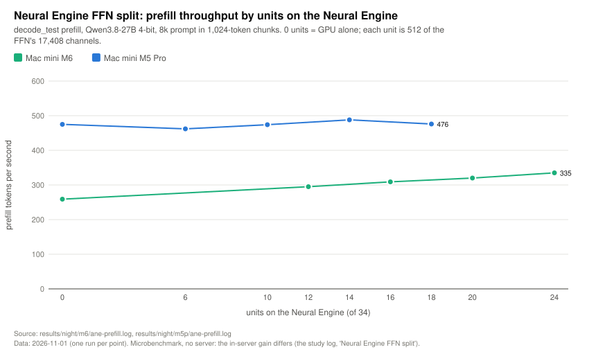

`decode_test prefill`, 8k prompt in 1,024-token chunks, no server, by the number of 512-channel FFN units (of 34) on
the Neural Engine (`aneprefill.sh` (lab script, not published), 1 Nov, one run per point):

| Units on the Neural Engine | 0 (GPU alone) | 6 | 10 | 12 | 14 | 16 | 18 | 20 | 24 | Raw |
|---|---:|---:|---:|---:|---:|---:|---:|---:|---:|---|
| Mac mini M6, prefill tok/s | 259 | – | – | 295 | – | 309 | – | 320 | **335** (+29%) | [raw](../results/night/m6/ane-prefill.log) |
| Mac mini M5 Pro, prefill tok/s | 475 | 462 | 474 | – | **488** (+3%) | – | 476 | – | – | [raw](../results/night/m5p/ane-prefill.log) |

The M6 curve was still rising at 24 units (the largest tried). In the server the split shortened the M6's 8k fleet
prime from 31.2 to 25.5 s (+23%) once a residency set kept the GPU's memory wired; the M5 Pro's +3% was too small to
pursue, so its fleets ran on the GPU alone. See [MACHINES.md](MACHINES.md) for why the two machines differ.

### (a4) How the mini fleets got here (earlier builds, 16k, cells N:K)

These cells come from the study log only (their raw files stayed on the minis and are not in this repo). They used
the earlier 5-cell layout (4:4, 8:8, 8:4, 16:16, 16:4) and 3 rounds, so they are not comparable with (a1). Splash
references in brackets are from an earlier Splash run on the same box.

| Build (date) | M5 Pro 4:4 / 8:8 / 8:4 / 16:16 / 16:4 | M6 4:4 / 8:8 / 8:4 / 16:16 / 16:4 | Source |
|---|---|---|---|
| no SSD tier (30 Oct) | 13.2 / 10.9 / – / 2.3 (16 agents) | 5.2 / 0.85 / – / 0.79 | the study log, "attn_mpp" section |
| v3, SSD tier (30 Oct) | 12.6 / 13.1 / 13.5 / **5.3** / 11.8 (Splash 14.4 / 15.5 / 14.5 / 14.4 / 14.6) | 7.0 / 5.7 / 5.5 / 6.8 / 6.5 (Splash 8.8 / 8.5 / 9.4 / 8.9 / 9.1) | the study log, "Agent fleets (2026-10-30 evening)" |
| v6, final fixes (31 Oct) | 14.32 / 13.92 / 13.35 / **14.23** / 12.99 | 8.7 / 7.7 / 7.59 / 7.97 / 7.73 | the study log, "Mac minis, final build" |

The 16:16 cliffs were fixed by three changes: spilling snapshots from inner trie nodes, not evicting the snapshot just
restored, and KV-budget admission (the study log, the three "Diagnosed" sections of 30–31 Oct). Across builds compare
generated tok/s, not turns per minute: 8-bit attention changed the greedy text and its length (the study log, "Minis on the
head-plane build").

---

## (b) Mac Studio M5 Ultra vs other engines

**Engines on the Studio** (Mac Studio M5 Ultra, 80-core GPU, 256 GB), all Qwen3.8-27B 4-bit + DFlash2, same harness,
one engine at a time:

| Engine | Version | Notes |
|---|---|---|
| inferd | builds of 30 Oct – 1 Nov (labelled below) | bf16 KV until 31 Oct, 8-bit KV since |
| Splash | 1.5.0 | Serves ~4–8 agents at a time and queues the rest; INT8 KV by default |
| Kapitsa | 0.2.24 | Stopped where it had already collapsed |
| mlx-serve | 26.10.2 | Stopped where it had already collapsed |

**inferd builds in the tables:** `inferd10` = the 31 Oct milestone (8-bit KV, reworked verify attention, self-tuning
draft block); "0.1.0 re-run" = cells re-run on the 0.1.0 release build (31 Oct evening: KV blocks in aligned groups,
two attention threadgroups per core for one long sequence) on a server that had already run other fleets, from
[inferd11](../results/cmp/inferd11-agents.jsonl) and [inferd12](../results/cmp/inferd12-agents.jsonl);
`inferd14` = the full sweep of 1 Nov 02:24–05:20 on the current dev build (drafter vocabulary cut off, `lane4` off).

### (b1) Agents on the Studio (conc.py follow-ups)

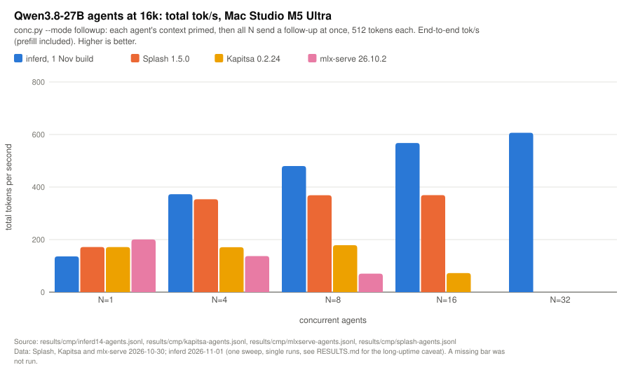

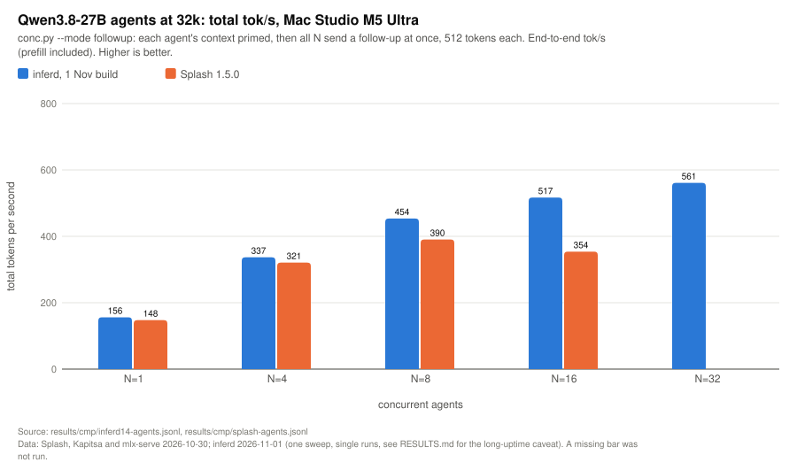

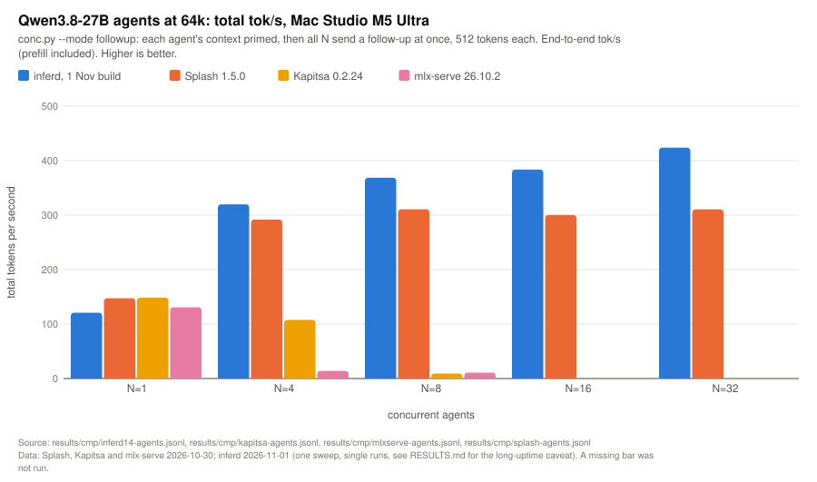

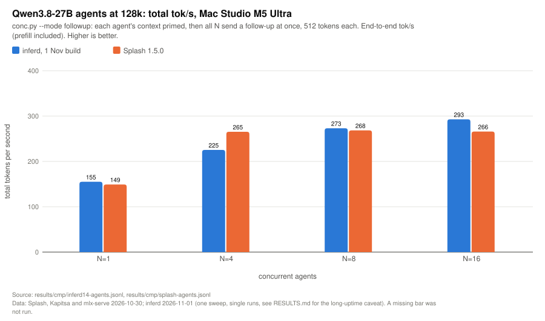

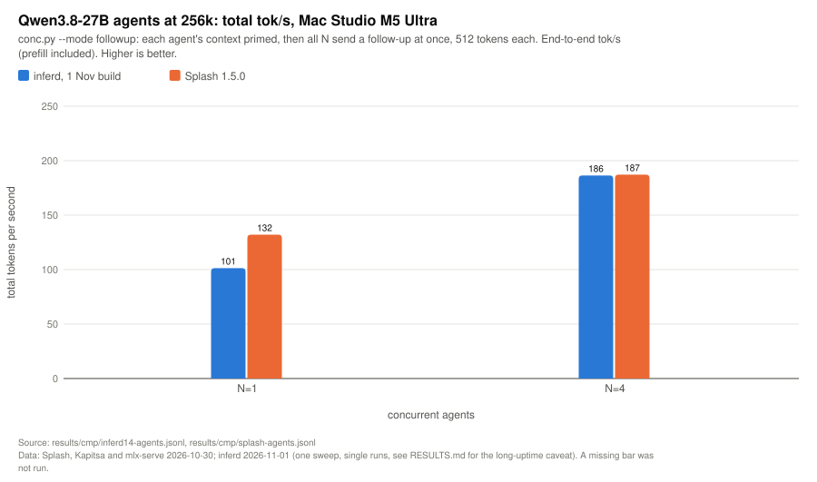

**Total tok/s** (end to end, 512 tokens per agent). Bold = best Studio engine in the row. A dash means not run.

| Ctx | N | inferd10 (31 Oct) | 0.1.0 re-run | inferd14 (1 Nov) | Splash 1.5.0 | Kapitsa 0.2.24 | mlx-serve 26.10.2 |
|---|---:|---:|---:|---:|---:|---:|---:|
| 16k | 1 | 147 | 142 | 136 | 172 | 172 | **200** |
| 16k | 4 | 366 | – | **373** | 354 | 171 | 137 |
| 16k | 8 | **485** | – | 480 | 369 | 179 | 70.5 |
| 16k | 16 | 563 | – | **568** | 369 | 72.6 | – |
| 16k | 32 | 599 | 603 | **607** | – | – | – |
| 32k | 1 | 150 | – | **156** | 148 | – | – |
| 32k | 4 | **405** | – | 337 | 321 | – | – |
| 32k | 8 | **465** | – | 454 | 390 | – | – |
| 32k | 16 | 504 | **518** | 517 | 354 | – | – |
| 32k | 32 | 549 | – | **561** | – | – | – |
| 64k | 1 | 139 | 146 | 121 | 147 | **148** | 131 |
| 64k | 4 | **323** | – | 320 | 292 | 108 | 14.0 |
| 64k | 8 | 362 | – | **369** | 311 | 9.2 | 10.9 |
| 64k | 16 | **390** | – | 384 | 300 | – | – |
| 64k | 32 | **430** | – | 424 | 311 | – | – |
| 128k | 1 | 146 | – | **155** | 149 | – | – |
| 128k | 4 | 241 | **270** | 225 | 265 | – | – |
| 128k | 8 | 265 | **291** | 273 | 268 | – | – |
| 128k | 16 | 292 | – | **293** | 266 | – | – |
| 256k | 1 | 95.3 | 111 ⁴ | 101 | **132** | – | – |
| 256k | 4 | **190** | – | 186 | 187 | – | – |
| 256k | 8 | 187 | – | – | – | – | – |

⁴ inferd12; the same build's other 256k × 1 run gave 102 ([inferd11](../results/cmp/inferd11-agents.jsonl)).

Raw: [inferd10](../results/cmp/inferd10-agents.jsonl), [inferd11](../results/cmp/inferd11-agents.jsonl),
[inferd12](../results/cmp/inferd12-agents.jsonl), [inferd14](../results/cmp/inferd14-agents.jsonl),
[Splash](../results/cmp/splash-agents.jsonl), [Kapitsa](../results/cmp/kapitsa-agents.jsonl),
[mlx-serve](../results/cmp/mlxserve-agents.jsonl).
Dates: Splash/Kapitsa/mlx-serve 30 Oct 2026 (01:34–11:11 CET); inferd10 31 Oct 13:10–17:00; inferd11/12 31 Oct
20:14–21:07; inferd14 1 Nov 02:24–05:20.

**Worst time to first token (s)** for the same cells:

| Ctx | N | inferd10 | inferd14 | Splash | Kapitsa | mlx-serve |
|---|---:|---:|---:|---:|---:|---:|
| 16k | 8 | 0.7 | 0.7 | 6.4 | 1.2 | 43.1 |
| 16k | 16 | 1.3 | 1.3 | 17.2 | 73.6 | – |
| 16k | 32 | 2.6 | 2.7 | – | – | – |
| 32k | 16 | 1.7 | 1.7 | 18.1 | – | – |
| 64k | 8 | 1.0 | 1.0 | 8.0 | 396 | 372 |
| 64k | 16 | 2.3 | 2.3 | 22.2 | – | – |
| 64k | 32 | 4.4 | 4.8 | 48.9 | – | – |
| 128k | 16 | 3.5 | 3.6 | 25.0 | – | – |

**Last agent done (s)**, the wall time of the cell:

| Ctx × N | inferd10 | inferd14 | Splash |
|---|---:|---:|---:|
| 16k × 16 | 14.6 | 14.4 | 22.2 |
| 32k × 16 | 16.2 | 15.8 | 23.1 |
| 64k × 16 | 21.0 | 21.4 | 27.3 |
| 64k × 32 | 38.1 | 38.6 | 52.7 |
| 128k × 8 | 15.5 | 15.0 | 15.3 |
| 128k × 16 | 28.1 | 28.0 | 30.8 |
| 256k × 4 | 10.8 | 11.0 | 10.9 |

Why the shapes differ: Splash's multi-agent cells have `overlap` 0 from 8 agents up (it runs a few agents at full
speed, ~70–110 tok/s each, and queues the rest), so its total flattens at ~265–390 tok/s while worst TTFT grows to
17–49 s. inferd decodes every admitted agent in the same step; per-agent speed falls (21 tok/s each at 16k × 32) but
total throughput keeps rising and TTFT stays at 1–5 s. Kapitsa and mlx-serve collapse by 8–16 agents (re-prefill,
cache eviction or one-at-a-time service).

**Long-uptime slowdown.** The 128k × 4 cell measured 241 (milestone), 270 (0.1.0), 225 (inferd14, at the end of a
21-cell sweep) and 256 / 249 on a freshly started server
([inferd14r](../results/studio/cmp/inferd14r-agents.jsonl)). The KV-page fragmentation fix (aligned groups of 4)
recovered most of it on 31 Oct (`decode_test` with scattered pages: +10–14% per step at 128k–256k), but some slowdown
after hours of runs remains, cause not yet found (the study log, "Overnight agent-fleet results").

### (b2) inferd's own progression on the Studio (16k and 64k, total tok/s)

| Build (date) | 16k × 1 / 8 / 16 / 32 | 64k × 1 / 8 / 32 | Raw |
|---|---|---|---|
| inferd, before the drafter fix (30 Oct 04:02) | 110 / 372 / 467 / 521 | 90.4 / 259 / 324 | [raw](../results/cmp/inferd-agents.jsonl) |
| inferd2, 16-row W4A8 tiles, tile-aware block (30 Oct 06:28) | 110 / 405 / 487 / 536 | – | [raw](../results/cmp/inferd2-agents.jsonl) |
| inferd3, after block-8 fix, evening (30 Oct 15:46) | 135 / 451 / 515 / 506 | 116 / 289 / – | [raw](../results/cmp/inferd3-agents.jsonl) |
| inferd10, milestone (31 Oct 13:10) | 147 / 485 / 563 / 599 | 139 / 362 / 430 | [raw](../results/cmp/inferd10-agents.jsonl) |
| inferd14, current (1 Nov 02:24) | 136 / 480 / 568 / 607 | 121 / 369 / 424 | [raw](../results/cmp/inferd14-agents.jsonl) |

Targeted A/B runs (smoke, single cells):

| A/B | Result (total tok/s) | Raw |
|---|---|---|
| 128k × 8 follow-ups, bf16 KV vs 8-bit KV (31 Oct morning) | 220 (last done 18.6 s) vs 239 (17.1 s); Splash 268 (15.3 s) | [bf16](../results/cmp/inferd7-agents.jsonl), [KV8](../results/cmp/inferd7kv8-agents.jsonl) |
| Self-tuning draft block off vs on (31 Oct) | 32k × 8: 449 vs 447; 32k × 16: 519 vs 512; 128k × 8: 263 vs **289** | [off](../results/cmp/inferd8-auto0-agents.jsonl), [on](../results/cmp/inferd8-auto1-agents.jsonl) |
| KV allocator after a full pool (30 Oct night) | 64k × 4 273, × 8 310; 128k × 4 228 (fragmented pool before the fix, [inferd4](../results/cmp/inferd4-agents.jsonl): 241, 262 and 208) | [raw](../results/cmp/inferd5-agents.jsonl) |
| `lane4` kernel off vs on (1 Nov) | 16k × 1 147 vs 125; 16k × 8 489 vs 488; 64k × 1 166 vs 129; 128k × 1 151 vs 107 | [off](../results/studio/cmp/inferd13n-agents.jsonl), [on](../results/studio/cmp/inferd13-agents.jsonl) |
| Drafter vocabulary cut off vs on (1 Nov) | 16k × 1 150.5 vs 143.0; 64k × 1 156.6 vs 144.7; 16k × 8 474.6 vs 477.7 | [off](../results/studio/cmp/inferd14v0-agents.jsonl), [on](../results/studio/cmp/inferd14v98304-agents.jsonl) |

### (b3) Single-stream sweep (speed.py)

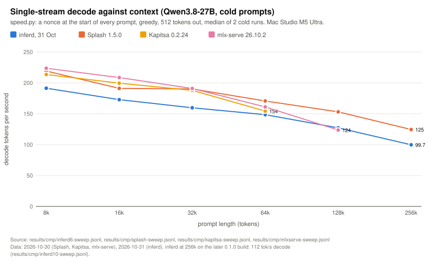

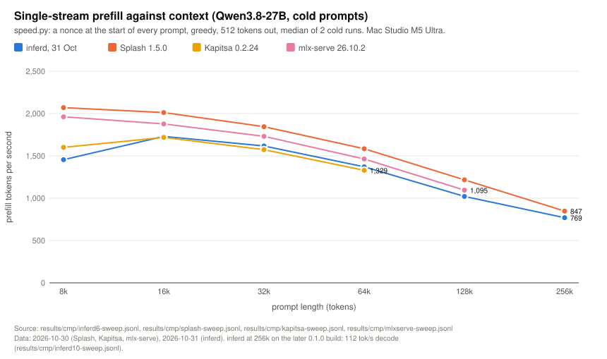

Median of 2 cold runs, 512 tokens out. Decode tok/s / prefill tok/s / TTFT s:

| Prompt | inferd (31 Oct, inferd6) | inferd (30 Oct, before the drafter fix) | Splash 1.5.0 | Kapitsa 0.2.24 | mlx-serve 26.10.2 |
|---|---|---|---|---|---|
| 8k | 191 / 1,455 / 5.9 | 118 / 1,778 / 4.6 | 219 / 2,070 / 4.0 | 214 / 1,601 / 5.1 | **224 / 1,962 / 4.2** |
| 16k | 173 / 1,730 / 9.5 | 114 / 1,728 / 9.5 | 191 / **2,012** / 8.1 | 200 / 1,718 / 9.5 | **209** / 1,878 / 8.7 |
| 32k | 160 / 1,616 / 20.3 | 106 / 1,612 / 20.3 | 190 / **1,845** / 17.8 | 188 / 1,573 / 20.8 | **191** / 1,731 / 18.9 |
| 64k | 149 / 1,371 / 47.9 | 95 / 1,414 / 46.4 | **171 / 1,584 / 41.4** | 154 / 1,329 / 49.4 | 161 / 1,463 / 44.9 |
| 128k | 127 / 1,021 / 129 | 78 / 1,144 / 116 | **153 / 1,217 / 109** | – | 124 / 1,095 / 121 |
| 256k | 100 / 769 / 329 (0.1.0 build: 112 / 767 / 330) | 67 / 844 / 300 | **125 / 847 / 298** | – | – |

Raw: [inferd6](../results/cmp/inferd6-sweep.jsonl), [inferd10 256k](../results/cmp/inferd10-sweep.jsonl),
[inferd 30 Oct](../results/cmp/inferd-sweep.jsonl), [Splash](../results/cmp/splash-sweep.jsonl),
[Kapitsa](../results/cmp/kapitsa-sweep.jsonl), [mlx-serve](../results/cmp/mlxserve-sweep.jsonl).
Not used: [inferd9-sweep](../results/studio/cmp/inferd9-sweep.jsonl) (31 Oct, invalid: the QMST drafter bug; the copy
in `results/cmp/` is renamed `.invalid-qmst-bug`).

Single-stream decode is 10–20% behind Splash at every length, with the same fall-off. Prefill trails Splash by 9–16%
from 16k to 256k and by about 30% at 8k; inferd's prefill at 8k and 128k is also lower on 31 Oct than on 30 Oct (1,455
vs 1,778 at 8k; 1,021 vs 1,144 at 128k), a regression noted but not yet explained (the study log, "2026-10-31 morning").

### (b5) Shared-prefix fleets (Studio)

N agents on one shared document (nonce per run): a fan-out (all first turns at once), then 2 rounds of ~1k-token
turns. [raw](../results/studio/shared.jsonl), 30 Oct.

| Cell | Engine | Fan-out wall s | Fan-out cached tokens | Turns/min | Turn TTFT median s |
|---|---|---:|---:|---:|---:|
| 32k × 8 | inferd, before fan-out sharing | 188.8 | 0 of 283k | 37.0 | 2.37 |
| 32k × 8 | inferd, fan-out sharing | 24.6 | 247k of 283k | **37.8** | **2.44** |
| 32k × 8 | Splash 1.5.0 | **22.9** | 247k of 283k | 33.8 | 6.15 |
| 64k × 16 | inferd, fan-out sharing | 59.3 | 1.07M of 1.14M | 26.8 | **5.36** |
| 64k × 16 | inferd, cascade attention on / off | 59.3 / 59.4 | 1.07M | 27.4 / 30.8 | 5.83 / 4.21 |
| 64k × 16 | Splash 1.5.0 | **53.8** | 1.07M of 1.14M | 26.1 | 27.5 |

Cascade attention was correct but slower in step timings, and is off by default (the study log, "Agent fleets (2026-10-30
evening)").

### (b6) Memory on the Studio

Peak wired memory while each engine ran the head-to-head, from the 2 s samples:

| Engine | Peak wired GiB | Raw | Note |
|---|---:|---|---|
| inferd (30 Oct) | 198.1 | [raw](../results/cmp/inferd-mem.tsv) | Mostly a pre-allocated 140 GiB KV pool (bf16 at the time: ~2.2–2.3M tokens; 8-bit KV since 31 Oct: ~4.5M) |
| Splash 1.5.0 | 211.4 | [raw](../results/cmp/splash-mem.tsv) | the study log and the 30 Oct report say 224; the raw file's maximum is 211.4 (see caveats) |
| Kapitsa 0.2.24 | 56.9 | [raw](../results/cmp/kapitsa-mem.tsv) | Runs out of concurrency rather than memory |
| mlx-serve 26.10.2 | 67.6 | [raw](../results/cmp/mlxserve-mem.tsv) | Same |

### (b7) Earlier baselines (other studies, context only)

The study started from numbers measured in earlier, separate studies on the same Studio (the study log,
"Starting point"). Their raw data is not in this repo and the harness settings differ, so they are context only:

| Model | Machine, engine | 1 stream tok/s | Best multi-user total | How it fails |
|---|---|---:|---:|---|
| 27B 4-bit | Studio, Splash + DFlash2 (older version) | 200 | 404 at N=4 and N=16 | batches ~4 and queues the rest |
| 27B 4-bit | Studio, mlx-serve | 77 | 412 at N=16 | DFlash turns itself off under load |
| Flash-Next 4-bit | Studio, oMLX, MTP off | 155–170 (MTP on) | 269 (16 × 16k follow-ups) | memory guard at 16 × 64k; MTPLX cannot batch |

---

## (c) The mlx.fast competition figures (third party)

The mlx.fast challenge is a public competition run around the TensorFold engine's
Qwen3.8-27B track. **The leaderboard figures below are the organisers' published numbers, not ours**, copied into
the study log and the comparison report on the dates shown; we did not re-measure them.

Scored regime (as published): batch 1, a ~1,065-token "longcopy" prompt given as raw token ids, 128 decode steps after
a seed window, score = (decode gain)^0.75 × (prefill gain)^0.25 against a live TensorFold control, on an M5 Max.

| Track (published leaderboard, 2026-10-31) | Hardware | Baseline decode | Leader decode | Leader prefill | Leader score |
|---|---|---:|---:|---:|---:|
| mlx.fast | M5 Max | 30.5 tok/s | 59.2 tok/s | 1,140 tok/s | +56.3% |

On 2026-11-01 the organisers' list of 28 promoted mlx.fast entries showed scores from 1.233 to 1.669 (the study log,
"Lessons from the mlx.fast competition"). That is a later snapshot than the table, which is why its top score is
higher than +56.3%.

**inferd on the same prompt (ours, not a competition entry).** The challenge's own prompt tokens and model pair
(TensorFold's Qwen3.8-27B MLX 4-bit, z-lab DFlash2) through inferd's socket with
[`bench/tfprompt.py`](../bench/tfprompt.py) on the MacBook Pro M5 Max, 3 runs, a random leading token per run so the
prefix cache cannot help ([raw](../results/cmp/tfprompt-m5max.jsonl), 31 Oct):

| Metric | Median | Range |
|---|---:|---|
| Decode over the first 128 tokens | 51.6 tok/s | 48.7–62.3 |
| Decode over 512 tokens | 85.9 tok/s | 84.2–93.5 |
| Prefill (1,066 tokens) | 955 tok/s | 771–956 |

This is not the challenge harness and its output was not checked against the challenge's correctness goldens, so it
is not comparable with the scores. For reference, the TensorFold baseline measured locally on the same M5 Max gave 61.8
tok/s decode (1,023-step window) and 1,115 prefill (the study log). The laptop numbers carry the M5 Max caveat in
[MACHINES.md](MACHINES.md) (often on battery, throttling).

What we took from reading the entries: one kernel layout (`lane4`, weights repacked into contiguous per-tile groups,
bf16 activations straight into the tensor units) made 3–16-row steps 12–15% faster on the M5 Max but was slower on the
M5 Ultra end to end (see (b2)); it is off by default.

---

## (d) Coding benchmark: languages-benchmark v1

The Incept5-AI languages-benchmark v1: 8 challenges × 6 languages = 48 tests, graded by the benchmark's own
`bench.py` (unmodified), run and graded on the Mac Studio M5 Ultra. Settings for every run: Qwen3.8-27B 4-bit, thinking
on, effort medium, 32k token cap, 32 tests in flight, the repo's Qwen sampling (temperature 0.6, top-p 0.95, top-k 20).
Raw: [results/code/](../results/code/).

| Run | Engine | Score /48 | Pass first try | Hit cap | Errors | Minutes | Total tok/s | Per-request tok/s (median) | Raw |
|---|---|---:|---:|---:|---:|---:|---:|---:|---|
| r1 | inferd 0.1.1 | 37.5 | 34 | 0 | 0 | 5.2 | 659 | 26.7 | [raw](../results/code/v1-v1-q27-inferd011-medium-32k-r1.json) |
| r2 | inferd 0.1.1 | 39.5 | 35 | 0 | 0 | 5.5 | 637 | 28.0 | [raw](../results/code/v1-v1-q27-inferd011-medium-32k-r2.json) |
| r3 | inferd 0.1.1 | 43.5 | 41 | 0 | 0 | 4.4 | 716 | 27.9 | [raw](../results/code/v1-v1-q27-inferd011-medium-32k-r3.json) |
| r1 | inferd 0.1.0 | 41.5 | 39 | 0 | 0 | 8.7 | 367 | 20.4 | [raw](../results/code/v1-v1-q27-inferd-medium-32k-r1.json) |
| r2 | inferd 0.1.0 | 45.5 | 45 | 0 | 0 | 9.2 | 326 | 20.4 | [raw](../results/code/v1-v1-q27-inferd-medium-32k-r2.json) |
| r3 | inferd 0.1.0 | 40.5 | 38 | 0 | 0 | 14.0 | 265 | 20.4 | [raw](../results/code/v1-v1-q27-inferd-medium-32k-r3.json) |
| r1 | inferd, **8-bit** weights, 16 in flight, 64k window | 43.5 | 41 | 0 | 0 | 6.7 | 480 | 42.4 | [raw](../results/code/v1-v1-q27-8bit-fn5-medium-32k-w64k-w16-r1.json) |
| r2 | inferd, **8-bit** weights, 16 in flight, 64k window | 44.0 | 42 | 0 | 0 | 4.8 | 558 | 41.7 | [raw](../results/code/v1-v1-q27-8bit-fn5-medium-32k-w64k-w16-r2.json) |
| r3 | inferd, **8-bit** weights, 16 in flight, 64k window | 43.0 | 39 | 0 | 0 | 6.6 | 472 | 38.2 | [raw](../results/code/v1-v1-q27-8bit-fn5-medium-32k-w64k-w16-r3.json) |
| b-r1 | inferd, **Qwen3.8-Flash-Next** oQ4e + MTP + QSA, 16 in flight, 64k window | 45.5 | 43 | 0 | 0 | 3.5 | 523 | 36.1 | [raw](../results/code/v1-v1-fn-oq4e-final-medium-32k-w16-b-r1.json) |
| b-r2 | inferd, **Qwen3.8-Flash-Next** oQ4e + MTP + QSA, 16 in flight, 64k window | 44.5 | 42 | 0 | 0 | 3.9 | 519 | 36.0 | [raw](../results/code/v1-v1-fn-oq4e-final-medium-32k-w16-b-r2.json) |
| r0 | inferd, **Qwen3.8-Flash-Next** oQ4e + MTP + QSA, 16 in flight, 64k window | 45.5 | 45 | 0 | 0 | 3.5 | 525 | 36.0 | [raw](../results/code/v1-v1-fn-oq4e-final-medium-32k-w16.json) |
| r1–r3 | Splash 1.3.2 (the benchmark repo's published runs, same settings, same Studio) | 41.5 / 43.0 / 41.5 | 39 / 40 / 38 | 0 | 0 | 6.6–6.8 | 499–506 | 129–131 | the benchmark repo ⁵ |

⁵ The Splash runs are the benchmark repository's published example files; they are not copied into this repo, so the
link is to the report that embeds them. In-flight count was not recorded for them.

| Engine | Mean score /48 (range) | Minutes per run |
|---|---|---|
| inferd 0.1.1 (speculative sampling) | 40.2 (37.5–43.5) | 4.4–5.5 |
| inferd 0.1.0 (sampled requests decoded without speculation) | 42.5 (40.5–45.5) | 8.7–14.0 |
| Splash 1.3.2 | 42.0 (41.5–43.0) | 6.6–6.8 |
| inferd, Qwen3.8-27B **8-bit** (1 Nov, fused build, 16 in flight) | **43.5** (43.0–44.0) | 4.8–6.7 |
| inferd, **Qwen3.8-Flash-Next** oQ4e (2 Nov final build, 16 in flight) | **45.2** (44.5–45.5) | 3.5–3.9 |

- **Quality.** The three ranges overlap and the run-to-run spread is about ±3 points, so three runs per engine cannot
  separate them. A distribution check of speculative sampling (400 samples, temperature 1, top-k 16) matched plain
  sampling within noise (the study log, "0.1.1: speculative sampling").
- **Speed.** 0.1.0 speculated only greedy requests, so this sampled benchmark ran at ~20 tok/s per request and a run
  ended with its longest tests decoding alone (slowest attempt 431–553 s). 0.1.1 drafts and verifies sampled requests
  with exact speculative sampling: runs take 4.4–5.5 minutes against Splash's ~6.7.
- **8-bit weights (1 Nov 2026).** mlx-community Qwen3.8-27B 8-bit, DFlash2, same settings except 16 tests in flight
  and a 64k server window (32k output cap). The highest mean so far and the tightest spread, but still within the ±3
  noise of the 4-bit runs. A first attempt with a 32k window lost 3–6 feedback rounds per run to "context too long"
  (prompt + answer + 31k cap > 32k) and is not quoted ([log](../results/studio/code48.log)).
- **v2 (120 tests), Qwen3.8-Flash-Next (2 Nov final build):** 62.0/120 at the 32k cap (48 tests capped, 0 errors,
  130 min, 16 in flight), **69.5/120** after re-running the 35 eligible capped tests at a 64k budget (9 still capped;
  [run](../results/code/v2-v2-fn-oq4e-final-medium-32k-w16.json),
  [re-run](../results/code/v2-v2-fn-oq4e-final-medium-32k-w16-rerun64k.json)). Qwen3.8-27B 4-bit on the M5 Pro (v2,
  32k cap): 30.5/120 with 88 tests capped, so the 27B needs the 64k re-run before it can be compared.
- **Not run:** the 120-test v2 suite on inferd ([log](../results/studio/code-v2.log) shows two starts and no result
  file). The three additional 0.1.1 v1 runs mentioned in the report are not in this repo.

---

**Same-day comparison behind the website's coding figure (2 November):** inferd default 43.7 (42.5 / 43.5 / 45.0) vs
Splash 1.5.0 41.8 (39.5 / 41.5 / 44.5), level within run-to-run noise; raw result files and the ablation arms:
[results/quality-2026-11-02/](../results/quality-2026-11-02/README.md).

## (e) Other models

Smoke ports, **not tuned, no drafters** (speculation off), all matching mlx_lm's logits (top-1 agreement, cosine ≥
0.9997). Same `Qwen35` model class with per-family attention shapes. Harness: `models_smoke.sh` (lab script, not published)
on the minis (speed.py 1 rep per size, conc.py follow-ups at 32k × 1 / 8 / 16, 512 tokens); on the Studio speed.py had
2 reps. All 1 Nov 2026.

| Model | Checkpoint type | Notes |
|---|---|---|
| Qwen3.5-9B | same hybrid (GDN + gated attention) as the 27B | GQ 4; the NAX verify-attention kernels are GQ 6 only, so they are off |
| Qwen3.6-35B-A3B | MoE (`qwen3_5_moe`), top-8 + shared expert | Per-row expert GEMV below 128 routed rows, sorted gather GEMM above |
| Muse Glimmer 30B | sliding window 2,048, NoPE global layers, softcap 20 | — |
| Gemma-4-31B | sliding + global layers (Dh 256 / 512), softcap 30 | **bf16 KV only** (8-bit KV breaks it: KL 1.96 on a repetition prompt); ~900 KB of KV per token, so few agents fit |

### (e1) Mac Studio M5 Ultra

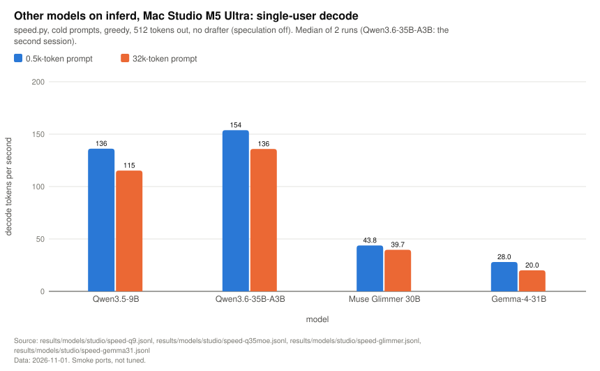

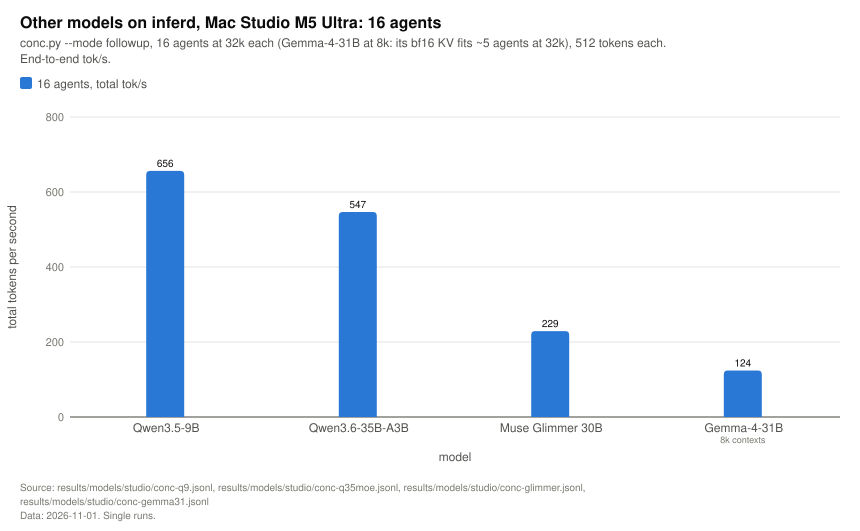

| Model | Decode tok/s, 0.5k / 32k | Prefill tok/s, 4k / 32k | 32k agents ×1 / ×8 / ×16, total tok/s | ×16 per stream | ×16 TTFT median | Raw |
|---|---|---|---|---:|---:|---|
| Qwen3.5-9B | 136 / 115 | 5,877 / 5,216 | 117 / 480 / 656 | 45 | 1.2 s | [speed](../results/models/studio/speed-q9.jsonl), [agents](../results/models/studio/conc-q9.jsonl) |
| Qwen3.6-35B-A3B | 154 / 136 | 7,163 / 6,858 ⁶ | 138 / 414 / 547 | 38 | 1.5 s | [speed](../results/models/studio/speed-q35moe.jsonl), [agents](../results/models/studio/conc-q35moe.jsonl) |
| Muse Glimmer 30B | 44 / 40 | 1,852 / 1,874 | 39 / 155 / 229 | 16 | 4.2 s | [speed](../results/models/studio/speed-glimmer.jsonl), [agents](../results/models/studio/conc-glimmer.jsonl) |
| Gemma-4-31B (bf16 KV) | 28 / 20 | 1,493 / 1,155 | 18 / 37 (×4) / – ; 8k × 16: 124 | 9.4 (8k) | 11.8 s (8k) | [speed](../results/models/studio/speed-gemma31.jsonl), [agents](../results/models/studio/conc-gemma31.jsonl) |

Agent rows use the final run of each model in the file (`q9-fix`, `q35moe-fix`, `glimmer-fix`; Gemma's only run).
⁶ The Qwen3.6-35B-A3B speed file holds two sessions: the first (`q35moe-inferd`, 10:39) prefilled at ~1,960 / ~1,870
tok/s, before the sorted expert GEMM; the second (`q35moe-inferd2`, 11:15) at 7,163 / 6,858. The table uses the second.
Its agent rows also improved across three sessions (16 agents: 379 → 417 → 547 tok/s). Gemma at 32k is capped at ~5
agents by its bf16 KV (a 160 GiB pool holds ~0.2M tokens), so its multi-agent row is 4 agents at 32k and 8 / 16 agents
at 8k.

### (e2) Mac minis

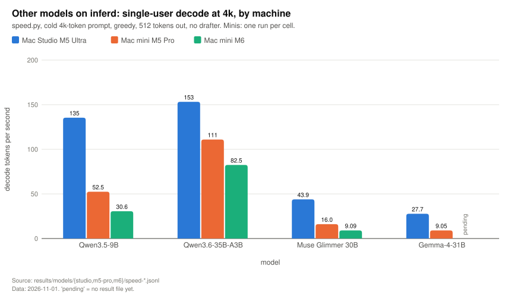

Single run per cell. Decode tok/s at 0.5k / 4k / 32k; prefill tok/s at 4k / 32k; conc.py at 32k, total tok/s.

| Machine | Model | Decode 0.5k / 4k / 32k | Prefill 4k / 32k | 32k × 1 / × 8 / × 16 | Raw |
|---|---|---|---|---|---|
| M5 Pro | Qwen3.5-9B | 52.8 / 52.5 / 46.5 | 1,670 / 1,355 | 45.9 / 170 / 223 | [speed](../results/models/m5-pro/speed-q9-m5-pro.jsonl), [agents](../results/models/m5-pro/conc-q9-m5-pro.jsonl) |
| M5 Pro | Qwen3.6-35B-A3B | 112.5 / 111.0 / 78.2 | 2,460 / 2,264 | 75.6 / 137 / 57.4 ⁷ | [speed](../results/models/m5-pro/speed-q35moe-m5-pro.jsonl), [agents](../results/models/m5-pro/conc-q35moe-m5-pro.jsonl) |
| M5 Pro | Qwen3.6-35B-A3B, re-run `s48` ⁸ | 112.2 / 111.4 / 78.8 | 2,988 / 2,277 | – / – / 174 | [speed](../results/models/m5-pro/speed-q35moe-m5-pro-s48.jsonl), [agents](../results/models/m5-pro/conc-q35moe-m5-pro-s48.jsonl) |
| M5 Pro | Muse Glimmer 30B | 16.1 / 16.0 / 14.1 | 419 / 404 | 13.8 / 58.9 / 14.3 ⁷ | [speed](../results/models/m5-pro/speed-glimmer-m5-pro.jsonl), [agents](../results/models/m5-pro/conc-glimmer-m5-pro.jsonl) |
| M5 Pro | Gemma-4-31B (bf16 KV) ⁹ | 9.9 / 9.1 / 7.8 (16k) | 334 / 303 (16k) | 8k: 8.6 (× 1) / 18.1 (× 3) | [speed](../results/models/m5-pro/speed-gemma31-m5-pro.jsonl), [agents](../results/models/m5-pro/conc-gemma31-m5-pro.jsonl) |
| M6 | Qwen3.5-9B | 31.0 / 30.6 / 27.3 | 1,017 / 850 | 26.9 / 91.1 / 115 | [speed](../results/models/m6/speed-q9-m6.jsonl), [agents](../results/models/m6/conc-q9-m6.jsonl) |
| M6 | Qwen3.6-35B-A3B | 79.1 / 82.5 / 56.2 | 1,637 / 1,389 | 53.1 / 92.2 / 28.1 ⁷ | [speed](../results/models/m6/speed-q35moe-m6.jsonl), [agents](../results/models/m6/conc-q35moe-m6.jsonl) |
| M6 | Qwen3.6-35B-A3B, re-run `spill` ⁸ | 82.2 / 79.4 / 56.9 | 1,837 / 1,392 | – / 92.7 / 87.2 | [speed](../results/models/m6/speed-q35moe-m6-spill.jsonl), [agents](../results/models/m6/conc-q35moe-m6-spill.jsonl) |
| M6 | Muse Glimmer 30B | 9.2 / 9.1 / 8.4 | 248 / 234 | 8.3 / 32.5 / **pending** | [speed](../results/models/m6/speed-glimmer-m6.jsonl), [agents](../results/models/m6/conc-glimmer-m6.jsonl) |
| M6 | Gemma-4-31B | not run | not run | not run | 32 GB cannot hold its bf16 KV (≈ 900 KB a token) beside 18 GB of weights |

⁷ **Collapsed 16-agent cells.** These cells have worst TTFTs of 112 s (35B-A3B, M5 Pro), 263 s (35B-A3B, M6) and 503 s
(Glimmer, M5 Pro) against 3–7 s for the cells beside them. Diagnosed 2026-11-01: the prefix cache keeps at most as many
cached prefixes as there are state snapshot slots (`snapshots`, the 5th `run.sh` argument; `models_smoke.sh` used 16
running + 16 snapshots), even for pure-attention models whose slots hold no state. With 16 agents, some agents' 32k
prefixes were evicted and their follow-ups re-prefilled one after another. The M5 Pro's KV pool (2.9M tokens) was not
the limit. Fix in the engine: decouple prefix retention from state slots for models without recurrent state (ROADMAP).
⁹ Gemma-4-31B on the M5 Pro: bf16 KV (≈ 900 KB a token) leaves room for ~37k tokens, so it ran 0.5k/4k/16k single-user and 1 and 3 agents at 8k, not 32k.
⁸ Re-runs on the same build with more snapshot slots: `s48` = M5 Pro, `RUN=16 SNAPS=48`; `spill` = M6, `RUN=8 SNAPS=24`
with the SSD tier on (`SPILL_DIR`, `SPILL_GIB=64`), because 16 × 32k (0.52M tokens) does not fit the M6's 0.4M-token
pool for this model. Settings from `models_smoke.sh` (lab script, not published) / `mini_queue.sh` invocations recorded in the session.

The 0.5k prefill figures on the minis are single first requests and include start-up effects (e.g. 215 tok/s on the
M6 for Qwen3.6-35B-A3B); they are left out of the table above.

---

### (e3) Qwen3.8-Flash-Next on the Mac Studio (1 Nov 2026)

**Update, 2 Nov 2026: QSA sparse attention implemented, exact past 2k.** Indexer (4 query heads, 1 pooled key per
4 tokens, relu-weighted scores, top-512 groups per row) per mlx-vlm 0.7.8; index keys live in extra KV planes, so the
prefix cache, preemption and SSD tier carry them. KL vs mlx-vlm: 2k (dense) 0.0223, 8k 0.0160, 32k 0.0202 (R=1),
inside Flash-Next's own short-context band; the selection matches the reference's sparse one, not dense. conc.py 16k
follow-ups: 8 agents 397 → 466 tok/s, 16 agents 507 → 681 (TTFT 4.6 → 1.0 s); single-stream prefill 8–12% slower at
4k–32k. `QSA=0` restores the 2k limit. 27B byte-identical.

**Update, 1 Nov 2026 (night): decode step fused, 172 tok/s single stream with MTP.** Hyper-connections in 2 launches,
MoE in 4 (experts shared by a verify block's rows read once), and a 12-heads-per-KV-head tensor-unit attention kernel:
B=1 step 16.86 → 11.18 ms (1,300 → 698 dispatches), 4-row MTP cycle 25.6 → 16.8 ms, B=16 step 37.3 → 34.1 ms.
speed.py 0.5k / 1k: **172.7 / 171.3 tok/s with MTP** (was 115.5 / 117.8), 91 without (60). conc.py 1k decode tok/s
at 1 / 8 / 16 agents: 168 / 503 / 753 with MTP (117 / 471 / 663). Acceptance 3.49–3.50 tokens per cycle, level with
oMLX on the same prompts (~3.57); the 3.02 below came from an earlier build. oMLX like-for-like: ~200 tok/s (plain step
8.3 ms vs our 11.2). The 27B is byte-identical. The original entry follows.

Exact only for contexts up to 2k tokens (the QSA sparse-attention indexer is not implemented yet). With the model's own
MTP head drafting 3 tokens per cycle (`MTP=1`): **114-118 tok/s single stream** (53.5 without), and conc.py at 1k
**114 / 440 / 637 total tok/s at 1 / 8 / 16 agents** (without MTP 53 / 283 / 413). Acceptance 3.02 tokens per cycle.
Prefill 2,491 tok/s at 1k. Reference points: TensorFold with MTP on a MacBook Pro M5 Max 83-88 tok/s; oMLX with MTP
on the Studio 155-170 single stream. Raw rows: `results/models/studio/*flashnext*`, `*fn-mtp*`. Details: the study log "Flash-Next MTP drafting".

### (e4) Mac mini M4 Pro (lightly tested)

Qwen3.8-27B 4-bit on an M4 Pro (no GPU neural accelerators), fixed build: decode 24.6 tok/s single stream with the
DFlash2 drafter (15.1 without), prefill ~106 tok/s; conc.py at 4k, total decode 19.0 / 55.7 / 60.9 / 65.0 tok/s at
1 / 4 / 8 / 16 agents (no drafter: 14.9 / 20.6 / 39.0 / 73.1). **Not fully tested.** See
[MACHINES.md](MACHINES.md#mac-mini-m4-pro-works-lightly-tested-1-november-2026); raw rows in
[results/models/m4-pro/](../results/models/m4-pro/). Invalid (wrong kernels or the drafter bug): `*.prefix-bug.jsonl`,
`speed-m4pro-nodraft.jsonl`, `conc-m4pro-nodraft.jsonl`, `speed-m4pro.jsonl`, `conc-m4pro.jsonl`.

### (e5) Qwen3.8-27B 8-bit (mlx-community) on the Studio and the M5 Pro (1 Nov 2026)

Logits match mlx_lm (top-1 ok, cos ≥ 0.9997 on all four sequences), DFlash2 drafter with 4-bit linears.

| Studio, conc.py follow-ups, total tok/s | 1 agent | 8 | 16 | 32 |
|---|---:|---:|---:|---:|
| 16k, 8-bit | 110 | 442 | 533 | **599** (TTFT 2.5 s) |
| 32k, 8-bit | 101 | 375 | 461 | **516** (TTFT 3.3 s) |
| 32k, 4-bit for comparison | | | 504 | 561 |

Single stream (speed.py, 2 cold reps): 130 / 114 / 111 / 108 tok/s decode and 776 / 1,664 / 1,607 / 1,499 tok/s
prefill at 0.5k / 4k / 16k / 32k. Decode step at 8k: 29.4 / 50.8 / 101.5 ms at B = 1 / 16 / 64 (4-bit 20.1 / 35.3 /
91.3). At fleet scale 8-bit keeps ~92% of 4-bit throughput. Raw rows:
[q27-8bit-conc.jsonl](../results/models/studio/q27-8bit-conc.jsonl) (the `q27-8bit` 16k × 32 row at 19:12 is
**invalid**: a second large model was running on the Studio; use the `q27-8bit-rerun` row) and
[q27-8bit-speed.jsonl](../results/models/studio/q27-8bit-speed.jsonl).

Mac mini M5 Pro (64 GB), same checkpoint: logits pass; decode step at B=1 103 ms (4-bit 60 ms). speed.py: 33–39
tok/s decode, 260–430 prefill (4-bit 54–63 and 340–450). 16k fleet, 8 agents: 13.82 turns/min (4-bit 12.72 in the
same session). The 16-agent cells from that session are under investigation (both precisions came in well below the
overnight 4-bit figure) and are not quoted.

### (e6) 8-bit vs bf16 KV accuracy at long context (1 Nov 2026)

`engine/tools/kv_check` prefills a long real text and feeds its last 256 tokens teacher-forced (R=1: decode path;
R=5: verify-attention path), and `kv_ref.py` compares every kept row with mlx_lm (bf16 KV). Qwen3.8-27B 4-bit, two
texts (engine source, docs), mean KL in nats (top-1 agreement 96–100% in every arm):

| Machine, context, path | bf16 KV | 8-bit KV |
|---|---:|---:|
| Studio (M5 Ultra), 8k, decode | 0.00055 | 0.00061 |
| Studio, 32k, decode | 0.00073 | 0.00091 |
| Studio, 8k, verify | 0.00080 | 0.00080 |
| Studio, 32k, verify | 0.00127 | 0.00107 |
| M4 Pro (no neural accelerators; the M1–M4 kernel path), 8k, decode | 0.00094 | 0.00106 |
| M4 Pro, 8k, verify | 0.00104 | 0.00115 |
| M4 Pro, 32k, decode | 0.00169 | 0.00145 |

8-bit KV adds at most ~0.0002 nats, less than bf16's own distance from mlx_lm. Speed on the Studio at 32k: +16% at 16
sequences, +19% at 32 (5–8% at 8k), and twice the tokens per GiB. Gemma-4 is the exception (KL 1.96 with 8-bit KV) and
defaults to bf16.

### (e7) Many users with long prompts released at once (2 Nov 2026)

The shape of a public M3 Ultra comparison (TensorFold on the Mac, published by MiaAI-Lab; Qwen3.8-Flash-Next): N users
released together, each with its own 14,336-token prompt and 6,400 generated tokens. There the Mac prefilled the prompts
one at a time, so the 8th user waited ~9 minutes for a first token and end-to-end throughput fell to 65 tok/s.
inferd prefills in chunks interleaved with decoding and admits by KV budget. Harness: [bench/wall.py](../bench/wall.py)
(distinct prompts, `ignore_eos`, thinking off, greedy); Mac Studio M5 Ultra, one trial per level
([raw](../results/studio/wall.jsonl), [log](../results/studio/wall.log)).

| Model on inferd (Studio) | N | TTFT median | Last user's first token | Decode, all users generating | End-to-end (A_e2e) |
|---|---:|---:|---:|---:|---:|
| Flash-Next oQ4e + MTP, QSA (exact) | 1 | 6.5 s | 6.5 s | 167 tok/s | 143 tok/s |
| | 2 | 8.3 s | 10.6 s | 239 | 198 |
| | 4 | 14.0 s | 21.0 s | 312 | 249 |
| | 8 | 24.8 s | **42.4 s** | **443** | **327** |
| Qwen3.8-27B 4-bit + DFlash2 | 1 | 13.2 s | 13.2 s | 131 | 103 |
| | 4 | 23.2 s | 33.8 s | 587 | 327 |
| | 8 | 42.0 s | **74.5 s** | **694** | **343** |

**Final build of 2 Nov (819c396: QSA, ~4k tok/s Flash-Next prefill, copy drafts and DFlash2 trees for one stream)**,
same harness, one trial per level ([raw](../results/studio/wall-final.jsonl), [log](../results/studio/wall-final.log)):

| Model on inferd (Studio) | N | TTFT median | Last user's first token | Decode, all users generating | End-to-end (A_e2e) |
|---|---:|---:|---:|---:|---:|
| Flash-Next oQ4e + MTP + QSA | 1 | 5.7 s | 5.7 s | 190 | 162 |
| | 2 | 6.7 s | 7.4 s | 249 | 218 |
| | 4 | 10.1 s | 15.6 s | 307 | 261 |
| | 8 | 18.7 s | **32.7 s** | 435 | **341** |
| Qwen3.8-27B 4-bit + DFlash2 (tree for one stream) | 1 | 8.9 s | 8.9 s | 233 | 176 |
| | 2 | 13.0 s | 16.7 s | 390 | 247 |
| | 4 | 23.1 s | 33.7 s | 584 | 325 |
| | 8 | 39.9 s | 67.8 s | **702** | **355** |

**TensorFold with its arrival-order prefill (2 Nov, afternoon).** TensorFold 1.2.1 has an opt-in
`TENSORFOLD_PREFILL_POLICY=fcfs` (its PR #1843) that our first TensorFold runs did not use. Re-run with it,
`--parallel 8 --context 32768`, same harness and weights ([log](../results/studio/wall-tf-fcfs.log)):

| Flash-Next, Studio | N | Last user's first token | Decode, all generating | End-to-end |
|---|---:|---:|---:|---:|
| inferd (final 2 Nov build) | 2 / 4 / 8 | 7.4 / 15.6 / 32.7 s | 249 / 307 / **435** | 218 / 261 / **341** |
| TensorFold, fcfs, 8,192-token chunks | 2 / 4 / 8 | **6.5 / 13.1 / 26.4 s** | 289 / 354 / 357 | **256 / 305** / 300 |
| TensorFold, fcfs, 2,048-token chunks | 2 / 4 / 8 | 7.2 / 15.2 / 31.6 s | 285 / 349 / 358 | 248 / 281 / 297 |

With it, TensorFold starts every user sooner than inferd (it prefills faster: ~4.9k vs ~4k tok/s) and leads end to end at
2 and 4 users; inferd leads end to end at 8 users (+14%) and on decode with all users generating (+22%). The rows
below are TensorFold's defaults, which serve one prompt at a time.

**Like for like on the Studio (2 Nov 2026): TensorFold 1.2.1 on the same oQ4e Flash-Next weights, same harness.**
Default server (one request at a time) and `--parallel 8 --context 32768` (its concurrent mode; at the default 256k
context the 8 slots don't fit its 70% RAM policy). Raw: [wall-tf.log](../results/studio/wall-tf.log),
[wall-tf-par8.log](../results/studio/wall-tf-par8.log), rows in [wall.jsonl](../results/studio/wall.jsonl).

| Flash-Next oQ4e, Studio | N | Last user's first token | Decode, all users generating | End-to-end (A_e2e) |
|---|---:|---:|---:|---:|
| **inferd** (MTP + QSA) | 1 | 6.5 s | 167 | 143 |
| | 2 | 10.6 s | 239 | 198 |
| | 4 | 21.0 s | 312 | 249 |
| | 8 | **42.4 s** | **443** | **327** |
| TensorFold 1.2.1, default | 1 | **2.9 s** | **233** | **210** |
| | 2 | 33.2 s | (never two at once) | 215 |
| | 4 | 93.1 s | (never two at once) | 209 |
| | 8 | 222.1 s | (never two at once) | 205 |
| TensorFold 1.2.1, `--parallel 8` | 2 | 52.0 s | 293 | 148 |
| | 4 | 130.5 s | 350 | 143 |
| | 8 | 331.8 s | (the first users finish before the last starts) | 124 |

At 8 users inferd's last user waits 42 s against TensorFold's 222 s (serial) or 332 s (parallel), and inferd delivers
1.6× / 2.6× the end-to-end throughput. TensorFold's parallel mode reproduces the published M3 Ultra behaviour (prompts
prefilled one at a time, A_e2e falling with N). A single user is TensorFold's case: 14k prefill in 2.9 s (~4,900
tok/s, vs inferd's ~2,200) and MTP plus context-copy drafting (5.5 tokens per round vs inferd's ~3.5).

Published figures at N = 8 for context (Flash-Next): TensorFold on an M3 Ultra ~550 s to the last first token and 65
tok/s end to end. **Not like for like:** an M5
Ultra (GPU neural accelerators) against an M3 Ultra, our oQ4e checkpoint, one trial against their five, and forced
6,400-token outputs past the natural end (whose text can draft unusually well). The scheduling difference is the
point: on inferd the 8th user waits 42 s, not 9 minutes.

### (e8) Single-stream decode vs TensorFold 1.2.1 (2 Nov 2026)

Studio, Qwen3.8-27B 4-bit, the same DFlash2 drafter weights (z-lab and incoai are byte-identical), greedy, 512 tokens,
identical prompts (fixed run ids, [script](../bench/studio/tf_fixed_prompts.py)). inferd: steady 185–202 tok/s,
5.5 tokens committed per cycle at block 8, ~28 ms per cycle. TensorFold: **bimodal on identical prompts and identical
output** (the same request at 276 and 117 tok/s), mean 216; its fast mode ~275 tok/s drafts ~15.5 tokens per cycle
(block 16, "lanes width=16"; its counters: 21,068 drafted, 8,890 kept over 20 requests) and commits ~7.5 in ~27 ms. The
gap is the block length, not the verify kernels: block-16 drafting is in progress. Raw:
[tfdiag-1.2.1.jsonl](../results/studio/tfdiag-1.2.1.jsonl), [tfcmp-1.2.1.jsonl](../results/studio/tfcmp-1.2.1.jsonl)
(speed.py's random run ids make three reps per cell too noisy to rank the engines).

**Update (2 Nov morning): block 16, then 16-node tree verification.** The drafter's top-16 per position grows a
best-first tree (up to 4 children per node); verify adds each row's ancestors to attention, GDN follows each node's
parent, and the accepted path's KV is compacted. Used while one greedy request decodes (`TREE=16`, `TREE=0` off).
Studio, 10 fixed prompts, 512 tokens: chain (block 8) 197 → block 16 215 → **tree 231 tok/s**, 7.3 tokens per cycle
(TensorFold's fast mode ~7.5 at ~27 ms per cycle; ours ~31 ms: the 16-row verify GEMMs take 24.7 ms, the remaining
gap). Fleets level (16k ×8 470 → 478, ×16 575 → 567, 3 cells each); logits byte-identical.

## (f) Drafter acceptance

> **Caveat found 1 Nov 2026:** until commit `abdc023` the drafter's input layer overflowed its W4A8 activation scratch
> on large prefill chunks, corrupting the draft context. `spec_test` on the M5 Pro went from 5.67 to 8.12 tokens per
> cycle with the fix. Acceptance and throughput figures below were measured with the bug and are probably
> understated; re-measure on the current build.

DFlash2 drafts a block of tokens (4, 5 or 8) each cycle and the target verifies them in one pass; acceptance is the
mean tokens committed per cycle (accepted drafts plus the bonus token). The engine logs it with `INFERD_DEBUG=1`
("commit N" lines; samples in [results/studio/night3.log](../results/studio/night3.log)). **Most of the figures below
come from the study log only**: the per-cycle histograms were read from server logs that are not in this repo.

| Date | Setting | Tokens per cycle | Source |
|---|---|---:|---|
| 29 Oct | Block 5, agent follow-up workload (half the cycles accept all 5) | 3.8 | the study log, "DFlash2" |
| 29 Oct | Block 5, code prompt, 4-bit / 8-bit / bf16 target | 4.4 at every precision | the study log, "Weight precisions" |
| 29 Oct | 8-bit checkpoint with a 4-bit embedding lookup in the drafter (bug) | 1.1 | the study log, "Weight precisions" |
| 30 Oct | Block 5 vs block 8, before the drafter-attention fix | 4.02 vs 4.08 | the study log, "Diagnosed 2026-10-30: block 8 was useless" |
| 30 Oct | Splash 1.5 on the same files, block 8 (its own log) | 5.0–5.8 (8k: 5.3–5.5) | the study log, "Splash's single-stream lead is drafter acceptance" |
| 30 Oct | Block 8 after the fix, 2k code prompt (MacBook Pro M5 Max) | 4.28 → **5.68** (44 of 90 cycles accept all 8) | the study log, same section |
| 30 Oct | Drafter linears 4-bit vs 8-bit | 5.71 vs 5.78 | the study log, same section |
| 30 Oct | Studio, 8k single stream, block 8 | 5.28 (132 of 388 cycles accept all 8); 5.34 in a later smoke | the study log, "Studio after the drafter fix", "Closing the gap" |
| 31 Oct | Multi-agent, 128k × 8, blocks 4 / 5 / 8 | ~3.4 / 4.0 / 5.3 | the study log, "2026-10-31 morning" |
| 1 Nov | Studio server, 16k × 1: vocabulary cut off vs on | 4.46 vs 4.15 | the study log, "Lessons from the mlx.fast competition" |
| 1 Nov | Studio server, 64k × 1: vocabulary cut off vs on | 5.14 vs 4.62 | same |
| 1 Nov | Studio server, the competition prompt | 5.5–6.0 (with or without the cut) | same |

Notes:

- The self-tuning chooser (`SPEC_AUTO`, default on) picks block 4, 5 or 8 per load regime (decoders × context) from
  measured step times and acceptance. The step timings behind it (the study log, "Block size by regime"): block 8 wins
  for 8 agents from 64k and ties at 16k; 16 agents want block 4 at 16k and block 8 at 128k.
- `spec_test` reports ~1.01 tokens per cycle on short chat prompts and ~2.5 on the competition prompt; that is the
  tool, not the engine. Measure acceptance through the server.
- Sampled requests (0.1.1) use the same drafter with exact speculative sampling (top-k capped at 16 on that path).

---

## (g) Merge of 2 November evening: memory, prefix retention, stop strings, strict JSON, hardening

One build carries the drafter-memory cut, prefix retention for pure-attention models, decode snapshots, `stop`
strings, strict structured output (constrained decoding for a documented subset of JSON Schema, followed by schema
validation) and the Codex-review hardening (front end, harness client, loader, SSD tier). Gates:

| Gate | Result |
|---|---|
| Logits, 27B 4-bit, chunks 1 and 24 | byte-identical to the previous build (Studio, M5 Pro) |
| Logits, Flash-Next, chunks 1 and 24 | byte-identical (Studio) |
| Single stream, fixed prompts, Studio | 231.9 vs 231.2 tok/s |
| conc 16k × 16, Studio, 3 cells per arm | 572.2 / 568.9 / 571.1 vs reference 566.5 / 571.1 |
| Forced decode snapshots (now opt-in, `SNAP_GEN_FORCE`) | 538.9 / 535.4 (−6%), so off by default |
| Unit tests | grammar 80/80, json 84/84, spill 27/27, weights 21/21; front end structured/tools/stream/vision OK |
| Strict JSON, live | 100/100 valid on the first attempt across 5 sets of 20 (greedy, low effort, T 0.7, mixed load) |
| SSD tier round trip (Studio) | 3 contexts recovered after restart, checksums verified, 6/6 replies identical |

Measured gains (27B 4-bit + DFlash2):

| Machine / workload | Before | After |
|---|---|---|
| Studio, drafter footprint (64 running / 96 snapshots) | 14.8 GiB | 9.7 GiB |
| M6 32 GB, verify scratch / KV pool | 4.49 / 2.1 GiB | 0.48 / 4.1 GiB |
| M6, follow-ups 4k × 8 agents | 39.7 tok/s | 98.2 tok/s |
| M6, follow-ups 16k × 4 agents | 18.7 tok/s | 72.3 tok/s (71.9 on the final build) |
| M6, follow-ups 16k × 8 agents | 7.7 tok/s | 33.1 tok/s (prefixes still partly evicted) |
| M6, agent-followups 16 × 4k: cached / all follow-ups | 81% / 271.5 s (snapshots off) | 88% / 226.8 s |
| M5 Pro, Muse Glimmer 30B 16 × 32k (pure attention) | 8.6 tok/s, follow-up wait 273 / 873 s | 88.5 tok/s, 9.5 s |

The M6's 16k × 8 cell is still limited by its KV pool. Prefill on the M5 Pro is unchanged (~445 tok/s, bf16 GEMM
bound); a large-M int8 prefill GEMM is in testing separately.

## (h) N agents at once, 3 trials per level: inferd vs TensorFold 1.2.1 fcfs (Mac Studio, 2 November night)

`bench/wall.py` unmodified: N agents released together, distinct 14,336-token prompts, 6,400 forced tokens, greedy,
thinking off. TensorFold with `TENSORFOLD_PREFILL_POLICY=fcfs`, 8,192-token prefill chunks. 3 trials per N, 0 errors;
mean ± half-range. Total = the last agent's last token.

**Qwen3.8-27B 4-bit** (both engines use the same DFlash2 drafter weights):

| N | inferd total s | TensorFold total s | inferd last 1st token | TF last 1st token | inferd decode, all generating | TF decode |
|---|---|---|---|---|---|---|
| 1 | 33.1 ± 2.1 | 30.7 ± 1.9 | 8.2 | 8.4 | 258 | 290 |
| 2 | 52.4 ± 2.2 | 51.7 ± 1.6 | 16.8 | 17.6 | 373 | 374 |
| 3 | 67.0 ± 4.5 | 72.1 ± 1.3 | 25.2 | 27.2 | 471 | 437 |
| 4 | 81.8 ± 5.6 | 91.4 ± 1.6 | 33.7 | 36.7 | 571 | 469 |
| 5 | 104.8 ± 2.5 | 113.1 ± 1.1 | 42.2 | 46.1 | 515 | 478 |
| 6 | 116.9 ± 2.6 | 135.1 ± 2.0 | 50.8 | 55.5 | 591 | 478 |
| 7 | 131.2 ± 5.8 | 158.4 ± 0.9 | 59.3 | 66.2 | 647 | 476 |
| 8 | 143.9 ± 1.2 | 177.9 ± 1.4 | 68.0 | 76.2 | 693 | 474 |

**Qwen3.8-Flash-Next** (oQ4e; inferd MTP + copy drafts):

| N | inferd total s | TensorFold total s | inferd last 1st token | TF last 1st token | inferd decode | TF decode |
|---|---|---|---|---|---|---|
| 1 | 37.3 ± 0.7 | 29.5 ± 1.2 | 3.6 | 3.2 | 190 | 244 |
| 2 | 59.1 ± 0.1 | 50.4 ± 0.4 | 7.4 | 6.5 | 247 | 290 |
| 4 | 98.9 ± 0.6 | 85.2 ± 1.7 | 15.6 | 13.0 | 306 | 353 |
| 6 | 125.7 ± 0.2 | 124.6 ± 1.4 | 24.0 | 19.6 | 375 | 362 |
| 7 | 137.9 ± 1.4 | 144.3 ± 1.0 | 28.2 | 22.8 | 406 | 361 |
| 8 | 147.1 ± 0.6 | 166.3 ± 1.0 | 32.5 | 26.1 | 442 | 362 |

27B: inferd is level at 1–2 agents and finishes sooner from 3 (−19% at 8). Flash-Next: TensorFold finishes sooner up
to 5 agents, parity at 6, inferd sooner at 7–8. TensorFold's decode flattens from 4 agents on both models. Both runs
predate the int8 prefill GEMM (PF8), which adds 32% (27B) and 9% (Flash-Next) to inferd's prefill on the Studio.

## (i) int8 prefill GEMM (PF8), 3 November

Group-free int8 prefill: Hadamard-rotated per-row int8 activations and weights, one `matmul2d` over all of K. Auto
default: on for 27B-class models when the KV pool left after the int8 weight copies (+22.7 GiB for the 27B) still holds
`max_running × max_ctx` tokens; off otherwise (logged at startup); Flash-Next off by default (`PF8=1` enables it).

| Check | Result |
|---|---|
| PF8=0 logits | byte-identical to 1570a8e: 27B chunks 1/24/1536, Flash-Next 1/24 (Studio); 27B 1/24 (M6) |
| 27B kv_check 8k, tail 512 vs mlx_lm | KL 0.00144, top-1 97.7% (PF8 off 0.00098 / 98.9%; W4A8 band ~0.002) |
| Flash-Next kv_check 8k / 32k | 0.0170 / 0.0229 (off 0.0189 / 0.0205; model band 0.022–0.023): upper edge at 32k, so off by default |
| 27B prefill, Studio, 16k | 1,841 → 2,555 tok/s (+39%; +5% of it from bit-identical GDN prefill kernels) |
| 27B prefill, M5 Pro, 8k (GPU) | 424–463 → 823–837 tok/s; server single agent 410 → 712 (Splash 1.5: 618) |
| Flash-Next prefill, Studio, 16k / 32k | 4,279 → 4,677 / 4,122 → 4,456 tok/s (+9% / +8%) |
| Fleet, Studio, 27B, conc 16k × 8 / 16 / 32 (3 cells each) | 478.6 / 577.8 / 622.2 → 488.3 / 590.4 / 633.9 tok/s; TTFT median at 32: 2.02 → 1.51 s; wired peak +22.8 GiB |
| Fleet, M5 Pro 64 GB, forced on | KV pool 28.9 → 6.2 GiB, every 16k context evicted at 16 agents: why auto keeps it off there |

## (j) HLE Lite on inferd (Mac Studio, 3 November)

The Incept5 HLE Lite harness (173 HLE-Verified Gold multiple-choice items, exact grading; a quality check, not a
target), effort medium, greedy, build a4ee879. 32k budget first, then capped/unanswered items re-asked at 128k
(`hle.py rerun`); nothing hit the 128k cap. Aggregates only: questions and answers are never committed.

| Model (concurrency) | 32k | after 128k | tokens per question, median / mean / max | wall (32k + 128k) | decode, aggregate |
|---|---|---|---|---|---|
| Qwen3.8-27B 4-bit + DFlash2 (32) | 31.2% | **32.4%** | 4,125 / 8,307 / 77,123 | 34.8 + 12.4 min | 507 tok/s |
| Qwen3.8-27B 8-bit + DFlash2 (32) | 32.9% | **34.1%** | 3,513 / 7,374 / 69,020 | 34.5 + 9.5 min | 483 tok/s |
| Qwen3.8-Flash-Next oQ4e + MTP (16) | 38.7% | **41.6%** | 3,963 / 9,155 / 82,922 | 49.9 + 24.0 min | 357 tok/s |

Paired McNemar: Flash-Next vs 27B 4-bit +9.2 points (p = 0.040); vs 27B 8-bit +7.5 (p = 0.085); 8-bit vs 4-bit +1.7
(p = 0.72). The published runs of the same models on other engines and hardware score 31.8–33.5% (27B, effort low) and
34.7–43.9% (Flash-Next): inferd's speed paths show no sign of costing answers. Details: results/hle/.

## (k) Scheduling defaults, 3 November: prefill budget, copy drafts at any load, admission lookahead

Studio, `bench/wall.py` (14,336-token prompts, 6,400 forced tokens, N agents at once, 3 trials), total seconds:

| N | Flash-Next before | Flash-Next now | TensorFold fcfs | 27B before | 27B now | TensorFold fcfs |
|---|---|---|---|---|---|---|
| 1 | 37.3 | 39.4 (9 trials; bimodal 37/42 s, see below) | 29.5 | 33.1 | 29.8 | 30.7 |
| 4 | 98.9 | 89.2 | 85.2 | 81.8 | 75.7 | 91.4 |
| 6 | 125.7 | 118.6 | 124.6 | 116.9 | 101.4 | 135.1 |
| 8 | 147.1 | 137.7 | 166.3 | 143.9 | 125.6 | 177.9 |

Mixed arrivals (16 agents, Poisson 3 s apart, 2k–16k prompts, 256–512 tokens out): 27B total 105.0 → 78.7 s,
TTFT p95 59.1 → 34.0 s, 9.2 → 12.2 turns/min (TensorFold 116.7 s / 72.0 s / 8.2); Flash-Next 60.4 → 54.5 s,
TTFT p95 15.3 → 11.4 s with PF8 on; with the shipped default (PF8 off for Flash-Next) 57.2 s / 13.7 s, level
with TensorFold on total time and behind on the tail (TensorFold 57.2 s / 9.1 s; re-measured in (m)). Fleets (conc 16k × 8/16/32) level; Flash-Next 16 agents +8%.

- Flash-Next N=1: the 42.5 s first measured was a build with the macOS 26 kernel target (wrong large-M kernels, reverted
  in 540f107). On 540f107, 9 trials average 39.4 s vs 38.3 s for the earlier tree; each trial is either ~37 s or ~42 s
  depending on whether copy drafts find repetition in the forced output. On 4 identical fixed prompts both builds give
  token-identical output, the same speculation statistics and totals within 0.3 s.
- `PREFILL_PRIO=16` (default): waiting prompts take a full prefill step beside decoders. No logit change.
- Flash-Next copy drafts at any load (default; `COPY_SOLO=1` restores the lone-decoder rule): outputs differ from
  plain greedy decoding only at near-ties (logit gap ≤ 0.5), exactly as MTP speculation alone does.
- `ADMIT_LOOKAHEAD=8`, `ADMIT_AGE=4` (default): bounded admission lookahead with aging (release review R11); no cost,
  and no measured gain in these mixes (the head never blocked a fitting request behind it).

## (l) MacBook Pro M3 Max, external tester (2–3 November)

M3 Max 30-core GPU, 96 GB, no GPU neural accelerators, macOS 27; Qwen3.8-27B 4-bit + DFlash2, identical weights for
every engine, `conc.py` at 32k (full table and per-phase thermals: `results/m3max-2026-11-02/`).

| 32k | inferd 819c396 | Splash 1.5.0 (2 runs) | TensorFold 1.2.1 |
|---|---|---|---|
| Prefill / decode, one agent (tok/s) | 147 / 34.0 | 242 / 57.3 | 126 / 19.9 |
| 16 agents, follow-ups: total tok/s | 61.1 | 58.1–58.6 | 1.2 |
| 16 agents: first token median / max (s) | 26.3 / 28.4 | 53.8–55.9 / 113–115 | 2,441 / 6,738 |

Splash leads clearly for one agent on this GPU (the M3/M4 kernel path has no int8 tensor units to use). At 16 agents
the totals are level and inferd's last agent starts 4× sooner. TensorFold did not reuse the shared prefix here.

## (m) TensorFold 1.2.2 re-tests, 3–4 November

TensorFold 1.2.2 (3 Nov) beside 1.2.1, each arm launched exactly as its 1.2.1 run; new options as extra arms
(`TENSORFOLD_PREFILL_ORDER=srpt`, `--prompt-cache-disk`). inferd 4a1c66a (rows re-used where measured on the same
defaults: (k)'s wall.py candidates, the 27B mixed arm, the 3 Nov Studio sweep). Raw: [results/tf122/](../results/tf122/).

**N agents at once (Studio, wall.py, 3 trials), total s:**

| N | 27B inferd | TF 1.2.1 fcfs | TF 1.2.2 fcfs | TF 1.2.2 srpt | Flash-Next inferd | TF 1.2.1 fcfs | TF 1.2.2 fcfs | TF 1.2.2 srpt |
|---|---|---|---|---|---|---|---|---|
| 1 | 29.8 | 30.7 | 32.1 | 31.3 | 39.4 | 29.5 | 29.9 | 29.2 |
| 2 | 53.4 | 51.7 | 53.9 | 54.1 | 57.2 | 50.4 | 50.3 | 50.3 |
| 3 | **61.5** | 72.1 | 71.4 | 74.1 | 73.4 | 67.6 | 66.6 | 67.4 |
| 4 | **75.7** | 91.4 | 91.3 | 102.4 | 89.2 | 85.2 | 86.7 | 85.2 |
| 5 | **93.3** | 113.1 | 113.1 | 141.0 | 105.9 | 104.2 | 104.6 | 103.6 |
| 6 | **101.4** | 135.1 | 133.3 | 168.2 | **118.6** | 124.6 | 125.1 | 126.6 |
| 8 | **125.6** | 177.9 | 177.6 | 211.0 | **137.7** | 166.3 | 166.1 | 166.7 |

1.2.2 is 1.2.1 within noise. srpt does nothing for Flash-Next and costs the 27B 25–30% from 4 agents (later prompts
wait behind decoding: last first token 46 → 112 s at N = 5). The 27B still finishes sooner on inferd from 3 agents
(−29% at 8); Flash-Next is level at 5 and inferd sooner from 6 (−17% at 8).

**Mixed arrivals (Studio, 16 users, Poisson 3 s, 2k–16k prompts, 3 trials), total s / TTFT p95 s:** 27B inferd
78.7 / 34.0; TF 1.2.1 116.7 / 72.0; 1.2.2 116.8 / 72.1; 1.2.2 srpt 122.9 / 79.0. Flash-Next inferd (shipped default,
PF8 off) 57.2 / 13.7 (the 54.5 / 11.4 in (k) was the PF8-on arm); TF 1.2.1 57.2 / 9.1; 1.2.2 57.3 / 9.2; srpt 57.6 / 9.7.

**Agent contexts (M5 Pro 64 GB, agents_scenarios.py), TTFT median (cached):**

| phase | inferd | TF 1.2.1 | TF 1.2.2 | TF 1.2.2 `--prompt-cache-disk` |
|---|---|---|---|---|
| a: 48 agents × 3 turns, all turns / wall | 23.4 s / 128 s | 140.4 / 813 s | 141.9 / 816 s | 44.0 / 206 s |
| b: relaunch 16 × 30k forks after unrelated load | 2.1 s (100%) | 193 s (50%) | 196 s (50%) | 195 s (50%) |
| c: resume 8 × 8k agents after unrelated load | 0.25 s (99%) | 15.3 s (0%) | 15.3 s (0%) | 15.4 s (0%) |
| e: 32 helpers / 3 researchers | 35 / 54 s | 37 / 89 s | 81 / 136 s | 50 / 127 s |

The disk cache restores only short (~2.1k-token) states, which fixes TF's many-small-agents case but not long
contexts. On the 32 GB M6 neither TensorFold version can start the 27B (its 8 GiB margin leaves 1.1 GiB for streams).

**Follow-up fleets.** M5 Pro conc 16k × 8 / 16: inferd 145.0 / 158.8 tok/s, TF 1.2.1 and 1.2.2 12.7 / 12.0 (every
context re-prefilled; 1.2.2's page-cache release frees ~18 GiB of file cache but its budget is static). Studio 16k ×
8 / 16 / 32: inferd 494 / 581 / 615, TF 1.2.2 79 / 54 / 49 (16 GiB default prompt cache); one agent: TF 186 vs 143.

**Single agent (M5 Pro, `tensorfold benchmark`, same prompts via `--server --chat-only`), code / chat at T 1:**
TF 1.2.2 130.7 / 49.1 tok/s, inferd 88.6 / 35.9. Managed (their protocol): 1.2.1 94.6 / 49.3, 1.2.2 94.5 / 49.2
(their 48 GB figure: 89.1 / 47.2).

OCR vs TensorFold was not measured: both versions refuse JPEG without libjpeg-turbo 3.1.4.1 (the Studio has 3.2.0).

## (n) Release 0.2.0 on four Macs, 4 November

The prebuilt `inferd-0.2.0-macos27-arm64.tar.gz` (sha256 verified) on each machine, Qwen3.8-27B 4-bit + DFlash2
(M4 Pro fleets without the drafter, as run.sh advises for M3/M4). Raw files: `examples/results/<machine>-0.2.0/` and
`results/agent-scenarios/<machine>-0.2.0/`.

| | Studio M5 Ultra | Mac mini M5 Pro 64 GB | Mac mini M6 32 GB | Mac mini M4 Pro 64 GB |
|---|---|---|---|---|
| Release gate (logits 1/24/256/1536 rows vs mlx_lm, top-1) | pass | pass | pass ¹ | pass |
| Self-tests (`examples/run_all.sh`) | – | 13/13 | 13/13 | 15/15 |
| Follow-ups, 16 agents, 4k contexts, total tok/s | – | 190.1 | 111.4 | 71.3 (no drafter) |
| Follow-ups, 16 agents, 16k contexts, total tok/s | 581 ² | 169.3 | 64.4 ³ | 54.8 (no drafter) |
| Follow-ups, 32 agents, 16k contexts, total tok/s | **619.9** (last first token 2.25 s) | – | – | – |
| Forked agents relaunched after unrelated load, first token | 1.03 s (32 agents) | 2.1 s ⁴ | – | 6.8 s (16 agents) |
| Agent resumed after unrelated load, first token | 0.09 s | 0.25 s ⁴ | 0.43 s ⁴ | 0.52 s |

¹ The bench step's 64 × 2048 does not fit 32 GB; run at 1 and 16. ² 3 Nov sweep on the same code. ³ The M6's KV pool
holds about four 16k contexts; the rest are re-read or restored from SSD. ⁴ From (m) (inferd 4a1c66a, the release code).
The 0.2.0 numbers match or beat the 1–3 November builds within run-to-run noise (M5 Pro 16 × 4k 184.6 → 190.1, Studio
32 × 16k 615.2 → 619.9).

## (o) Mac mini M6 head-to-head, 4 November (inferd 0.2.0 vs Splash 1.5.0 vs TensorFold 1.2.2)

Two M6 boxes (32 GB; macOS 27.0 and 27.2, level within noise), same weights (Qwen3.8-27B 4-bit + DFlash2; Qwen3.5-9B
4-bit and 8-bit) and harness for every engine. Full tables, configs and raw files:
[results/m6-h2h-2026-11-04/](../results/m6-h2h-2026-11-04/README.md); the benchmark-queue jobs that followed are
summarised there too.

- **TensorFold 1.2.2 cannot load the 27B on 32 GB**: refused in all 25 configurations (down to one stream, a 1,024-token
  context and no drafter), because of its fixed 8 GiB margin.
- **27B agent fleet, 8k contexts, turns/min (8 / 16 / 32 agents):** inferd 9.67 / 9.72 / 9.57, with the Neural Engine
  split 11.58 / 14.33 / 12.12; Splash 8.71 / 8.78 / 8.82.
- **27B follow-ups, total tok/s, 1 / 4 / 8 / 16 agents:** 4k: inferd 27.4 / 74.4 / 94.9 / **111.4**, Splash
  **36.4 / 93.2** / 94.9 / 88.5; 16k: inferd 25.2 / 66.6 / 65.8 / 64.4, Splash **32.6 / 69.6 / 86.4 / 88.6**. Splash
  is faster for one agent (prefill ~1.8x) and on 16k fleets of 8–16 agents: inferd's KV pool on 32 GB holds about
  four 16k contexts.
- **27B agents coming back (inferd API):** forked from a saved context 2.36 s (cold 75.2 s), relaunched after unrelated
  load 1.09 s, resumed 0.42–0.60 s.
- **9B follow-ups at 16k, 16 agents:** inferd 158–160 tok/s vs TensorFold 22.6–22.8 (4-bit); 114–115 vs 8.7 (8-bit).
  TensorFold leads at 4 agents (4k 98 vs 75).

## (p) oMLX 0.7.4.dev1 vs inferd 0.2.0 on the Mac Studio, 4 November

Same weights (Qwen3.8-27B 4-bit + DFlash2; Flash-Next oQ4e; 27B 8-bit) and harness; 0 errors. Full tables and the
prefill-accelerator estimate: [results/omlx074-2026-11-04/](../results/omlx074-2026-11-04/README.md).

| | inferd 0.2.0 | oMLX 0.7.4.dev1 | oMLX 0.7.3 |
|---|---|---|---|
| 27B follow-ups 16k, total tok/s, 1 / 8 / 32 agents | **150 / 490 / 628** | 127 / 154 / 179 | 41 / 42 / 45 (prefix not reused) |
| 27B, N agents at once, all done (s), 1 / 4 / 8 | **32.9 / 71.7 / 125.0** | 43.2 / 163.2 / 286.3 | – / – / 302.5 |
| 27B single stream, decode / prefill at 16k (tok/s) | **211** / 2,382 (PF8) | 162 / **2,582** | |
| Flash-Next, N at once (s), 1 / 4 / 8 | 38.9 / **92.1 / 142.7** | **34.8** / 121.0 / 191.7 | – / – / 201.7 |
| 27B 8-bit, 6 requests decode tok/s (no drafter / DFlash2) | 146.8 / **491.6** | **148.1** / 255.9 | 129.4 / – |

oMLX is faster for one user (first token, Flash-Next) and at 8–16k prefill: its int8-activation prefill reads the
packed 4-bit weights directly (no 22.7 GiB int8 copy like inferd's PF8). That kernel is being adapted for inferd
(32–64 GB Macs, where PF8 does not fit). Their back-to-back long-prompt fix (90.7 → 13.1 s) did not reproduce as a
collapse on the Studio: 0.7.3 was already 6.6 s, 0.7.4 5.7–6.0 s, inferd 9.1 s flat.

**Flash-Next with 16 and 32 agents released together (Studio, 4 November, single trial):** raw rows and logs in
[results/wall1632-2026-11-04/](../results/wall1632-2026-11-04/README.md) (the website's 16/32-agent card).

## (q) Benchmark queues on five minis, 4 November (Qwen3.5-9B 4-/8-bit, Qwen3.8-27B)

Every mini (two M6, two M5 Pro, one M4 Pro) ran a job queue on inferd 0.2.0 against TensorFold 1.2.2 (and Splash 1.5
where installed), same checkpoints and harness. Every table: [results/queue-2026-11-04/](../results/queue-2026-11-04/README.md)
(harness in its `harness/`). Headlines, 16 agents taking turns (total tok/s, inferd vs TensorFold 1.2.2):

| machine | 9B 4-bit, 4k | 9B 4-bit, 16k | 9B 8-bit, 16k |
|---|---|---|---|
| Mac mini M6 32 GB | **209** vs 92–98 | **158–160** vs 23 | **114–115** vs 8.7 |
| Mac mini M5 Pro 64 GB | **381–391** vs 274–276 | **287–295** vs 40–46 | **218** vs 20 |
| Mac mini M4 Pro 64 GB | **193** vs 144 | **156** vs 17 | |

TensorFold leads at 4–8 agents on the M5 Pro's 4k cells (8 × 4k 269–273 vs 255–264), at 8 agents on the M4 Pro's
(144 vs 115) and at 4 agents on the M6; one agent is level. 9B agent fleets on the M5 Pro (8k, turns/min, 8/16/32 agents): inferd
44.5 / 54.0 / 53.3 vs TensorFold 40.7 / 20.4 / 7.7 (4-bit) and 44.0 / 42.8 / 45.8 vs 19.3 / 8.6 / 3.0 (8-bit).
27B long context on the M5 Pro (one agent, cold prompt + 512 out): 32k 68 s, 64k 149–152 s.

## (o) 32 GB Mac mini M6: 4-bit KV (opt-in) and 8-bit drafter rings, 4 November

Qwen3.8-27B 4-bit + DFlash2, `conc.py --mode followup` (512-token replies), server `16 1024 0 8 32768` with the SSD tier,
same box (mini-m6-2) for every arm. Total tok/s (worst first token, s):

| arm (KV pool) | 4k x1 | x4 | x8 | x16 | 16k x1 | x4 | x8 | x16 |
|---|---|---|---|---|---|---|---|---|
| v0.2.0 (8-bit, 2.4 GiB, 78k tokens) | 27.2 | 73.5 | 95.5 | 112.3 (9.1) | 24.9 | 67.8 | 66.6 (34.7) | 69.0 (97.3) |
| `RING8` (now default; 8-bit, 2.9 GiB, 92k) | 28.0 | 76.2 | 97.8 | 112.6 (9.3) | 25.8 | 67.7 | 64.7 (38.7) | 66.2 (102.1) |
| `KV4=1` + `RING8` (4-bit, 2.9 GiB, 182k) | 26.9 | 73.5 | 98.5 | 114.5 (8.9) | 32.3 | 68.4 | **92.6 (4.1)** | **88.2 (61.1)** |
| v0.2.0 with 2 snapshot slots (8-bit, 3.5 GiB, 113k) | 27.6 | 74.8 | 95.1 | 113.9 (8.6) | 31.9 | 67.2 | 63.1 (40.8) | 74.8 (81.9) |

`RING8` stores the drafter's context rings in 8 bits: drafts only (the output stays exact), acceptance unchanged, the
drafter 2.8 -> 2.3 GiB on the M6 (4.4 -> 3.1 on a 64 GB M5 Pro, follow-ups level). `KV4` keeps eight 16k agents
resident at once (one wave instead of two). It is not lossless, so it is off by default. Accuracy (kv_check vs
mlx_lm, two real texts, 256 teacher-forced positions; mean KL nats / top-1):

| | 8k decode | 32k decode | 8k verify (4 rows) | 32k verify |
|---|---|---|---|---|
| 8-bit KV | 0.00136 / 99.2% | 0.00144 / 98.0% | 0.00174 / 98.4% | 0.00160 / 99.2% |
| 4-bit KV | 0.00771 / 98.4% | 0.00737 / 95.7% | 0.00696 / 96.9% | 0.00817 / 97.7% |

Logits gate (decode_test check, M6): KV4 off byte-identical to the previous build; KV4 on top-1 ok at chunks 1/24 and
on one of two 1,536-token sequences at chunks 256/1536 (the other flips). Step time KV4 = KV8 within 1% (4k/16k,
1-8 sequences, 1-8 rows).

## Engine-level measurements

Not product comparisons, but the measurements the design decisions rest on (Mac Studio M5 Ultra unless stated).

| Measurement | Value | Source |
|---|---|---|
| Memory bandwidth, streaming read 1–16 GiB | 1,135–1,142 GB/s | [results/micro-2026-10-29-r2.txt](../results/micro-2026-10-29-r2.txt) |
| fp16 GEMM 4096³, best tile (128×64) | 124 TFLOPS | same |
| Decode-shaped GEMM (27B MLP, 5120 → 17408), M = 1 → 64 rows | flat at 0.23–0.24 ms (~760 GB/s) | same |
| int8 × int8 → int32 tensor rate | 223 TOPS | the study log, "W4A8" |
| All linear layers per step, default routing (`qmv4` at M = 1, W4A8 above), M = 1 / 5 / 16 / 24 | 16.7–17.1 / 19.6 / 20.2 / 24.5 ms (weight-read floor 14.0 ms) | [results/studio/night2.log](../results/studio/night2.log) |
| Host overhead per step | ~0.5 ms (MLX: 8.6 ms) | the study log, "Native engine, day 1" |
| Raw batched decode, 64 sequences × 2k (no speculation) | 865 tok/s (unscheduled MLX: 591) | the study log, "Ragged batches" |
| SSD tier restore, 3 agents × 5.3k tokens (MacBook Pro M5 Max) | follow-up TTFT 0.24–0.33 s vs 7.2 s re-prefill; replies identical | the study log, "SSD tier" |
| Persistent SSD tier across a restart (Studio, 3 × 5.3k) | 6 of 6 replies identical; ~0.23 s restore vs 3 s re-prefill | [results/studio/persist.log](../results/studio/persist.log) |

---

## Caveats, contradictions and open items

**Noise and conditions**

- Nearly every cell is a single run. Single-agent cells on the Studio vary ±10% between runs of the same build.
- **Long uptime** slows the Studio: 128k × 4 gave 225 tok/s at the end of a 21-cell sweep and 249–256 on a fresh
  server; the KV allocator fix covers part of it, the rest is unexplained.
- **Thermal and power:** the MacBook Pro M5 Max laptop throttled during end-to-end A/Bs (plain decode drifted from 32
  to 45 ms per step) and was often on battery, so its numbers (the competition prompt, SSD-tier timings, `lane4`) are
  indicative only.
- **Refused requests:** Splash 1.5.0 returned HTTP 503 for 32 of 96 requests in both 64-agent fleet cells. Its
  turns-per-minute there counts only served turns.
- **Smoke cells:** every row in (e), and the A/B rows in (b2), are smoke or targeted runs, not milestone sweeps.
- **Greedy text differs between builds and engines.** inferd's int8 activation and 8-bit KV paths change near-tie
  tokens, so the generated text (and its length) differs from Splash's and from earlier builds. Turns per minute is
  comparable within one night's runs (reply lengths were 110–167 tokens a turn for both engines), not across builds.

**Contradictions found in the sources**

| Item | Sources disagree | What this document uses |
|---|---|---|
| Splash 1.5.0 peak wired memory on the Studio | the study log and the 30 Oct report: 224 GiB; [splash-mem.tsv](../results/cmp/splash-mem.tsv) maximum: 211.4 GiB | The raw 211.4, with the discrepancy noted. The 224 may come from a sample not in this file |
| Splash at 64 agents on the M5 Pro, 16k | the study log lists it as "–"; the raw file has a 64-agent cell (11.96 turns/min, 32 refused) | The raw cell, with the refusal caveat |
| Qwen3.6-35B-A3B prefill on the Studio | The raw file holds two sessions (~1,960 and ~7,163 tok/s at 4k) | The second session, as the study log does; both are listed |
| One agent at 16k on the Studio | 147 (milestone), 142 (0.1.0, quoted in `engine/README.md`), 136 (inferd14), 147 / 157 (inferd14r) | All listed; treat as 136–157 |
| 256k × 1 on the 0.1.0 build | 102 ([inferd11](../results/cmp/inferd11-agents.jsonl)) and 111 ([inferd12](../results/cmp/inferd12-agents.jsonl)); README quotes 111 | Both listed |
| Engine versions in the 30 Oct report | The 30 Oct internal report compared against Splash 1.3.2 and Kapitsa 0.1.37 (19–22 Oct, raw not in repo); the head-to-head used Splash 1.5.0 and Kapitsa 0.2.24 | The head-to-head only |

**Pending or not run**

- Other models on the minis: **Gemma-4-31B on both minis** (no result files) and **Muse Glimmer 30B × 16 agents on the
  M6** (the row is missing from the file).
- Mini fleets: 64 agents at 16k on the M6 and at 32k on the M5 Pro, and the Neural Engine split on the M5 Pro (its
  microbenchmark gain was +3%, below run-to-run noise in a fleet).
- languages-benchmark v2 (120 tests) on inferd.
- Splash at 16k × 32, 32k × 32 and 256k × 8 on the Studio.
